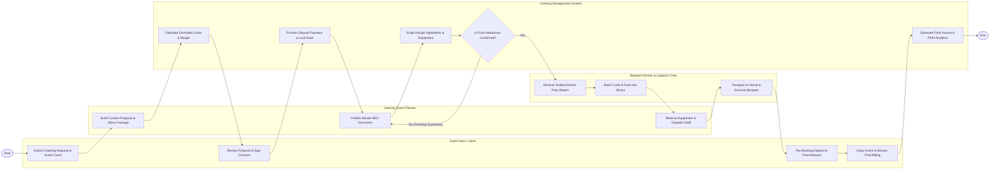

# Swimlane Diagram — Catering Service Management System

## Mermaid Code

## Flow Description | Mo ta luong

| Lane | Actor | Role in Flow |
|------|-------|-------------|
| **Lane 1** | Event Host / Client | Submits catering inquiries, reviews custom proposal packages, signs binding contracts, pays booking deposits, approves final headcount, and pays final event invoices. |
| **Lane 2** | Catering Event Planner | Creates customized proposal estimates, conducts site surveys, generates master Banquet Event Orders (BEO), reserves rental equipment, and dispatches event server rosters. |
| **Lane 3** | Banquet Kitchen & Logistics Crew | Receives scaled ingredient prep sheets, batch cooks meals, packs food into thermal hot-boxes, transports equipment to venue, sets up room layout, and executes banquet service. |
| **Lane 4** | Catering Management System | Calculates proposal cost estimates and profit margins, processes deposit payment authorizations, scales recipe ingredients perpetually, updates BEO revisions, and generates final billing. |

### Process Execution Steps | Cac buoc thuc hien quy trinh

1. **Lead Inquiry & Proposal Generation**: Client submits event specs (`C1`). Event Planner configures menu package and generates custom proposal (`P1`). Catering System calculates costs and margins (`S1`).
2. **Contract Execution & Deposit**: Client signs digital contract and pays booking deposit (`C2`). Catering System authorizes deposit hold, locks event date, and generates draft BEO (`S2`).
3. **BEO Publishing & Recipe Scaling**: Planner publishes finalized BEO (`P2`). System scales recipe ingredients by guest headcount and calculates rental hardware specs (`S3`).
4. **Headcount Confirmation Loop**: System checks guest headcount guarantee status (`S4`).
   - If **No**: Planner requests headcount confirmation from Client (`P2`).
   - If **Yes**: Executive Chef receives scaled prep sheet (`K1`), batch cooks food, and packs thermal containers (`K2`).
5. **Logistics, Execution & Settlement**: Planner reserves rental equipment and dispatches staff (`P3`). Logistics crew transports food/gear to venue and executes banquet (`K3`). Client pays final balance (`C3`, `C4`). System generates final invoice and logs event profit margin (`S5`), completing the workflow (`Finish`).
