# Action Tree — Catering Service Management System

## Mermaid Code

```mermaid
graph TD
    Root["Catering Service Management System"]

    Root --> M1["Lead Generation & Proposal Management"]
    Root --> M2["Banquet Menu & Package Engineering"]
    Root --> M3["BEO & Kitchen Batch Scaler"]
    Root --> M4["Equipment & Linen Rental Logistics"]
    Root --> M5["Banquet Staffing & Roster Scheduling"]
    Root --> M6["Event Contracts, Deposits & Settlement"]
    Root --> M7["Catering Analytics & System Administration"]

    M1 --> A11["Capture Event Inquiries"]
    M1 --> A12["Build Customized Event Proposals"]
    M1 --> A13["Track Lead Conversion Pipeline"]
    M1 --> A14["Schedule Pre-Event Menu Tastings"]

    M2 --> A21["Configure Buffet & Plated Packages"]
    M2 --> A22["Set Per-Head Pricing Tiers"]
    M2 --> A23["Configure Beverage Bar Packages"]
    M2 --> A24["Tag Dietary & Allergen Warnings"]

    M3 --> A31["Generate Master BEO Documents"]
    M3 --> A32["Publish BEO Revision Amendments"]
    M3 --> A33["Calculate Scaled Kitchen Prep Sheets"]
    M3 --> A34["Print Kitchen Packing Checklists"]

    M4 --> A41["Calculate Required Rental Equipment"]
    M4 --> A42["Dispatch Rental Requisitions to Vendors"]
    M4 --> A43["Schedule Transport Van Loading"]
    M4 --> A44["Audit Returned Rental Condition"]

    M5 --> A51["Calculate Required Staffing Ratios"]
    M5 --> A52["Dispatch Roster Alerts to Event Staff"]
    M5 --> A53["Request Temp Agency Personnel"]
    M5 --> A54["Track Mobile GPS Clock-In Timecards"]

    M6 --> A61["Generate E-Signature Catering Contracts"]
    M6 --> A62["Process Non-Refundable Booking Deposits"]
    M6 --> A63["Calculate Final Headcount Billing"]
    M6 --> A64["Process Over-Time & Add-On Charges"]

    M7 --> A71["Analyze Event Gross Profit Margins"]
    M7 --> A72["Track Food & Labor Cost Percentages"]
    M7 --> A73["Manage System Proposal Templates"]
    M7 --> A74["Manage User Security Permissions"]
```

## Module Description | Mo ta Module

| # | Module | Description | Actions |
|---|--------|-------------|---------|
| 1 | Lead Generation & Proposal Management | Manages client inquiry leads, custom proposal generation, sales pipeline stage tracking, and pre-event tasting schedules. | Capture Event Inquiries, Build Customized Event Proposals, Track Lead Conversion Pipeline, Schedule Pre-Event Menu Tastings |
| 2 | Banquet Menu & Package Engineering | Controls buffet/plated package setup, per-head pricing tiers, bar service options, and mandatory allergen/dietary tagging. | Configure Buffet & Plated Packages, Set Per-Head Pricing Tiers, Configure Beverage Bar Packages, Tag Dietary & Allergen Warnings |
| 3 | BEO & Kitchen Batch Scaler | Generates master Banquet Event Orders (BEO), manages BEO revisions, scales recipe ingredients by guest headcount, and outputs packing lists. | Generate Master BEO Documents, Publish BEO Revision Amendments, Calculate Scaled Kitchen Prep Sheets, Print Kitchen Packing Checklists |
| 4 | Equipment & Linen Rental Logistics | Calculates rental hardware needs (tables, chairs, china, linens), dispatches vendor requisitions, plans transport van loading, and audits returns. | Calculate Required Rental Equipment, Dispatch Rental Requisitions to Vendors, Schedule Transport Van Loading, Audit Returned Rental Condition |
| 5 | Banquet Staffing & Roster Scheduling | Computes staffing ratio needs, dispatches shift alerts to servers/captains, requests temp agency staff, and verifies mobile GPS timecards. | Calculate Required Staffing Ratios, Dispatch Roster Alerts to Event Staff, Request Temp Agency Personnel, Track Mobile GPS Clock-In Timecards |
| 6 | Event Contracts, Deposits & Settlement | Manages e-signature contract execution, non-refundable booking deposit collections, final headcount invoice adjustments, and overtime billing. | Generate E-Signature Catering Contracts, Process Non-Refundable Booking Deposits, Calculate Final Headcount Billing, Process Over-Time & Add-On Charges |
| 7 | Catering Analytics & System Administration | Provides executive analytical reports on net event profit margins, food/labor cost ratios, proposal template settings, and user security roles. | Analyze Event Gross Profit Margins, Track Food & Labor Cost Percentages, Manage System Proposal Templates, Manage User Security Permissions |
