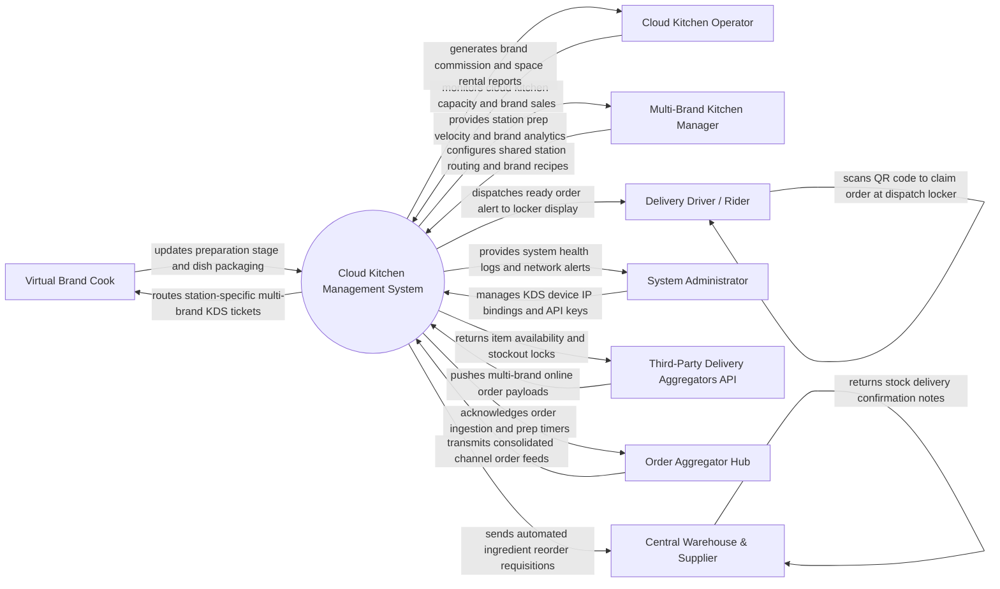

# Context Diagram — Cloud Kitchen Management System

## Mermaid Code

## Actor & Interaction Table | Bang Actor & Tuong tac

| # | Actor | Actor Type | Data Sent TO System | Data Received FROM System | Notes |
|---|-------|------------|---------------------|---------------------------|-------|
| 1 | Virtual Brand Cook | Primary | Dish preparation stage updates (Cooking, Ready), item sold-out alerts, station waste logs | Multi-brand KDS ticket cards, standardized brand recipes, packaging guides | Prepares dishes for multiple virtual brands at a shared kitchen station. |
| 2 | Cloud Kitchen Operator | Primary | Facility space rental rules, utility cost allocations, facility opening hours | Brand revenue contributions, facility utilization reports, tenant payouts | Manages the physical dark/cloud kitchen facility and brand tenants. |
| 3 | Multi-Brand Kitchen Manager | Primary | Shared station routing rules, master virtual brand menus, ingredient BOM recipes, SLA limits | Station prep timers, bottleneck alerts, ingredient stock balances | Oversees operational efficiency across all virtual brands operating in facility. |
| 4 | Delivery Driver / Rider | Primary | Driver QR code claim scans, arrival notifications | Dispatch locker compartment numbers, order pickup confirmation passes | Picks up bagged delivery orders from the central dispatch hub locker. |
| 5 | System Administrator | Primary | Device IP network bindings, channel API integration keys, security user roles | KDS screen health metrics, integration error logs, security audit trails | Manages cloud kitchen software infrastructure and channel API integrations. |
| 6 | Third-Party Delivery Aggregators API | Supporting | Incoming delivery order JSON payloads, delivery channel tags, customer notes | Omnichannel stockout locks (86ing), menu availability feeds, prep time estimates | Integrates with delivery apps like GrabFood, Foodpanda, ShopeeFood. |
| 7 | Order Aggregator Hub | Supporting | Consolidated multi-channel order feeds, unified order IDs | Order ingestion status, cooking progress milestones | Hardware/software aggregator hub unifying multiple delivery tablets into one API. |
| 8 | Central Warehouse & Supplier | Supporting | Stock shipment delivery notes, ingredient unit costs, batch numbers | Automated ingredient replenishment requisitions, stock transfer requests | Supplies raw ingredients and packaging materials to the cloud kitchen facility. |

## System Boundary Description | Mo ta Pham vi He thong

The **Cloud Kitchen Management System** manages multi-tenant, multi-virtual-brand ghost kitchen operations, centralized order aggregation, shared kitchen station routing, and central dispatch hub logistics. Inside its boundary, the system handles order consolidation from multiple third-party delivery apps (GrabFood, Foodpanda, ShopeeFood), multi-brand Kitchen Display System (KDS) routing, shared raw ingredient inventory depletion, central pickup locker dispatching, and virtual brand financial commission settlements.

The system boundary excludes physical food cooking by cooks, physical delivery transit by couriers, raw credit card processing (handled by Delivery Aggregator APIs), and external warehouse shipping logistics.
