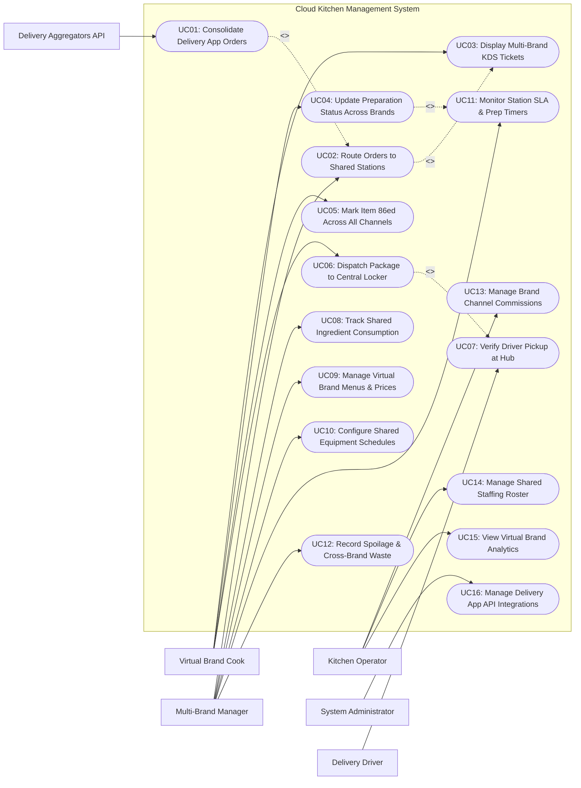

# Use Case Diagram — Cloud Kitchen Management System

## Mermaid Code

## Actor Table | Bang Actor

| # | Actor | Actor Type | Role Description | Related Use Cases |
|---|-------|------------|------------------|-------------------|
| 1 | Delivery Aggregators API | Secondary System | Third-party food delivery platforms (GrabFood, Foodpanda, ShopeeFood) sending multi-brand order feeds and receiving inventory locks. | UC01 |
| 2 | Virtual Brand Cook | Primary | Line cook preparing food for multiple virtual brands at a shared station, updating cooking states, and bagging orders. | UC03, UC04, UC05, UC06 |
| 3 | Delivery Driver | Primary | Gig courier driver arriving at the central cloud kitchen dispatch hub to pick up bagged orders via QR code scan. | UC07 |
| 4 | Multi-Brand Kitchen Manager | Primary | Operational manager overseeing shared station routing rules, ingredient consumption tracking, virtual brand menus, and prep SLA timers. | UC02, UC08, UC09, UC10, UC11, UC12 |
| 5 | Cloud Kitchen Operator | Primary | Facility owner managing tenant brand commission settlements, shared staff rosters, space rental billing, and overall facility analytics. | UC13, UC14, UC15 |
| 6 | System Administrator | Primary | Technical admin configuring KDS hardware IP addresses, channel API integration tokens, and system security permissions. | UC16 |

## Use Case Table | Bang Use Case

| # | UC ID | Use Case Name | Primary Actor | Secondary Actor | Description | Priority |
|---|-------|---------------|---------------|-----------------|-------------|----------|
| 1 | UC01 | Consolidate Delivery App Orders | Delivery API | None | Ingests and unifies incoming orders from multiple delivery apps (Grab, Foodpanda, Shopee) into a single kitchen stream. | High |
| 2 | UC02 | Route Orders to Shared Stations | Multi-Brand Manager | None | Algorithmically dispatches order items to designated shared kitchen prep stations (e.g., Fryer Station, Grill, Assembly Bar). | High |
| 3 | UC03 | Display Multi-Brand KDS Tickets | Virtual Brand Cook | None | Renders unified digital ticket cards on station screens, clearly indicating the specific virtual brand identity and packaging specs. | High |
| 4 | UC04 | Update Preparation Status Across Brands | Virtual Brand Cook | None | Updates dish cooking stage (`In Cooking` -> `Ready`) on KDS screens, notifying central dispatch and the customer. | High |
| 5 | UC05 | Mark Item 86ed Across All Channels | Virtual Brand Cook | Delivery API | Instantly locks an out-of-stock ingredient or dish across all connected delivery platforms simultaneously (single 86 action). | High |
| 6 | UC06 | Dispatch Package to Central Locker | Virtual Brand Cook | None | Transfers completed bagged orders to the central cloud kitchen dispatch hub locker counter, assigning a locker box number. | High |
| 7 | UC07 | Verify Driver Pickup at Hub | Delivery Driver | None | Validates courier QR code claim scan at the central dispatch locker, unlocks locker compartment, and logs pickup completion. | High |
| 8 | UC08 | Track Shared Ingredient Consumption | Multi-Brand Manager | None | Perpetually decrements shared raw ingredient inventory balances based on Bill of Materials (BOM) recipes across all brands. | High |
| 9 | UC09 | Manage Virtual Brand Menus & Prices | Multi-Brand Manager | Delivery API | Creates, updates, or disables virtual brand menu catalogs, dish items, prices, and channel markup rules. | High |
| 10 | UC10 | Configure Shared Equipment Schedules | Multi-Brand Manager | None | Schedules shared kitchen equipment usage (e.g., Combi Ovens, Deep Fryers) to prevent inter-brand station bottlenecks. | Medium |
| 11 | UC11 | Monitor Station SLA & Prep Timers | Multi-Brand Manager | None | Monitors real-time station preparation timers against target SLAs, highlighting delayed tickets in red. | High |
| 12 | UC12 | Record Spoilage & Cross-Brand Waste | Multi-Brand Manager | None | Logs spilled ingredients or expired prepped food, assigning waste costs to the respective virtual brand account. | Medium |
| 13 | UC13 | Manage Brand Channel Commissions | Cloud Kitchen Operator | None | Calculates channel commission fees, facility space rentals, and net payout distribution for virtual brand tenants. | High |
| 14 | UC14 | Manage Shared Staffing Roster | Cloud Kitchen Operator | None | Schedules shared kitchen staff cross-trained to cook for multiple virtual brands, optimizing labor cost ratios. | Medium |
| 15 | UC15 | View Virtual Brand Analytics | Cloud Kitchen Operator | None | Generates analytical reports on brand sales rankings, dish contribution margins, channel order density, and kitchen capacity. | High |
| 16 | UC16 | Manage Delivery App API Integrations | System Admin | None | Configures API connection endpoints, webhook tokens, payload schema mappings, and failover print settings. | High |

## Use Case Specification | Dac ta Use Case

---

### UC01 — Consolidate Delivery App Orders

| Field | Detail |
|-------|--------|
| **UC ID** | UC01 |
| **Use Case Name** | Consolidate Delivery App Orders |
| **Actor(s)** | Primary: Third-Party Delivery Aggregators API   Secondary: None |
| **Description** | Ingests incoming order payloads from multiple third-party food delivery platforms (GrabFood, Foodpanda, ShopeeFood, Baemin), normalizes order schemas, and consolidates them into a unified cloud kitchen stream. |
| **Precondition** | 1. Delivery platform API webhooks are active and authorized.   2. Virtual brand mapping table links external store IDs to internal virtual brand accounts. |
| **Main Flow** | 1. Third-party delivery app transmits a new order JSON payload to the cloud kitchen webhook endpoint.   2. System validates payload signature, parses external order ID, channel name (e.g., GrabFood), customer notes, target pickup time, and item list.   3. System maps external store ID to internal Virtual Brand Account (e.g., "Burger X" or "Noodle House").   4. System normalizes item PLU codes, modifier selections, and price subtotals into standard cloud kitchen JSON schema.   5. System assigns a unique Cloud Kitchen Master Order ID (e.g., CK-8821) and appends channel badge logo to order record.   6. System sends HTTP 200 Order Ingestion Acknowledgment back to delivery app API.   7. System dispatches order items to designated shared kitchen prep stations (executing UC02). |
| **Alternative Flow** | **AF1** — Direct API tablet aggregator hub fallback:   1. External webhook is disabled or fails.   2. Order is captured via physical Android Aggregator Hub tablet listening to delivery app notifications.   3. Aggregator Hub sends order payload to cloud kitchen server via local network WebSocket. |
| **Exception Flow** | **EX1** — Unmapped PLU or Virtual Brand ID:   1. At step 3, System receives an item code not registered in internal brand catalog.   2. System logs payload error, flags order on Manager dashboard "Unmapped PLU Item", and dispatches fallback paper chit print. |
| **Postcondition** | Multi-channel delivery orders are consolidated into a unified master order queue and routed to shared kitchen stations. |
| **Business Rule** | **BR1**: Order consolidation must parse and normalize incoming API payloads within 300 milliseconds of reception.   **BR2**: Consolidated order tickets must prominently display the channel logo and brand name to prevent packaging mix-ups. |

---

### UC02 — Route Orders to Shared Stations

| Field | Detail |
|-------|--------|
| **UC ID** | UC02 |
| **Use Case Name** | Route Orders to Shared Stations |
| **Actor(s)** | Primary: Multi-Brand Kitchen Manager   Secondary: None |
| **Description** | Algorithmically evaluates consolidated order items from various virtual brands and dispatches sub-tickets to shared physical kitchen prep stations (Grill Station, Fryer Line, Cold Pantry, Packaging Hub). |
| **Precondition** | 1. Master order is ingested and normalized (UC01).   2. Shared kitchen station routing rules (category and equipment mapping) are active. |
| **Main Flow** | 1. System receives normalized master order payload containing items from Virtual Brand "Burger X" and Virtual Brand "Wings & More".   2. System evaluates station routing rules configured for the cloud kitchen facility.   3. System identifies item prep requirements: Burger Patty -> Shared Grill Station KDS; Wings & Fries -> Shared Fryer Station KDS; Soda & Dessert -> Central Packaging Hub.   4. System splits master order into station sub-tickets while linking them via Master Order ID (CK-8821).   5. System dispatches station sub-tickets to respective station KDS screens simultaneously.   6. Station KDS screens render new ticket cards with audible chime alert.   7. System initializes station prep timer counter (00:00) and updates master order progress tracking. |
| **Alternative Flow** | **AF1** — Single-station virtual brand order:   1. Order contains items prepped entirely at 1 station (e.g., Salad Brand -> Cold Pantry KDS only).   2. System routes sub-ticket directly to Cold Pantry KDS without splitting. |
| **Exception Flow** | **EX1** — Target shared station KDS display offline:   1. At step 5, System detects Fryer Station KDS is disconnected from network.   2. System automatically reroutes Fryer sub-tickets to backup Manager KDS display and triggers backup paper print job on thermal printer. |
| **Postcondition** | Multi-brand order items are dispatched to designated shared station displays and prep timers start. |
| **Business Rule** | **BR1**: Items requiring long prep times (e.g., Grilled Chicken: 12 mins) must dispatch to station screens immediately, while quick items (e.g., Fries: 3 mins) can be delay-fired to align completion times.   **BR2**: Shared station screens must clearly color-code ticket headers by Virtual Brand for quick cook identification. |

---

### UC05 — Mark Item 86ed Across All Channels

| Field | Detail |
|-------|--------|
| **UC ID** | UC05 |
| **Use Case Name** | Mark Item 86ed Across All Channels |
| **Actor(s)** | Primary: Virtual Brand Cook   Secondary: Third-Party Delivery Aggregators API |
| **Description** | Allows kitchen staff to mark an out-of-stock ingredient or dish as sold out ("86ed"), propagating instant item stockout locks across all connected delivery platforms simultaneously with one click. |
| **Precondition** | 1. Kitchen staff identifies raw ingredient or dish shortage (e.g., Avocado sold out).   2. Multi-channel stockout sync module is active. |
| **Main Flow** | 1. Virtual Brand Cook selects "Mark 86 / Sold Out" menu on station KDS screen.   2. Cook searches or selects item (e.g., "Avocado Slices" or "Guacamole Burger").   3. Cook selects duration: "Rest of Day" or "Indefinite".   4. Cook taps "Confirm 86 Item".   5. System updates internal inventory status to `Sold Out / 86ed`.   6. System queries all virtual brands and dishes utilizing the 86ed ingredient/item.   7. System serializes lightweight stockout API payloads for all connected delivery app partners (GrabFood, Foodpanda, ShopeeFood).   8. System invokes third-party delivery APIs simultaneously to disable item ordering across all virtual brand storefronts.   9. Delivery platform APIs lock item ordering and return HTTP 200 confirmation.   10. System displays confirmation badge on station KDS: "Item 86ed across 3 Delivery Apps". |
| **Alternative Flow** | **AF1** — Un-86 item when stock is replenished:   1. Delivery of fresh avocado arrives at cloud kitchen.   2. Cook or Manager taps "Restore Item Stock (Un-86)" on KDS screen.   3. System sends API requests to delivery app partners to re-enable item ordering across storefronts. |
| **Exception Flow** | **EX1** — Single delivery app API failure during 86 sync:   1. At step 9, ShopeeFood API returns timeout error.   2. System logs API failure, alerts Manager dashboard "ShopeeFood 86 Sync Failed", and queues automated retry every 60 seconds. |
| **Postcondition** | Item stockout lock is active in system database and propagated to all connected delivery app storefronts. |
| **Business Rule** | **BR1**: Single 86 action on a shared raw ingredient must automatically lock ALL dishes across ALL virtual brands using that ingredient.   **BR2**: 86 stockout locks must propagate to external delivery APIs within 10 seconds to prevent unfulfillable orders. |

---

### UC07 — Verify Driver Pickup at Hub

| Field | Detail |
|-------|--------|
| **UC ID** | UC07 |
| **Use Case Name** | Verify Driver Pickup at Hub |
| **Actor(s)** | Primary: Delivery Driver   Secondary: None |
| **Description** | Manages delivery driver arrival at the central cloud kitchen dispatch hub locker, validates driver order claim QR code scan, unlocks the assigned locker compartment, and logs order pickup completion. |
| **Precondition** | 1. Order status is `Ready in Dispatch Locker` (UC06).   2. Bagged order is placed in smart dispatch locker compartment (e.g., Locker #B-04). |
| **Main Flow** | 1. Delivery Driver arrives at cloud kitchen central dispatch hub and approaches Smart Locker Station.   2. Driver opens driver app showing order pickup QR code / Order Reference ID (e.g., CK-8821).   3. Driver scans QR code at Smart Locker Station barcode scanner (or enters 4-digit pickup PIN on touchscreen).   4. System validates driver QR code against active order locker assignments.   5. System unlocks assigned Smart Locker compartment door (Locker #B-04) automatically and flashes green indicator LED.   6. Driver collects bagged food package from locker compartment and closes locker door.   7. Smart Locker sensors detect door closure and item removal.   8. System updates order status to `Picked Up by Driver / Out for Delivery`.   9. System notifies Customer: "Driver picked up your food from the kitchen!".   10. System sends pickup timestamp confirmation payload to third-party delivery app API. |
| **Alternative Flow** | **AF1** — Manual dispatch counter pickup (No Smart Locker):   1. Facility uses a manual dispatch counter with a Dispatch Expeditor staff.   2. Driver presents order ID at counter.   3. Expeditor scans driver QR code on tablet, hands food bag, and taps "Handed to Driver". |
| **Exception Flow** | **EX1** — Driver scans QR code for unready or wrong order:   1. At step 4, Driver scans QR code for an order still in `Cooking` status.   2. System displays alert screen on locker display "Order CK-8821 still cooking (Est 4 mins remaining). Please wait in driver lounge." and keeps lockers locked. |
| **Postcondition** | Order status changes to `Picked Up / Out for Delivery`, smart locker resets to `Available`, and delivery app API receives pickup event. |
| **Business Rule** | **BR1**: Smart Locker doors automatically lock and trigger security alarms if open for > 60 seconds.   **BR2**: Driver claim validation must verify matching delivery app courier IDs before unlocking locker compartments. |

---

### UC08 — Track Shared Ingredient Consumption

| Field | Detail |
|-------|--------|
| **UC ID** | UC08 |
| **Use Case Name** | Track Shared Ingredient Consumption |
| **Actor(s)** | Primary: Multi-Brand Kitchen Manager   Secondary: None |
| **Description** | Perpetually tracks and decrements shared raw ingredient stock balances (e.g., Cooking Oil, Flour, Packaging Bags) based on standard Bill of Materials (BOM) recipes across all virtual brands. |
| **Precondition** | 1. Master BOM recipes for all virtual brand menu items are configured.   2. Shared raw ingredient stock inventory balances are recorded in system. |
| **Main Flow** | 1. System processes completed order items across multiple virtual brands (e.g., 20 Burgers from "Brand A", 30 Fried Chicken portions from "Brand B").   2. System queries recipe BOM database for each sold dish item to extract ingredient usage weights.   3. System calculates total raw ingredient depletion (e.g., Brand A consumed 4.0 kg Beef, Brand B consumed 6.0 kg Chicken, both consumed 2.5 kg Shared Frying Oil and 50 Paper Bags).   4. System perpetually deducts calculated ingredient weights from central shared stock inventory balance.   5. System allocates ingredient cost proportions to respective Virtual Brand financial expense accounts.   6. Manager views real-time Shared Inventory Dashboard showing stock levels, daily depletion rates, and estimated days of stock remaining.   7. When an ingredient stock level falls below safety reorder threshold, System triggers automated purchase order requisition to central warehouse. |
| **Alternative Flow** | **AF1** — Physical stock count variance adjustment:   1. Manager conducts weekly physical inventory audit in walk-in freezer.   2. Manager enters actual physical count (e.g., Actual Beef: 45 kg vs Calculated: 48 kg).   3. System logs 3 kg inventory variance, updates stock balance to 45 kg, and records variance expense log. |
| **Exception Flow** | **EX1** — Negative stock calculation flag:   1. System detects calculated stock for "Cooking Oil" drops below zero due to unrecorded delivery shipment.   2. System flags high-priority stock audit alert on Manager dashboard "Inventory Discrepancy Alert". |
| **Postcondition** | Shared raw ingredient balances are decremented perpetually, ingredient costs are allocated per brand, and reorder alerts trigger. |
| **Business Rule** | **BR1**: Shared ingredient cost allocation must use weighted average cost pricing per unit weight.   **BR2**: Shared packaging materials (bags, napkins, cutlery) must deplete automatically with every completed order ticket. |
