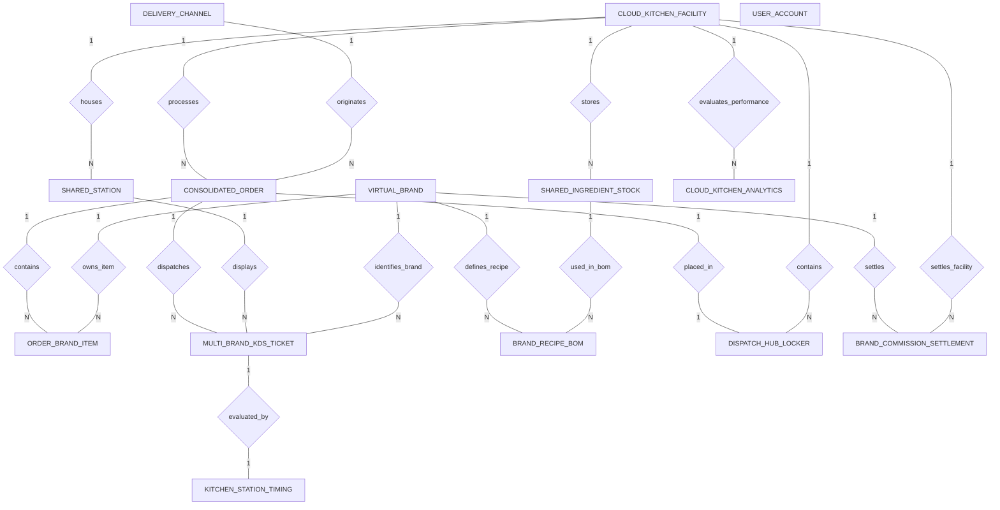

# Conceptual ERD — Cloud Kitchen Management System

## Mermaid Code

## Entity Description Table | Bang mo ta Entity

| # | Entity Name | Vietnamese Name | Description | Key Attributes | Main Relationships |
|---|-------------|-----------------|-------------|----------------|-------------------|
| 1 | VIRTUAL_BRAND | Thuong hieu ao | Represents virtual brand tenant accounts (e.g., Burger X, Noodle House) operating within the cloud kitchen. | brand_id, brand_code, brand_name, cuisine_concept, commission_rate, is_active | One-to-Many with ORDER_BRAND_ITEM, MULTI_BRAND_KDS_TICKET, BRAND_RECIPE_BOM, BRAND_COMMISSION_SETTLEMENT |
| 2 | CLOUD_KITCHEN_FACILITY | Co so bep ao | Physical dark kitchen facility location, total shared stations, smart dispatch lockers, and store specs. | facility_id, facility_code, facility_name, total_shared_stations, total_dispatch_lockers | One-to-Many with SHARED_STATION, CONSOLIDATED_ORDER, SHARED_INGREDIENT_STOCK, DISPATCH_HUB_LOCKER, BRAND_COMMISSION_SETTLEMENT, CLOUD_KITCHEN_ANALYTICS |
| 3 | SHARED_STATION | Tram bep dung chung | Shared kitchen preparation stations (Grill, Saute, Deep Fryer, Cold Pantry, Bar) and station SLA thresholds. | station_id, facility_id, station_name, warning_sla_seconds, critical_sla_seconds | Belongs to CLOUD_KITCHEN_FACILITY; One-to-Many with MULTI_BRAND_KDS_TICKET |
| 4 | CONSOLIDATED_ORDER | Don hang tong hop | Master consolidated order record ingesting multi-channel delivery app orders across various virtual brands. | order_id, facility_id, channel_id, external_order_ref, received_at, grand_total, order_status | Belongs to CLOUD_KITCHEN_FACILITY, DELIVERY_CHANNEL; One-to-Many with ORDER_BRAND_ITEM, MULTI_BRAND_KDS_TICKET; One-to-One with DISPATCH_HUB_LOCKER |
| 5 | ORDER_BRAND_ITEM | Chi tiet mon theo brand | Line items in a consolidated order, capturing virtual brand IDs, dish names, quantities, and line item prices. | line_item_id, order_id, brand_id, item_id, item_name, quantity, unit_price | Belongs to CONSOLIDATED_ORDER, VIRTUAL_BRAND |
| 6 | DELIVERY_CHANNEL | Kenh giao hang doi tac | Third-party food delivery platforms (GrabFood, Foodpanda, ShopeeFood), API webhooks, and channel fees. | channel_id, channel_name, api_webhook_url, channel_fee_percent, is_connected | One-to-Many with CONSOLIDATED_ORDER |
| 7 | MULTI_BRAND_KDS_TICKET | Phieu KDS da thuong hieu | Station KDS sub-tickets displaying items for specific virtual brands at shared kitchen workstations. | ticket_id, order_id, station_id, brand_id, dispatched_at, ready_at, prep_status | Belongs to CONSOLIDATED_ORDER, SHARED_STATION, VIRTUAL_BRAND; One-to-One with KITCHEN_STATION_TIMING |
| 8 | SHARED_INGREDIENT_STOCK | Ton kho nguyen lieu chung | Central shared raw ingredient stock inventory (oil, flour, proteins, packaging) and reorder thresholds. | stock_id, facility_id, ingredient_code, ingredient_name, current_stock_qty, reorder_level_qty | Belongs to CLOUD_KITCHEN_FACILITY; One-to-Many with BRAND_RECIPE_BOM |
| 9 | BRAND_RECIPE_BOM | Cong thuc va dinh muc BOM | Bill of Materials (BOM) mapping virtual brand menu dishes to required shared raw ingredient weights. | recipe_id, brand_id, item_id, stock_id, quantity_required | Belongs to VIRTUAL_BRAND, SHARED_INGREDIENT_STOCK |
| 10 | DISPATCH_HUB_LOCKER | Tu giao hang trung tam | Smart dispatch locker compartments holding completed food packages for driver QR code pickup validation. | locker_id, facility_id, order_id, locker_code, locker_status, stored_at, picked_up_at | One-to-One with CONSOLIDATED_ORDER; Belongs to CLOUD_KITCHEN_FACILITY |
| 11 | BRAND_COMMISSION_SETTLEMENT | Quyet toan hoa hong brand | Financial settlement record calculating gross sales, platform commissions, rental fees, and net payouts per brand. | settlement_id, brand_id, facility_id, period_start, gross_sales, platform_commission, net_payout | Belongs to VIRTUAL_BRAND, CLOUD_KITCHEN_FACILITY |
| 12 | KITCHEN_STATION_TIMING | Thoi gian che bien tram | Logs prep completion timing and SLA compliance flags for multi-brand station sub-tickets. | timing_id, ticket_id, total_prep_seconds, is_sla_breached | One-to-One with MULTI_BRAND_KDS_TICKET |
| 13 | USER_ACCOUNT | Tai khoan he thong | Core security authentication account holding credentials, password hashes, and user role definitions. | user_id, username, password_hash, role_name | Standard user account reference |
| 14 | CLOUD_KITCHEN_ANALYTICS | Thong ke cua hang bep ao | Facility daily analytics tracking total consolidated orders, facility GMV, average prep time, and station loads. | analytics_id, facility_id, metric_date, total_orders_consolidated, total_facility_gmv, avg_facility_prep_time | Belongs to CLOUD_KITCHEN_FACILITY |

## Relationship Description | Mo ta Quan he

| # | From Entity | Cardinality | To Entity | Relationship Label | Business Explanation |
|---|-------------|-------------|-----------|-------------------|----------------------|
| 1 | CLOUD_KITCHEN_FACILITY | One-to-Many | SHARED_STATION | houses | Mot co so bep ao chua nhieu tram bep che bien dung chung (Grill, Fryer, Cold Pantry). |
| 2 | CLOUD_KITCHEN_FACILITY | One-to-Many | CONSOLIDATED_ORDER | processes | Mot co so bep ao xu ly va dieu hanh nhieu don hang tong hop tu cac kenh delivery. |
| 3 | CLOUD_KITCHEN_FACILITY | One-to-Many | SHARED_INGREDIENT_STOCK | stores | Mot co so bep ao luu tro va quan ly kho nguyen lieu va bao bi dung chung. |
| 4 | CLOUD_KITCHEN_FACILITY | One-to-Many | DISPATCH_HUB_LOCKER | contains | Mot co so bep ao chua nhieu o tu giao hang thong minh tai khu vuc hub trung tam. |
| 5 | DELIVERY_CHANNEL | One-to-Many | CONSOLIDATED_ORDER | originates | Mot kenh giao hang doi tac (Grab, Foodpanda) phat sinh nhieu don hang den he thong. |
| 6 | CONSOLIDATED_ORDER | One-to-Many | ORDER_BRAND_ITEM | contains | Mot don hang tong hop chua nhieu mon an thuoc mot hoac nhieu thuong hieu ao. |
| 7 | VIRTUAL_BRAND | One-to-Many | ORDER_BRAND_ITEM | owns_item | Mot thuong hieu ao so huu va cung cap cac mon an trong don hang. |
| 8 | CONSOLIDATED_ORDER | One-to-Many | MULTI_BRAND_KDS_TICKET | dispatches | Mot don hang tong hop duoc phan luong thanh nhieu phieu KDS den cac tram bep. |
| 9 | SHARED_STATION | One-to-Many | MULTI_BRAND_KDS_TICKET | displays | Mot tram bep hien thi va xu ly nhieu phieu KDS cua cac thuong hieu ao khac nhau. |
| 10 | VIRTUAL_BRAND | One-to-Many | MULTI_BRAND_KDS_TICKET | identifies_brand | Mot phieu KDS dinh danh va hien thi logo/ten cua thuong hieu ao cu the. |
| 11 | VIRTUAL_BRAND | One-to-Many | BRAND_RECIPE_BOM | defines_recipe | Mot thuong hieu ao dinh nghia dinh muc cong thuc BOM cho cac mon an cua minh. |
| 12 | SHARED_INGREDIENT_STOCK | One-to-Many | BRAND_RECIPE_BOM | used_in_bom | Mot nguyen lieu dung chung duoc su dung trong cong thuc BOM cua nhieu thuong hieu. |
| 13 | CONSOLIDATED_ORDER | One-to-One | DISPATCH_HUB_LOCKER | placed_in | Mot don hang hoan thanh duoc luu tai mot o tu giao hang thong minh tuong ung. |
| 14 | VIRTUAL_BRAND | One-to-Many | BRAND_COMMISSION_SETTLEMENT | settles | Mot thuong hieu ao duoc quyet toan doanh thu va chi phi hoa hong theo ky. |
