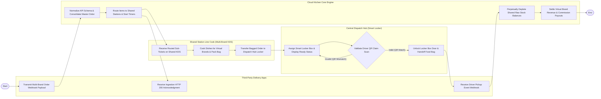

# Swimlane Diagram — Cloud Kitchen Management System

## Mermaid Code

## Flow Description | Mo ta luong

| Lane | Actor | Role in Flow |
|------|-------|-------------|
| **Lane 1** | Third-Party Delivery Apps | Transmits incoming order webhooks from GrabFood, Foodpanda, and ShopeeFood, receives ingestion acknowledgments, and accepts driver pickup webhooks. |
| **Lane 2** | Shared Station Line Cook | Views routed multi-brand ticket cards on shared station KDS displays, cooks dishes according to brand specs, bags orders, and transfers packages to dispatch lockers. |
| **Lane 3** | Central Dispatch Hub | Assigns smart locker compartments, displays ready pickup numbers on overhead screens, validates courier QR claim scans, and unlocks locker doors for driver pickup. |
| **Lane 4** | Cloud Kitchen Core Engine | Normalizes API schemas across delivery apps, consolidates master orders, routes sub-tickets to shared stations, perpetually depletes raw stock, and calculates brand commission payouts. |

### Process Execution Steps | Cac buoc thuc hien quy trinh

1. **API Ingestion & Master Consolidation**: Delivery App transmits order payload (`D1`). Core Engine normalizes API schemas, assigns Master Order ID (`S1`), and sends HTTP 200 acknowledgment (`D2`).
2. **Shared Station Routing & Preparation**: Core Engine routes items to shared station KDS displays (`S2`). Line Cook reads brand specs (`K1`), cooks meals, packs food bags with brand labels (`K2`), and moves bags to dispatch hub (`K3`).
3. **Locker Storage & Driver Arrival**: Dispatch Hub assigns smart locker compartment (e.g., Locker #B-04) and displays pickup number on screen (`L1`). Delivery Driver arrives and scans claim QR code (`L2`).
4. **Driver Claim Validation Loop**: Dispatch Hub validates driver QR code (`L2`).
   - If **Invalid**: System displays error message and holds locker door locked (`L1`).
   - If **Valid**: System unlocks Locker #B-04 door, driver collects food bag (`L3`), and delivery app receives pickup event (`D3`).
5. **Perpetual Inventory & Financial Settlement**: Core Engine perpetually deducts shared raw ingredient inventory based on BOM recipes (`S3`) and settles virtual brand commission revenue (`S4`), completing execution (`Finish`).
