# Action Tree — Cloud Kitchen Management System

## Mermaid Code

```mermaid
graph TD
    Root["Cloud Kitchen Management System"]

    Root --> M1["Multi-Channel Order Aggregation"]
    Root --> M2["Multi-Brand KDS & Shared Station Routing"]
    Root --> M3["Central Dispatch Hub & Driver Verification"]
    Root --> M4["Shared Inventory & Perpetual Stock Depletion"]
    Root --> M5["Virtual Brand Catalog & Price Management"]
    Root --> M6["Equipment Scheduling & Station SLA Tracking"]
    Root --> M7["Brand Performance & Financial Analytics"]

    M1 --> A11["Ingest Delivery App Webhook Payloads"]
    M1 --> A12["Normalize Multi-Channel Order Schemas"]
    M1 --> A13["Assign Unified Cloud Kitchen Order IDs"]
    M1 --> A14["Handle Channel Disconnections & Retries"]

    M2 --> A21["Route Items to Shared Kitchen Stations"]
    M2 --> A22["Display Multi-Brand Ticket Cards"]
    M2 --> A23["Update Prep Status In-Cooking/Ready"]
    M2 --> A24["Consolidate Shared Equipment Orders"]

    M3 --> A31["Assign Smart Dispatch Locker Compartments"]
    M3 --> A32["Validate Driver QR Claim Scans"]
    M3 --> A33["Unlock Smart Locker Doors"]
    M3 --> A34["Update Overhead Driver Pickup Displays"]

    M4 --> A41["Track Shared Raw Stock Balances"]
    M4 --> A42["Deduct BOM Recipe Ingredient Usage"]
    M4 --> A43["Single-Click 86 Across All Delivery Apps"]
    M4 --> A44["Audit Cross-Brand Waste & Spoilage"]

    M5 --> A51["Create Virtual Brand Menu Catalogs"]
    M5 --> A52["Configure Delivery Channel Markup Prices"]
    M5 --> A53["Map PLU Codes to Virtual Brands"]
    M5 --> A54["Deploy Catalog Sync to Delivery Apps"]

    M6 --> A61["Schedule Shared Equipment Availability"]
    M6 --> A62["Monitor Station Prep SLA Timers"]
    M6 --> A63["Highlight Red Overdue Station Tickets"]
    M6 --> A64["Schedule Shared Kitchen Staff Rosters"]

    M7 --> A71["Calculate Virtual Brand Revenue & Margins"]
    M7 --> A72["Settle Platform Channel Commissions"]
    M7 --> A73["Compare Virtual Brand Sales Rankings"]
    M7 --> A74["Export Facility Tax & Rental Reports"]
```

## Module Description | Mo ta Module

| # | Module | Description | Actions |
|---|--------|-------------|---------|
| 1 | Multi-Channel Order Aggregation | Handles incoming order webhook ingestion from Grab, Foodpanda, and Shopee, schema normalization, unified order ID generation, and channel retry handling. | Ingest Delivery App Webhook Payloads, Normalize Multi-Channel Order Schemas, Assign Unified Cloud Kitchen Order IDs, Handle Channel Disconnections & Retries |
| 2 | Multi-Brand KDS & Shared Station Routing | Controls algorithmic item dispatch to shared kitchen stations, multi-brand ticket display formatting, cooking status updates, and equipment consolidation. | Route Items to Shared Kitchen Stations, Display Multi-Brand Ticket Cards, Update Prep Status In-Cooking/Ready, Consolidate Shared Equipment Orders |
| 3 | Central Dispatch Hub & Driver Verification | Manages smart locker box assignments, driver claim QR code validations, automatic locker door unlocks, and overhead pickup screen updates. | Assign Smart Dispatch Locker Compartments, Validate Driver QR Claim Scans, Unlock Smart Locker Doors, Update Overhead Driver Pickup Displays |
| 4 | Shared Inventory & Perpetual Stock Depletion | Tracks shared raw ingredient inventory, perpetually deducts BOM recipe usage, executes single-click 86 stockout locks across delivery apps, and logs waste. | Track Shared Raw Stock Balances, Deduct BOM Recipe Ingredient Usage, Single-Click 86 Across All Delivery Apps, Audit Cross-Brand Waste & Spoilage |
| 5 | Virtual Brand Catalog & Price Management | Configures virtual brand menu catalogs, delivery channel pricing markups, PLU code mapping, and omnichannel catalog pushes to delivery app partners. | Create Virtual Brand Menu Catalogs, Configure Delivery Channel Markup Prices, Map PLU Codes to Virtual Brands, Deploy Catalog Sync to Delivery Apps |
| 6 | Equipment Scheduling & Station SLA Tracking | Controls shared kitchen equipment scheduling, station preparation SLA timer tracking, overdue ticket alerts, and shared staff roster scheduling. | Schedule Shared Equipment Availability, Monitor Station Prep SLA Timers, Highlight Red Overdue Station Tickets, Schedule Shared Kitchen Staff Rosters |
| 7 | Brand Performance & Financial Analytics | Provides facility management reporting on virtual brand sales rankings, net revenue margins, channel commission settlements, space rental billing, and tax reports. | Calculate Virtual Brand Revenue & Margins, Settle Platform Channel Commissions, Compare Virtual Brand Sales Rankings, Export Facility Tax & Rental Reports |
