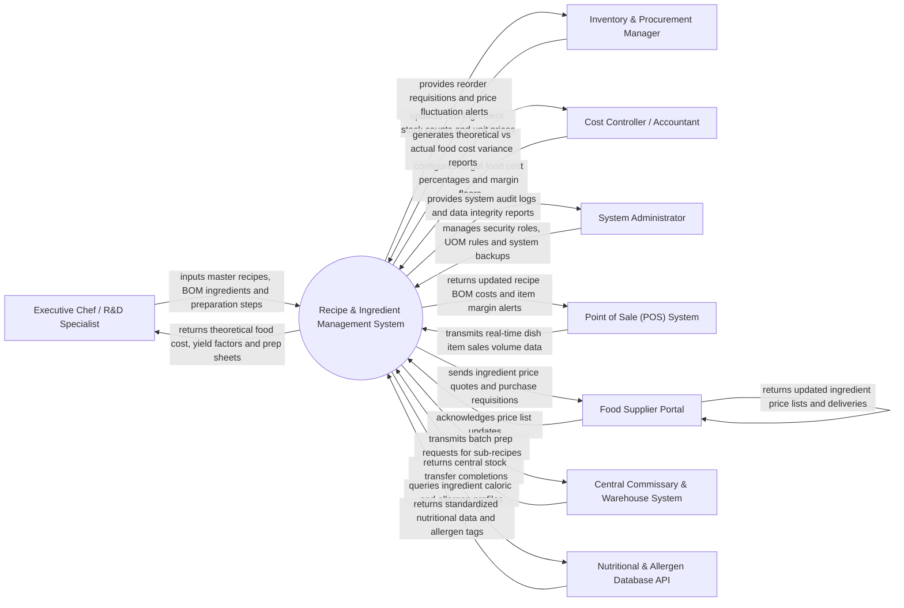

# Context Diagram — Recipe & Ingredient Management System

## Mermaid Code

## Actor & Interaction Table | Bang Actor & Tuong tac

| # | Actor | Actor Type | Data Sent TO System | Data Received FROM System | Notes |
|---|-------|------------|---------------------|---------------------------|-------|
| 1 | Executive Chef / R&D Specialist | Primary | Master recipes, ingredient quantities, preparation steps, yield percentage factors, sub-recipe formulas | Theoretical food cost per portion, recipe prep sheets, plating guides, allergen alerts | Creates and versions culinary recipes and Bill of Materials (BOM) specifications. |
| 2 | Inventory & Procurement Manager | Primary | Raw ingredient catalog entries, stock take counts, purchase invoice costs, supplier deliveries | Stock reorder requisitions, supplier price fluctuation alerts, inventory depletion forecasts | Oversees ingredient purchasing, stockroom counts, and vendor price tracking. |
| 3 | Cost Controller / Accountant | Primary | Target food cost percentages (e.g., 28%), price margin floors, waste allowance budgets | Theoretical vs Actual (TvA) food cost variance, gross profit margin reports, waste audit analytics | Monitors food profitability, cost variances, and inventory shrinkage. |
| 4 | System Administrator | Primary | User accounts, security role policies, Unit of Measure (UOM) conversion ratios, system settings | Audit trail logs, database backup statuses, security event alerts | Manages platform infrastructure, user permissions, and master UOM conversion tables. |
| 5 | Point of Sale (POS) System | Supporting | Real-time sold dish item quantities, PLU sales volume data, item price modifications | Updated recipe BOM costs, dish margin alerts, ingredient depletion triggers | Integrates via REST or WebSocket to feed perpetual inventory depletion algorithms. |
| 6 | Food Supplier Portal | Supporting | Ingredient price lists, pack size changes, supplier delivery confirmations | Automated purchase requisitions, price quote requests, item specification inquiries | External vendor portal for updating ingredient market prices and pack sizes. |
| 7 | Central Commissary & Warehouse System | Supporting | Central stock transfer completions, batch prep confirmations | Sub-recipe batch prep orders, raw ingredient requisition requests | Manages central prep kitchen manufacturing and inter-unit warehouse logistics. |
| 8 | Nutritional & Allergen Database API | Supporting | Standardized nutrient profiles, allergen classifications, dietary tags | Ingredient nutrition lookup queries, USDA/EFSA database syncs | External API providing certified nutritional data and allergen tagging. |

## System Boundary Description | Mo ta Pham vi He thong

The **Recipe & Ingredient Management System** serves as the central culinary database and cost engineering platform for restaurant enterprises. Inside its boundary, the system handles master recipe creation, versioning, multi-level Bill of Materials (BOM) structuring, unit of measure (UOM) conversions, recipe yield factor adjustments, theoretical food cost calculations, perpetual POS sales stock depletion, and theoretical vs. actual (TvA) variance auditing.

The system boundary excludes physical food cooking by chefs, front-of-house guest ordering (handled by POS Systems), physical inventory receiving at loading docks (handled by Procurement/Warehouse Systems), and direct supplier payment processing (handled by Accounting/ERP Systems).
