# Use Case Diagram — Recipe & Ingredient Management System

## Mermaid Code

```mermaid
flowchart LR
    actor_Chef["Executive Chef / R&D"]
    actor_InventoryManager["Procurement Manager"]
    actor_CostController["Cost Controller"]
    actor_Admin["System Administrator"]
    actor_POS["POS System"]
    actor_Supplier["Food Supplier Portal"]

    subgraph SystemBoundary["Recipe & Ingredient Management System"]
        UC01(["UC01: Create & Version Master Recipes"])
        UC02(["UC02: Build BOM Ingredient Specs"])
        UC03(["UC03: Calculate Theoretical Food Cost"])
        UC04(["UC04: Convert Unit of Measures UOM"])
        UC05(["UC05: Deplete Stock via POS Sales"])
        UC06(["UC06: Track Raw Material Purchase Costs"])
        UC07(["UC07: Manage Allergen & Nutrition Profiles"])
        UC08(["UC08: Create Sub-Recipes & Batch Formulas"])
        UC09(["UC09: Perform Stock Take & Waste Audits"])
        UC10(["UC10: Generate Recipe Yield & Shrinkage"])
        UC11(["UC11: Manage Supplier Price Lists"])
        UC12(["UC12: Auto-Generate Purchase Requisitions"])
        UC13(["UC13: Export Recipe Plating Guides"])
        UC14(["UC14: Scale Recipe by Headcount"])
        UC15(["UC15: View Food Cost Variance Analytics"])
        UC16(["UC16: Manage User Roles & Security"])
    end

    actor_Chef --> UC01
    actor_Chef --> UC02
    actor_Chef --> UC07
    actor_Chef --> UC08
    actor_Chef --> UC10
    actor_Chef --> UC13
    actor_Chef --> UC14

    actor_InventoryManager --> UC04
    actor_InventoryManager --> UC06
    actor_InventoryManager --> UC09
    actor_InventoryManager --> UC11
    actor_InventoryManager --> UC12

    actor_CostController --> UC03
    actor_CostController --> UC06
    actor_CostController --> UC09
    actor_CostController --> UC15

    actor_POS --> UC05
    actor_Supplier --> UC11

    actor_Admin --> UC16

    UC01 -.->|"<<include>>"| UC02
    UC02 -.->|"<<include>>"| UC03
    UC03 -.->|"<<include>>"| UC04
    UC05 -.->|"<<include>>"| UC02
    UC09 -.->|"<<extend>>"| UC05
    UC12 --> actor_Supplier
```

## Actor Table | Bang Actor

| # | Actor | Actor Type | Role Description | Related Use Cases |
|---|-------|------------|------------------|-------------------|
| 1 | Executive Chef / R&D | Primary | Culinary lead who creates master recipes, builds Bill of Materials (BOM) ingredient lists, sets yield factors, defines sub-recipes, and uploads plating photos. | UC01, UC02, UC07, UC08, UC10, UC13, UC14 |
| 2 | Procurement Manager | Primary | Purchasing manager responsible for configuring UOM conversions, tracking raw material costs, conducting stock takes, and managing supplier price lists. | UC04, UC06, UC09, UC11, UC12 |
| 3 | Cost Controller | Primary | Financial analyst who monitors theoretical vs actual (TvA) food cost variances, analyzes dish profit margins, and audits inventory waste logs. | UC03, UC06, UC09, UC15 |
| 4 | System Administrator | Primary | Technical admin managing user access roles, security controls, master UOM conversion matrices, and system integrations. | UC16 |
| 5 | Point of Sale (POS) System | Secondary System | External sales engine sending real-time sold dish line items to trigger perpetual ingredient stock depletion algorithms. | UC05 |
| 6 | Food Supplier Portal | Secondary System | External vendor system receiving automated purchase requisitions and providing updated ingredient market price lists. | UC11, UC12 |

## Use Case Table | Bang Use Case

| # | UC ID | Use Case Name | Primary Actor | Secondary Actor | Description | Priority |
|---|-------|---------------|---------------|-----------------|-------------|----------|
| 1 | UC01 | Create & Version Master Recipes | Executive Chef | None | Creates master culinary dish recipes, assigns portion sizes, tracks revision history, and manages recipe approval states. | High |
| 2 | UC02 | Build BOM Ingredient Specs | Executive Chef | None | Defines itemized Bill of Materials (BOM) ingredient components, net prep weights, gross weights, and waste factors. | High |
| 3 | UC03 | Calculate Theoretical Food Cost | Cost Controller | None | Computes theoretical cost per portion and ideal gross margin percentage based on current ingredient purchasing costs. | High |
| 4 | UC04 | Convert Unit of Measures UOM | Procurement Manager | None | Defines conversion ratios between purchasing units (e.g., 25 kg Bag), stocking units (kg), and recipe units (grams/ounces). | High |
| 5 | UC05 | Deplete Stock via POS Sales | System | POS System | Automatically decrements ingredient stock balances in real time as sold dish line items are received from POS. | High |
| 6 | UC06 | Track Raw Material Purchase Costs | Procurement Manager | Cost Controller | Records incoming supplier invoice unit prices, tracking ingredient price inflation and historical cost trends. | High |
| 7 | UC07 | Manage Allergen & Nutrition Profiles | Executive Chef | None | Tags ingredients with allergen warnings (Gluten, Dairy, Soy, Nuts) and logs caloric and nutritional specs per dish. | Medium |
| 8 | UC08 | Create Sub-Recipes & Batch Formulas | Executive Chef | None | Builds multi-level sub-recipes (e.g., House Tomato Sauce, Beef Stock) used as ingredient components in multiple dishes. | High |
| 9 | UC09 | Perform Stock Take & Waste Audits | Procurement Manager | Cost Controller | Compares physical stock counts against calculated theoretical balances to audit variance, spoilage, and theft. | High |
| 10 | UC10 | Generate Recipe Yield & Shrinkage | Executive Chef | None | Calculates cooking shrinkage percentages (e.g., Raw Beef 100g -> Cooked Beef 80g = 20% shrinkage) and edible yield factors. | High |
| 11 | UC11 | Manage Supplier Price Lists | Procurement Manager | Food Supplier | Imports and manages contracted ingredient price lists, pack sizes, and supplier lead times. | Medium |
| 12 | UC12 | Auto-Generate Purchase Requisitions | Procurement Manager | Food Supplier | Automatically generates purchase orders when ingredient stock levels fall below minimum safety reorder points. | High |
| 13 | UC13 | Export Recipe Plating Guides | Executive Chef | None | Exports formatted recipe instruction sheets, step-by-step assembly guides, and high-resolution plating photography for kitchen staff. | Medium |
| 14 | UC14 | Scale Recipe by Headcount | Executive Chef | None | Dynamically multiplies recipe ingredient quantities by guest headcount for banquet and catering batch production. | Medium |
| 15 | UC15 | View Food Cost Variance Analytics | Cost Controller | None | Generates Theoretical vs. Actual (TvA) food cost reports, item margin contribution matrices, and inventory variance dashboards. | High |
| 16 | UC16 | Manage User Roles & Security | System Admin | None | Configures user security role permissions (Chef, Purchaser, Auditor), approval limits, and security audit logs. | High |

## Use Case Specification | Dac ta Use Case

---

### UC01 — Create & Version Master Recipes

| Field | Detail |
|-------|--------|
| **UC ID** | UC01 |
| **Use Case Name** | Create & Version Master Recipes |
| **Actor(s)** | Primary: Executive Chef / R&D Specialist   Secondary: None |
| **Description** | Allows a chef to create a master culinary recipe record, define portion yields, specify preparation steps, track revision history, and manage recipe approval workflows. |
| **Precondition** | 1. User is authenticated with Executive Chef or R&D privileges.   2. Raw ingredient master catalog and UOM conversion tables (UC04) are active. |
| **Main Flow** | 1. Chef accesses Recipe Management module and clicks "Create Master Recipe".   2. Chef enters header details: Recipe Name (e.g., Grilled Ribeye Steak with Herb Butter), Internal Recipe SKU, Category (Main Course), Standard Portion Size (1 portion), and Target Yield (1 serving).   3. Chef builds Bill of Materials (BOM) ingredient list (executing UC02).   4. Chef inputs step-by-step culinary preparation instructions, cooking methods, target prep time, and storage temperature specs.   5. System calculates theoretical food cost and gross margin percentage (executing UC03).   6. Chef attaches high-resolution plating photos (executing UC13).   7. Chef clicks "Submit for Approval" (or "Publish Version 1.0").   8. System validates recipe data completeness, locks version `v1.0`, logs timestamp, and makes recipe available for menu pricing and kitchen production. |
| **Alternative Flow** | **AF1** — Create new recipe version revision (v1.1):   1. Chef modifies an existing published recipe (e.g., replaces butter with garlic herb oil).   2. System prompts "Create New Version?". Chef confirms creation of Version 1.1.   3. System archives Version 1.0 in revision history and publishes Version 1.1 as active recipe. |
| **Exception Flow** | **EX1** — Missing ingredient BOM or zero cost alert:   1. At step 5, System detects an ingredient in the BOM has zero cost or missing UOM conversion.   2. System highlights ingredient in red alert "Missing Cost Data: Herb Oil" and blocks recipe publishing until cost data is resolved. |
| **Postcondition** | Master recipe version is stored, theoretical cost is calculated, and version history is logged. |
| **Business Rule** | **BR1**: Published recipes cannot be overwritten directly; any changes to ingredient BOMs or portion sizes must increment version numbers (e.g., v1.0 -> v1.1).   **BR2**: Master recipes must maintain full audit logs detailing who modified ingredients and timestamps. |

---

### UC02 — Build BOM Ingredient Specs

| Field | Detail |
|-------|--------|
| **UC ID** | UC02 |
| **Use Case Name** | Build BOM Ingredient Specs |
| **Actor(s)** | Primary: Executive Chef / R&D Specialist   Secondary: None |
| **Description** | Builds the itemized Bill of Materials (BOM) for a recipe, specifying raw ingredient items, gross prep quantities, net yield weights, and preparation waste percentages. |
| **Precondition** | 1. Master recipe header record (UC01) is initialized.   2. Raw ingredient catalog contains active ingredient items and purchase unit costs. |
| **Main Flow** | 1. Chef opens "BOM Ingredient Builder" tab within recipe editor.   2. Chef searches and selects a raw ingredient (e.g., Raw Ribeye Beef).   3. Chef inputs Gross Prep Quantity (e.g., 250 grams).   4. Chef inputs Prep Waste/Trimming Percentage (e.g., 8% trimming waste) or Net Portion Weight (230 grams).   5. System applies ingredient yield factor (92%) and calculates Net Usable Quantity.   6. Chef selects recipe Unit of Measure (e.g., grams, ml, pcs, tbsp).   7. System calls UOM Conversion Engine (UC04) to calculate unit cost per recipe UOM based on purchasing pack cost.   8. System computes total cost for line item (e.g., 250g Beef @ $0.04/g = $10.00).   9. Chef repeats steps 2-8 for all ingredients and sub-recipes (e.g., 15g Herb Butter sub-recipe, 100g Asparagus).   10. System sums all line item costs to calculate Total Recipe BOM Cost ($12.50). |
| **Alternative Flow** | **AF1** — Add sub-recipe as a BOM component:   1. At step 2, Chef selects a pre-made sub-recipe (e.g., "Demi-Glace Sauce v2.0").   2. System retrieves sub-recipe unit cost per ml and calculates line cost based on specified volume (e.g., 50 ml Demi-Glace = $1.20). |
| **Exception Flow** | **EX1** — UOM conversion factor missing:   1. At step 7, Chef selects recipe unit "Fluid Ounces" for an ingredient purchased in "Kilograms", but no conversion ratio exists.   2. System displays error "No UOM conversion defined between kg and fl oz" and prompts Procurement Manager to add conversion factor. |
| **Postcondition** | Itemized BOM ingredient list, net yield weights, and total BOM cost are bound to the recipe record. |
| **Business Rule** | **BR1**: Ingredient prep waste factors must automatically adjust net portion costs to ensure accurate food costing.   **BR2**: Multi-level sub-recipes can be nested up to 3 levels deep within a master dish BOM. |

---

### UC03 — Calculate Theoretical Food Cost

| Field | Detail |
|-------|--------|
| **UC ID** | UC03 |
| **Use Case Name** | Calculate Theoretical Food Cost |
| **Actor(s)** | Primary: Cost Controller / Accountant   Secondary: None |
| **Description** | Calculates theoretical cost per dish portion based on real-time ingredient purchasing costs, compares against selling price, and determines ideal Gross Profit Margin %. |
| **Precondition** | 1. Recipe BOM ingredient specifications (UC02) are complete.   2. Latest raw ingredient purchase costs and dish menu selling prices are loaded. |
| **Main Flow** | 1. Cost Controller selects a recipe or opens "Food Cost Engineering Matrix" module.   2. System retrieves current unit purchase costs for all raw ingredients listed in the dish BOM.   3. System multiplies recipe line quantities by current unit costs (including waste yield factors) and calculates Total Theoretical Portion Cost (e.g., $4.50).   4. System retrieves current selling price for the dish from Menu Management System (e.g., $18.00).   5. System calculates Theoretical Food Cost Percentage: `(Theoretical Cost / Selling Price) * 100` -> `($4.50 / $18.00) * 100 = 25.0%`.   6. System calculates Ideal Gross Margin Percentage: `100% - 25.0% = 75.0%` (Ideal Margin: $13.50).   7. System compares calculated Food Cost % against company Target Food Cost Threshold (e.g., Target: 28.0%).   8. System displays status badge: **Green / Optimal Margin** (since 25% < 28%). |
| **Alternative Flow** | **AF1** — Ingredient price increase triggers margin alert:   1. Raw salmon purchase cost increases by 30% on supplier invoice.   2. System recalculates theoretical food cost for Salmon Entree ($6.50 -> $8.50), pushing Food Cost % from 26% to 34%.   3. System generates high-priority cost breach alert **Red / Margin Warning** on Cost Controller dashboard. |
| **Exception Flow** | **EX1** — Selling price missing or zero:   1. At step 4, dish item has no assigned menu selling price.   2. System displays Food Cost Amount ($4.50) but flags Food Cost % as "N/A - Set Selling Price". |
| **Postcondition** | Theoretical portion cost, Food Cost %, and ideal margin metrics are updated in real time. |
| **Business Rule** | **BR1**: Theoretical food cost must automatically update whenever raw ingredient purchase invoice costs change.   **BR2**: Dishes breaching the target food cost threshold by > 3% must flag automated alerts to Executive Chef and Cost Controller. |

---

### UC05 — Deplete Stock via POS Sales

| Field | Detail |
|-------|--------|
| **UC ID** | UC05 |
| **Use Case Name** | Deplete Stock via POS Sales |
| **Actor(s)** | Primary: System   Secondary: Point of Sale (POS) System |
| **Description** | Automatically decrements raw ingredient stock balances in real time as sold dish line items are received from the POS system, maintaining perpetual theoretical inventory balances. |
| **Precondition** | 1. POS sales transaction integration is connected.   2. Sold dish PLU codes are mapped to active master recipe BOMs. |
| **Main Flow** | 1. POS System transmits sold order transaction payload containing PLU code, dish name, and quantity sold (e.g., 10x Grilled Ribeye Steak).   2. System receives payload, validates PLU mapping, and retrieves active master recipe BOM for Ribeye Steak.   3. System identifies all ingredient BOM components (e.g., 250g Beef, 15g Herb Butter, 100g Asparagus per portion).   4. System multiplies recipe BOM quantities by sold order quantity (10 portions x 250g Beef = 2,500g / 2.5 kg Beef).   5. System perpetually deducts calculated ingredient weights from the store's Current Stock Inventory balance.   6. System records perpetual depletion log entries specifying Order Ref ID, Timestamp, PLU, Ingredient, and Depleted Quantity.   7. System updates real-time theoretical stock balance dashboard. |
| **Alternative Flow** | **AF1** — Deplete sub-recipe ingredients recursively:   1. Sold dish contains a sub-recipe component (Herb Butter).   2. System unpacks sub-recipe BOM recursively (15g Herb Butter = 12g Butter + 2g Garlic + 1g Parsley) and deducts raw base ingredients from stock. |
| **Exception Flow** | **EX1** — Sold POS dish PLU not mapped to recipe BOM:   1. At step 2, System receives a sold PLU code that has no recipe BOM mapped in database.   2. System logs exception event, alerts Cost Controller "Unmapped POS Sales PLU: 4099", and skips inventory depletion for that item. |
| **Postcondition** | Raw ingredient inventory balances are decremented perpetually and sales depletion logs are recorded. |
| **Business Rule** | **BR1**: POS sales depletion calculations must process in real time within 2 seconds of receiving sales transaction webhooks.   **BR2**: Voided or returned POS orders must automatically credit depleted ingredient quantities back to stock inventory. |

---

### UC09 — Perform Stock Take & Waste Audits

| Field | Detail |
|-------|--------|
| **UC ID** | UC09 |
| **Use Case Name** | Perform Stock Take & Waste Audits |
| **Actor(s)** | Primary: Procurement Manager, Cost Controller   Secondary: None |
| **Description** | Compares physical count counts against system-calculated theoretical stock balances to compute inventory variance, calculate monetary shrinkage cost, and audit food waste. |
| **Precondition** | 1. Perpetual POS stock depletion (UC05) has processed all sales up to stock take cutoff time.   2. Physical inventory count form is generated. |
| **Main Flow** | 1. Procurement Manager conducts physical inventory count in storerooms, walk-in coolers, and kitchen stations at end of period.   2. Manager enters actual physical count quantities into Stock Take module (or uploads mobile scanner count file).   3. System retrieves calculated Theoretical Stock Balance for each ingredient (Opening Stock + Purchases - POS Sales Depletions - Logged Waste).   4. System calculates Quantity Variance: `Actual Physical Count - Theoretical Stock Balance` (e.g., Actual Beef: 42 kg; Theoretical: 45 kg -> Variance: -3 kg).   5. System calculates Monetary Variance Cost: `Quantity Variance * Unit Purchase Cost` (-3 kg x $15/kg = -$45.00 Variance Loss).   6. System calculates Variance Percentage: `(Quantity Variance / Theoretical Stock) * 100` -> `(-3 / 45) * 100 = -6.67%`.   7. Cost Controller reviews variance report, cross-references logged kitchen waste entries (spoilage, dropped food), and categorizes unaccounted variance as Shrinkage/Theft.   8. Manager approves inventory adjustment; System updates stock balance to match actual physical count and posts variance expense to financial ledger. |
| **Alternative Flow** | **AF1** — Positive inventory variance (Surplus):   1. Physical count is higher than theoretical balance (+2 kg Beef).   2. System flags positive variance alert, indicating potential under-portioning by kitchen crew or unrecorded delivery receipt. |
| **Exception Flow** | **EX1** — Unusually high variance threshold breach:   1. At step 6, an expensive ingredient (e.g., Tenderloin) shows > 10% negative variance loss.   2. System triggers mandatory audit alert "High Variance Threshold Breached: Tenderloin (-15%)" requiring manager justification note before closing stock take. |
| **Postcondition** | Physical stock take is recorded, inventory balances are reconciled to actual counts, and TvA variance cost reports are generated. |
| **Business Rule** | **BR1**: Stock take variance reports must separate known logged kitchen waste from unknown inventory shrinkage.   **BR2**: Stock take adjustments must permanently lock inventory records for the audited financial period. |
