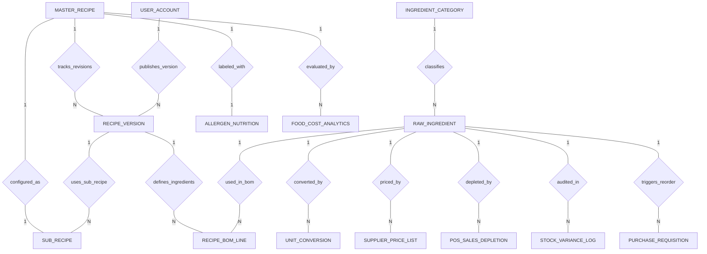

# Conceptual ERD — Recipe & Ingredient Management System

## Mermaid Code

## Entity Description Table | Bang mo ta Entity

| # | Entity Name | Vietnamese Name | Description | Key Attributes | Main Relationships |
|---|-------------|-----------------|-------------|----------------|-------------------|
| 1 | MASTER_RECIPE | Cong thuc goc | Master culinary recipe container tracking SKU, recipe name, dish category, portion yields, and total recipe cost. | recipe_id, recipe_sku, recipe_name, category_name, portion_yield, total_recipe_cost | One-to-Many with RECIPE_VERSION, FOOD_COST_ANALYTICS; One-to-One with SUB_RECIPE, ALLERGEN_NUTRITION |
| 2 | RECIPE_VERSION | Phien ban cong thuc | Specific revision of a master recipe, storing preparation instructions, publication timestamps, and author user ID. | version_id, recipe_id, version_tag, prep_instructions, published_at, published_by | Belongs to MASTER_RECIPE; One-to-Many with RECIPE_BOM_LINE, SUB_RECIPE |
| 3 | RECIPE_BOM_LINE | Dong nguyen lieu BOM | Line item in a recipe BOM version, storing gross prep quantity, waste percentage, net weight, UOM, and line item cost. | bom_line_id, version_id, ingredient_id, gross_quantity, waste_percent, line_cost | Belongs to RECIPE_VERSION, RAW_INGREDIENT |
| 4 | RAW_INGREDIENT | Nguyen lieu tho | Raw food material catalog item, codes, purchasing UOM, recipe UOM, current stock balances, and reorder levels. | ingredient_id, category_id, ingredient_code, ingredient_name, current_stock_qty | Belongs to INGREDIENT_CATEGORY; One-to-Many with RECIPE_BOM_LINE, UNIT_CONVERSION, SUPPLIER_PRICE_LIST, POS_SALES_DEPLETION, STOCK_VARIANCE_LOG, PURCHASE_REQUISITION |
| 5 | INGREDIENT_CATEGORY | Danh muc nguyen lieu | Logical category grouping for raw materials (Proteins, Dairy, Produce, Dry Goods, Spices). | category_id, category_name, description | One-to-Many with RAW_INGREDIENT |
| 6 | UNIT_CONVERSION | Quy doi don vi tinh | Conversion ratio mapping between purchasing UOMs (Bag, Box, Case) and recipe UOMs (Grams, Ounces, Milliliters). | conversion_id, ingredient_id, from_uom, to_uom, conversion_factor | Belongs to RAW_INGREDIENT |
| 7 | SUPPLIER_PRICE_LIST | Bang gia nha cung cap | Contracted purchasing price lists from suppliers, pack sizes, effective dates, and unit purchasing costs. | price_id, ingredient_id, supplier_name, pack_cost, unit_cost, effective_date | Belongs to RAW_INGREDIENT |
| 8 | SUB_RECIPE | Cong thuc so che | Multi-level sub-recipe (sauces, stocks, marinades) formulas used as ingredient components in other master recipes. | sub_recipe_id, master_recipe_id, parent_version_id, yield_volume_ml, unit_cost_per_ml | One-to-One with MASTER_RECIPE; Belongs to RECIPE_VERSION |
| 9 | POS_SALES_DEPLETION | Nhat ky tru kho POS | Real-time depletion transaction log recording raw ingredient quantities deducted by sold POS dish PLUs. | depletion_id, ingredient_id, pos_order_ref, quantity_sold, depleted_quantity | Belongs to RAW_INGREDIENT |
| 10 | STOCK_VARIANCE_LOG | Nhat ky chênh lech kho | Stock take audit log comparing theoretical stock against physical counts to record quantity/cost variances. | variance_id, ingredient_id, audit_date, theoretical_qty, physical_qty, variance_cost | Belongs to RAW_INGREDIENT |
| 11 | ALLERGEN_NUTRITION | Dinh duong & Di ung | Caloric specs and mandatory allergen flags (Gluten, Dairy, Nuts, Soy) associated with a master recipe. | info_id, recipe_id, calories_per_portion, contains_gluten, contains_dairy | One-to-One with MASTER_RECIPE |
| 12 | PURCHASE_REQUISITION | De xuat mua nguyen lieu | Automated reorder requisition records generated when ingredient stock falls below minimum safety thresholds. | req_id, ingredient_id, reorder_quantity, estimated_cost, req_status | Belongs to RAW_INGREDIENT |
| 13 | USER_ACCOUNT | Tai khoan he thong | Core security authentication account holding credentials, password hashes, and user role definitions. | user_id, username, password_hash, role_name | One-to-Many with RECIPE_VERSION |
| 14 | FOOD_COST_ANALYTICS | Thong ke chi phi thuc an | Daily analytical metrics tracking recipe theoretical portion costs, selling prices, Food Cost %, and margin amounts. | analytics_id, recipe_id, metric_date, theoretical_cost, selling_price, food_cost_percent | Belongs to MASTER_RECIPE |

## Relationship Description | Mo ta Quan he

| # | From Entity | Cardinality | To Entity | Relationship Label | Business Explanation |
|---|-------------|-------------|-----------|-------------------|----------------------|
| 1 | MASTER_RECIPE | One-to-Many | RECIPE_VERSION | tracks_revisions | Mot cong thuc goc theo doi nhieu phien ban chinh sua (v1.0, v1.1) qua thoi gian. |
| 2 | RECIPE_VERSION | One-to-Many | RECIPE_BOM_LINE | defines_ingredients | Mot phien ban cong thuc dinh nghia danh sach cac dong nguyen lieu BOM thanh phan. |
| 3 | RAW_INGREDIENT | One-to-Many | RECIPE_BOM_LINE | used_in_bom | Mot nguyen lieu tho duoc su dung trong dinh muc BOM cua nhieu cong thuc. |
| 4 | INGREDIENT_CATEGORY | One-to-Many | RAW_INGREDIENT | classifies | Mot danh muc (Vi du: Thit, Rau) phan loai nhieu nguyen lieu tho cu the. |
| 5 | RAW_INGREDIENT | One-to-Many | UNIT_CONVERSION | converted_by | Mot nguyen lieu co cac he so quy doi giua don vi mua va don vi cong thuc. |
| 6 | RAW_INGREDIENT | One-to-Many | SUPPLIER_PRICE_LIST | priced_by | Mot nguyen lieu co nhieu bang gia tu cac nha cung cap khac nhau theo thoi gian. |
| 7 | MASTER_RECIPE | One-to-One | SUB_RECIPE | configured_as | Mot cong thuc goc co the duoc cau hinh thanh mot cong thuc so che (Sub-recipe). |
| 8 | RECIPE_VERSION | One-to-Many | SUB_RECIPE | uses_sub_recipe | Mot phien ban cong thuc co the su dung cac cong thuc so che lam thanh phan BOM. |
| 9 | RAW_INGREDIENT | One-to-Many | POS_SALES_DEPLETION | depleted_by | Mot nguyen lieu duoc tru kho lien tuc tu cac giao dich ban hang tren POS. |
| 10 | RAW_INGREDIENT | One-to-Many | STOCK_VARIANCE_LOG | audited_in | Mot nguyen lieu duoc kiem ke va theo doi chênh lech giua ly thuyet va thuc te. |
| 11 | MASTER_RECIPE | One-to-One | ALLERGEN_NUTRITION | labeled_with | Mot cong thuc goc duoc dinh kem thong tin dinh duong va canh bao di ung. |
| 12 | RAW_INGREDIENT | One-to-Many | PURCHASE_REQUISITION | triggers_reorder | Mot nguyen lieu sap het kho kich hoat cac de xuat mua hang tu dong. |
| 13 | USER_ACCOUNT | One-to-Many | RECIPE_VERSION | publishes_version | Mot tai khoan nguoi dung (Bap truong) xuat ban cac phien ban cong thuc. |
| 14 | MASTER_RECIPE | One-to-Many | FOOD_COST_ANALYTICS | evaluated_by | Mot cong thuc goc duoc thong ke va danh gia gia thanh va ti le loi nhuan dinh ky. |
