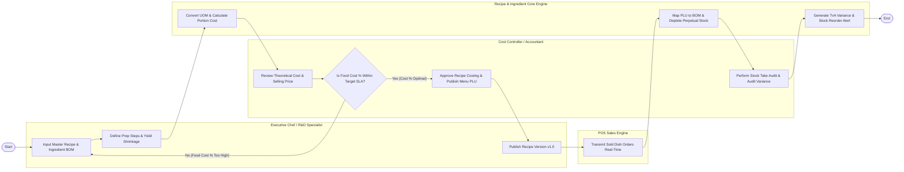

# Swimlane Diagram — Recipe & Ingredient Management System

## Mermaid Code

## Flow Description | Mo ta luong

| Lane | Actor | Role in Flow |
|------|-------|-------------|
| **Lane 1** | Executive Chef / R&D Specialist | Inputs master recipe details, itemizes Bill of Materials (BOM) ingredients, defines yield factors and prep steps, and publishes recipe versions. |
| **Lane 2** | Cost Controller / Accountant | Evaluates theoretical food cost percentages against target SLAs, approves recipe costing, conducts stock take audits, and analyzes variance losses. |
| **Lane 3** | POS Sales Engine | Transmits real-time sold dish line item transaction payloads from restaurant POS terminals to trigger inventory stock depletion. |
| **Lane 4** | Recipe & Ingredient Core Engine | Converts UOM ratios, computes portion costs, maps POS PLUs to BOM components, perpetually decrements stock balances, and calculates TvA variances. |

### Process Execution Steps | Cac buoc thuc hien quy trinh

1. **Recipe Creation & BOM Building**: Chef inputs master recipe details, specifies raw ingredients, net weights, and waste factors (`C1`, `C2`).
2. **UOM Conversion & Cost Calculation**: Core Engine converts purchasing UOMs to recipe UOMs and computes theoretical portion cost (`S1`). Cost Controller evaluates theoretical Food Cost % against target company SLA (`A1`, `A2`).
3. **Approval & Version Publishing**:
   - If **No (Food Cost % Too High)**: Cost Controller returns recipe to Chef to revise portion sizes or substitute ingredients (`C1`).
   - If **Yes (Cost % Optimal)**: Cost Controller approves costing (`A3`), and Chef publishes recipe version (`C3`).
4. **POS Depletion & Stock Audit**: POS Sales Engine sends sold dish orders (`P1`). Core Engine perpetually decrements raw ingredient stock based on BOM recipes (`S2`). Cost Controller conducts periodic stock take audits (`A4`). Core Engine calculates Theoretical vs Actual (TvA) variance cost and triggers reorder alerts (`S3`), ending the workflow (`Finish`).
