# Action Tree — Recipe & Ingredient Management System

## Mermaid Code

```mermaid
graph TD
    Root["Recipe & Ingredient Management System"]

    Root --> M1["Recipe Engineering & Version Control"]
    Root --> M2["Bill of Materials BOM & Sub-Recipes"]
    Root --> M3["Unit of Measure UOM & Yield Management"]
    Root --> M4["Food Costing & Pricing Margin Control"]
    Root --> M5["Stock Depletion & Perpetual Variance Audits"]
    Root --> M6["Supplier Costing & Purchase Requisitions"]
    Root --> M7["Recipe Analytics & System Security"]

    M1 --> A11["Create Master Dish Recipes"]
    M1 --> A12["Manage Recipe Version Revisioning"]
    M1 --> A13["Export Plating Guides & Photos"]
    M1 --> A14["Scale Recipes by Guest Headcount"]

    M2 --> A21["Build Ingredient BOM Line Items"]
    M2 --> A22["Configure Multi-Level Sub-Recipes"]
    M2 --> A23["Set Prep Trimming Waste Percentages"]
    M2 --> A24["Tag Allergen & Nutritional Profiles"]

    M3 --> A31["Configure UOM Conversion Ratios"]
    M3 --> A32["Map Purchase Pack to Recipe Units"]
    M3 --> A33["Calculate Cooking Yield Factors"]
    M3 --> A34["Audit Shrinkage & Trimming Loss"]

    M4 --> A41["Calculate Theoretical Portion Cost"]
    M4 --> A42["Determine Ideal Gross Margin Percent"]
    M4 --> A43["Track Purchase Price Inflation"]
    M4 --> A44["Flag High Food Cost SLA Breaches"]

    M5 --> A51["Deplete Stock via POS Sales Feeds"]
    M5 --> A52["Process Stock Take Physical Counts"]
    M5 --> A53["Calculate TvA Variance Losses"]
    M5 --> A54["Audit Spoilage & Waste Entries"]

    M6 --> A61["Import Approved Supplier Price Lists"]
    M6 --> A62["Auto-Generate Reorder Requisitions"]
    M6 --> A63["Track Supplier Pack Size Changes"]
    M6 --> A64["Manage Commissary Stock Transfers"]

    M7 --> A71["Monitor Item Margin Matrix Stars/Dogs"]
    M7 --> A72["Generate Theoretical vs Actual Reports"]
    M7 --> A73["Audit Recipe Change Event Logs"]
    M7 --> A74["Manage User Roles & Access Rights"]
```

## Module Description | Mo ta Module

| # | Module | Description | Actions |
|---|--------|-------------|---------|
| 1 | Recipe Engineering & Version Control | Controls master recipe creation, version revision tracking (v1.0 -> v1.1), step-by-step plating guide exports, and headcount scaling. | Create Master Dish Recipes, Manage Recipe Version Revisioning, Export Plating Guides & Photos, Scale Recipes by Guest Headcount |
| 2 | Bill of Materials (BOM) & Sub-Recipes | Manages itemized BOM ingredient specs, multi-level nested sub-recipes, trimming waste percentages, and mandatory allergen/nutritional tagging. | Build Ingredient BOM Line Items, Configure Multi-Level Sub-Recipes, Set Prep Trimming Waste Percentages, Tag Allergen & Nutritional Profiles |
| 3 | Unit of Measure (UOM) & Yield Management | Configures conversion ratios between purchasing UOMs and recipe UOMs, calculating edible portion yield factors and cooking shrinkage percentages. | Configure UOM Conversion Ratios, Map Purchase Pack to Recipe Units, Calculate Cooking Yield Factors, Audit Shrinkage & Trimming Loss |
| 4 | Food Costing & Pricing Margin Control | Computes theoretical portion costs, determines ideal gross profit margin %, tracks supplier price inflation, and flags food cost SLA threshold breaches. | Calculate Theoretical Portion Cost, Determine Ideal Gross Margin Percent, Track Purchase Price Inflation, Flag High Food Cost SLA Breaches |
| 5 | Stock Depletion & Perpetual Variance Audits | Handles real-time POS sales ingredient depletion, physical stock take reconciliation, Theoretical vs Actual (TvA) variance cost calculations, and waste audits. | Deplete Stock via POS Sales Feeds, Process Stock Take Physical Counts, Calculate TvA Variance Losses, Audit Spoilage & Waste Entries |
| 6 | Supplier Costing & Purchase Requisitions | Imports contracted supplier price lists, auto-generates purchase requisitions when stock drops below safety levels, and manages commissary transfers. | Import Approved Supplier Price Lists, Auto-Generate Reorder Requisitions, Track Supplier Pack Size Changes, Manage Commissary Stock Transfers |
| 7 | Recipe Analytics & System Security | Provides menu engineering profitability matrix reports (Stars, Workhorses, Puzzles, Dogs), TvA variance dashboards, audit change logs, and user access permissions. | Monitor Item Margin Matrix Stars/Dogs, Generate Theoretical vs Actual Reports, Audit Recipe Change Event Logs, Manage User Roles & Access Rights |
