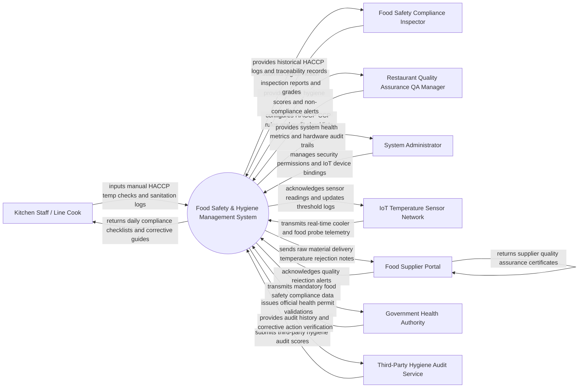

# Context Diagram — Food Safety & Hygiene Management System

## Mermaid Code

## Actor & Interaction Table | Bang Actor & Tuong tac

| # | Actor | Actor Type | Data Sent TO System | Data Received FROM System | Notes |
|---|-------|------------|---------------------|---------------------------|-------|
| 1 | Kitchen Staff / Line Cook | Primary | Manual food core temperatures, cooler check logs, cleaning task completions, staff health declarations | Daily digital HACCP checklists, temperature violation alerts, corrective action steps | Uses handheld Bluetooth probes and kitchen tablets for logging. |
| 2 | Food Safety Inspector | Primary | Health inspection scores, violation citations, official inspection reports | Historical HACCP temperature logs, food batch lot numbers, pest logs | Government or municipal health department official. |
| 3 | QA Manager | Primary | HACCP Critical Control Point (CCP) rules, target temp limits, hygiene audit templates | Compliance dashboards, high-priority temperature breach alerts, audit reports | Oversees food safety standards across restaurant locations. |
| 4 | System Administrator | Primary | User accounts, security role permissions, IoT sensor IP/Bluetooth bindings | Hardware status logs, battery level warnings, network connectivity alerts | Manages system infrastructure, IoT sensor networks, and software access. |
| 5 | IoT Temperature Sensor Network | Supporting | Continuous ambient cooler/freezer temperatures, door open sensor telemetry | Sensor ping acknowledgments, calibration parameters | Automated Bluetooth/WiFi sensors installed in walk-in coolers and freezers. |
| 6 | Food Supplier Portal | Supporting | Supplier Certificate of Analysis (CoA), cold chain transport logs | Goods receiving temperature rejection notices, supplier rating scores | External portal connecting food distributors to receiving records. |
| 7 | Government Health Authority | Regulatory | Official food safety regulations, health permit renewals, regulatory mandates | Automated compliance reports, food recall traceability logs | State/National regulatory body (e.g., FDA, EFSA, Local Health Dept). |
| 8 | Third-Party Hygiene Audit Service | Supporting | External hygiene audit scores, swab test lab results, corrective requests | Facility historical audit logs, corrective action proof uploads | Independent food safety auditing agency. |

## System Boundary Description | Mo ta Pham vi He thong

The **Food Safety & Hygiene Management System** manages hazard analysis critical control points (HACCP), automated IoT temperature monitoring, food batch traceability, sanitation schedules, and regulatory compliance. Inside its boundary, the system handles real-time ambient cooler telemetry ingestion, Bluetooth food probe temperature logging, automated out-of-range temperature alerts, corrective action workflow enforcement, food batch lot recall tracing, staff health screening, and digital health inspection reporting.

The system boundary excludes physical cleaning execution by staff, physical calibration of thermometer probes (handled by hardware labs), physical pest control extermination (handled by pest vendors), and raw credit card processing.
