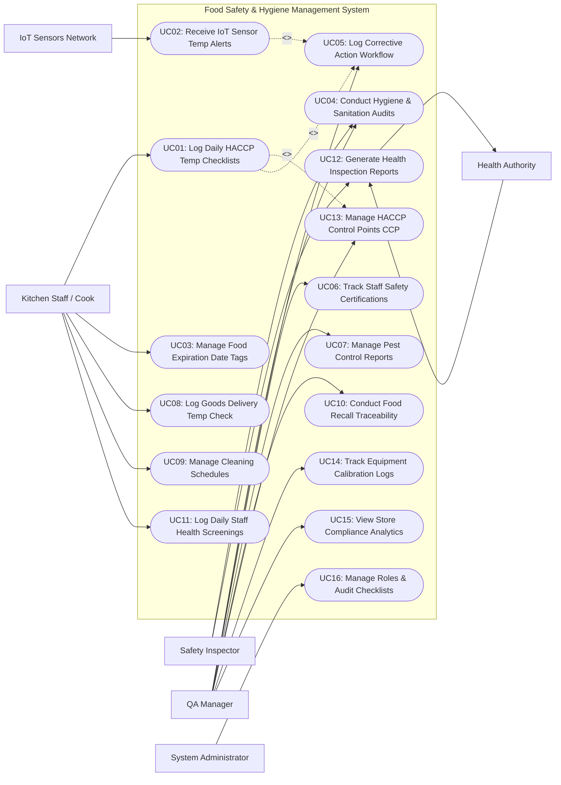

# Use Case Diagram — Food Safety & Hygiene Management System

## Mermaid Code

## Actor Table | Bang Actor

| # | Actor | Actor Type | Role Description | Related Use Cases |
|---|-------|------------|------------------|-------------------|
| 1 | IoT Sensors Network | Secondary System | Continuous hardware sensor network monitoring cooler/freezer ambient temperatures and broadcasting alerts upon SLA breach. | UC02 |
| 2 | Kitchen Staff / Cook | Primary | Front-line culinary staff conducting manual probe temperature checks, applying date labels, verifying delivery temperatures, and logging cleaning tasks. | UC01, UC03, UC08, UC09, UC11 |
| 3 | Food Safety Inspector | Primary | Internal auditor or external government health inspector evaluating restaurant hygiene, scoring audits, and issuing compliance reports. | UC04, UC12 |
| 4 | QA Manager | Primary | Quality assurance manager setting HACCP Critical Control Points (CCPs), reviewing temperature deviations, enforcing corrective actions, and conducting food recalls. | UC04, UC05, UC06, UC07, UC10, UC13, UC14, UC15 |
| 5 | Government Health Authority | Secondary System | Regulatory body receiving mandatory food safety compliance reports, health inspection scores, and food recall notices. | UC12 |
| 6 | System Administrator | Primary | Technical manager configuring IoT sensor bindings, user security roles, system parameters, and audit checklist templates. | UC16 |

## Use Case Table | Bang Use Case

| # | UC ID | Use Case Name | Primary Actor | Secondary Actor | Description | Priority |
|---|-------|---------------|---------------|-----------------|-------------|----------|
| 1 | UC01 | Log Daily HACCP Temp Checklists | Kitchen Staff | None | Records daily mandatory food core and holding line temperatures using Bluetooth probes and digital checklists. | High |
| 2 | UC02 | Receive IoT Sensor Temp Alerts | System | IoT Sensors Network | Ingests real-time cooler/freezer ambient temperatures and triggers instant alerts when limits are breached. | High |
| 3 | UC03 | Manage Food Expiration Date Tags | Kitchen Staff | None | Generates digital use-by and prep expiration labels for prepped ingredients based on food shelf-life rules. | High |
| 4 | UC04 | Conduct Hygiene & Sanitation Audits | QA Manager | Safety Inspector | Performs digital food safety audits using standardized inspection forms, scoring facility cleanliness and compliance. | High |
| 5 | UC05 | Log Corrective Action Workflow | QA Manager | Kitchen Staff | Enforces mandatory root-cause logging and corrective actions (e.g., discard food, recalibrate cooler) for temperature breaches. | High |
| 6 | UC06 | Track Staff Safety Certifications | QA Manager | None | Tracks employee food handler cards, ServSafe certifications, health permits, and renewal expiration alerts. | Medium |
| 7 | UC07 | Manage Pest Control Reports | QA Manager | None | Logs third-party pest control inspection reports, bait station checks, activity findings, and corrective plans. | Medium |
| 8 | UC08 | Log Goods Delivery Temp Check | Kitchen Staff | None | Verifies refrigerated delivery truck temperatures and raw ingredient core temperatures upon receiving goods at loading dock. | High |
| 9 | UC09 | Manage Cleaning Schedules | Kitchen Staff | None | Schedules and tracks completion of master kitchen sanitation tasks (deep fryer clean, hood filter wash, floor scrub). | Medium |
| 10 | UC10 | Conduct Food Recall Traceability | QA Manager | None | Traces supplier ingredient batch lot numbers through prep logs to sold orders within minutes during a food recall. | High |
| 11 | UC11 | Log Daily Staff Health Screenings | Kitchen Staff | None | Captures daily pre-shift staff illness declarations (fever, diarrhea, jaundice) before allowing kitchen access. | High |
| 12 | UC12 | Generate Health Inspection Reports | Safety Inspector | Health Authority | Exports official digital health inspection reports, compliance certificates, and historical audit trends. | High |
| 13 | UC13 | Manage HACCP Control Points CCP | QA Manager | None | Configures Critical Control Points (CCPs), critical temperature boundaries (e.g., Hot Hold >= 60°C; Cold Hold <= 4°C), and corrective rules. | High |
| 14 | UC14 | Track Equipment Calibration Logs | QA Manager | None | Logs periodic calibration records for digital thermometers, probe sensors, scales, and automated timers. | Medium |
| 15 | UC15 | View Store Compliance Analytics | QA Manager | None | Displays store food safety compliance scores, temperature breach frequencies, audit performance, and risk heatmaps. | High |
| 16 | UC16 | Manage Roles & Audit Checklists | System Admin | None | Manages user security permissions, role access levels, audit checklist template definitions, and system parameters. | High |

## Use Case Specification | Dac ta Use Case

---

### UC01 — Log Daily HACCP Temp Checklists

| Field | Detail |
|-------|--------|
| **UC ID** | UC01 |
| **Use Case Name** | Log Daily HACCP Temp Checklists |
| **Actor(s)** | Primary: Kitchen Staff / Cook   Secondary: None |
| **Description** | Allows kitchen staff to execute daily scheduled HACCP temperature checks (hot holding, cold holding, cooking core temperatures) using wireless Bluetooth probes and digital tablet checklists. |
| **Precondition** | 1. User is authenticated on the kitchen tablet app.   2. Bluetooth thermometer probe is paired and calibrated.   3. HACCP Critical Control Points (CCPs) and temperature limits (UC13) are active. |
| **Main Flow** | 1. Kitchen Staff opens "Daily HACCP Checklist" on tablet display (e.g., Morning Shift Line Check).   2. System displays list of required temperature check items organized by station (Grill, Cold Line, Steam Table).   3. Staff inserts Bluetooth probe into food item (e.g., Cooked Chicken Breast on hot line).   4. Bluetooth probe measures core temperature (e.g., 74°C) and transmits reading to tablet app.   5. System compares measured temperature against configured CCP limits (e.g., Cooking Core Temp >= 74°C).   6. Measured temperature satisfies limit; System logs reading with timestamp, staff ID, probe serial number, and marks item as **Pass (Green)**.   7. Staff repeats steps 3-6 for all scheduled items on checklist.   8. Staff submits completed checklist; System archives log in HACCP compliance database. |
| **Alternative Flow** | **AF1** — Manual temperature entry (Probe Backup):   1. Bluetooth probe is unavailable.   2. Staff selects "Manual Temp Entry", inputs temperature reading, and enters mandatory reason note.   3. System logs entry with `Manual Input Flag` for QA review. |
| **Exception Flow** | **EX1** — Temperature out of safe range (Deviation):   1. At step 5, measured temperature fails CCP limit (e.g., Cold Soup reading is 9°C; Limit <= 4°C).   2. System highlights reading in **Flashing Red**, triggers audible alarm, and blocks checklist completion until Corrective Action Workflow (UC05) is logged. |
| **Postcondition** | HACCP temperature logs are recorded with immutable timestamps, staff IDs, and compliance status. |
| **Business Rule** | **BR1**: Temperature check logs must capture immutable timestamps and hardware probe IDs to prevent manual falsification.   **BR2**: Temperature checks failing critical limits must mandate immediate corrective action logging before the checklist can be closed. |

---

### UC02 — Receive Automated IoT Sensor Temperature Alerts

| Field | Detail |
|-------|--------|
| **UC ID** | UC02 |
| **Use Case Name** | Receive Automated IoT Sensor Temperature Alerts |
| **Actor(s)** | Primary: System   Secondary: IoT Sensors Network |
| **Description** | Ingests continuous 24/7 ambient temperature telemetry from wireless IoT sensors installed in walk-in coolers and freezers, triggering automated alerts when temperatures breach safe thresholds. |
| **Precondition** | 1. Wireless IoT temperature sensors are installed in equipment (Walk-in Cooler 1, Freezer 2) and bound in system.   2. Sensor reading intervals (e.g., every 10 minutes) and threshold limits (Cooler: 1°C to 4°C) are set. |
| **Main Flow** | 1. Wireless IoT sensor measures ambient temperature inside Walk-in Cooler 1 (e.g., 8.5°C due to compressor failure).   2. Sensor transmits telemetry payload (Device ID, Temperature, Humidity, Battery Level, Timestamp) via gateway to System.   3. System ingests payload, records reading in temperature log database, and compares against safe operating threshold (1°C - 4°C).   4. System detects temperature has exceeded upper limit (8.5°C > 4°C) for longer than the allowable grace period (e.g., > 15 minutes).   5. System flags high-priority **Critical Temperature Breach Alert**.   6. System dispatches push notifications and SMS alerts to Kitchen Staff, QA Manager, and Facilities Manager: "ALERT: Walk-in Cooler 1 temp is 8.5°C! Immediate action required."   7. System displays blinking red alert banner on all active kitchen tablets and manager dashboards.   8. System initializes Corrective Action Tracking Workflow (UC05). |
| **Alternative Flow** | **AF1** — Brief defrost cycle ignored:   1. Temperature spikes briefly to 6°C during an automated 10-minute freezer defrost cycle.   2. System detects temperature returns to safe range (-18°C) within the 15-minute grace period.   3. System logs event as `Defrost Cycle - Normal` without triggering high-priority alarms. |
| **Exception Flow** | **EX1** — IoT Sensor offline / Battery low:   1. An IoT sensor fails to transmit telemetry for > 30 minutes (low battery or wireless disconnect).   2. System triggers `Sensor Offline Warning` to System Admin and QA Manager, prompting manual temperature checks. |
| **Postcondition** | Temperature breach event is logged, SMS/push notifications are dispatched, and corrective tracking is initiated. |
| **Business Rule** | **BR1**: High-priority temperature breach alerts must dispatch SMS and phone call alerts if unacknowledged within 10 minutes.   **BR2**: All IoT sensor telemetry logs must be retained in raw form for a minimum of 2 years for regulatory audit compliance. |

---

### UC04 — Conduct Hygiene & Sanitation Audits

| Field | Detail |
|-------|--------|
| **UC ID** | UC04 |
| **Use Case Name** | Conduct Hygiene & Sanitation Audits |
| **Actor(s)** | Primary: QA Manager / Food Safety Inspector   Secondary: None |
| **Description** | Enables internal QA managers or external health inspectors to perform digital food safety audits using standardized inspection templates, scoring facility cleanliness, and issuing compliance reports. |
| **Precondition** | 1. User is authenticated with QA Manager or Food Safety Inspector privileges.   2. Audit checklist templates (Personal Hygiene, Cross-Contamination, Sanitization, Storage) are active. |
| **Main Flow** | 1. Auditor opens "New Hygiene Audit" on tablet device and selects audit template (e.g., Monthly Corporate Food Safety Audit).   2. Auditor selects target store location and initiates inspection walkthrough.   3. Auditor evaluates checklist inspection items across sections (e.g., Section 1: Handwashing Station Setup; Section 2: Raw & Cooked Separation; Section 3: Sanitizer Concentration).   4. For each item, Auditor selects compliance score: `Compliant (Pass)`, `Minor Violation`, `Major Violation`, or `Critical Health Hazard`.   5. For non-compliant items, Auditor attaches notes, photo evidence captured via tablet camera, and assigns a target correction deadline.   6. Upon completing walkthrough, System calculates Overall Audit Score (e.g., 92% - Grade A).   7. Auditor and Store Manager review audit summary on screen and sign digital signature block.   8. System publishes audit report, archives results, sends PDF report to management, and auto-generates corrective action tickets for violations (UC05). |
| **Alternative Flow** | **AF1** — Off-line audit execution:   1. Auditor inspects basement storeroom with no WiFi coverage.   2. App operates in offline mode, saving photo evidence and scores locally.   3. App syncs audit report automatically upon reconnecting to network. |
| **Exception Flow** | **EX1** — Critical Health Hazard detected:   1. At step 4, Auditor flags a `Critical Health Hazard` (e.g., Sewage backup or active pest infestation).   2. System triggers immediate high-priority emergency alert to VP of Operations and locks store status to `Imminent Health Hazard - Temporary Closure`. |
| **Postcondition** | Digital audit report is scored and published, photo evidence is archived, and corrective action tickets are dispatched. |
| **Business Rule** | **BR1**: Any audit item flagged as a Major or Critical Violation mandates photo evidence attachment before saving.   **BR2**: Audit scores falling below 80% automatically schedule a mandatory re-inspection audit within 7 calendar days. |

---

### UC05 — Log Corrective Action Workflow

| Field | Detail |
|-------|--------|
| **UC ID** | UC05 |
| **Use Case Name** | Log Corrective Action Workflow |
| **Actor(s)** | Primary: QA Manager, Kitchen Staff   Secondary: None |
| **Description** | Manages mandatory corrective actions required when temperature checks fail or audit violations occur, enforcing root-cause logging, food disposition actions, and QA sign-off. |
| **Precondition** | 1. A temperature deviation (UC01/UC02) or audit violation (UC04) has triggered a Corrective Action Ticket.   2. Ticket status is `Open / Action Required`. |
| **Main Flow** | 1. Kitchen Staff or Manager receives Corrective Action alert on tablet (e.g., "Walk-in Cooler 1 temp 9°C for 2 hours").   2. User opens ticket and selects Food Disposition Action: `Discard Product`, `Re-cook to Safe Temp`, `Rapid Chill`, or `Transfer to Backup Cooler`.   3. User selects `Discard Product` (e.g., Discarded 15 kg prepped salads stored in failed cooler).   4. User logs root-cause analysis (e.g., "Cooler door left ajar by delivery staff / compressor fan failed").   5. User inputs physical action taken (e.g., "Moved remaining sealed meats to Walk-in 2, discarded open salads, called refrigeration technician").   6. User attaches photo proof of product discard and technician repair order.   7. User submits ticket; System updates ticket status to `Pending QA Sign-Off`.   8. QA Manager reviews logged corrective action, verifies disposition safety, and signs off.   9. System updates ticket status to `Closed / Resolved` and logs resolution in HACCP audit history. |
| **Alternative Flow** | **AF1** — Re-heating food to safe temperature:   1. At step 2, User selects `Re-cook to Safe Temp` for cooked soup that dropped to 52°C.   2. User rapidly re-heats soup to >= 74°C core temperature within 2 hours, probes core temp (76°C), and logs reading.   3. System verifies safe re-heat reading and resolves ticket. |
| **Exception Flow** | **EX1** — Unresolved corrective action escalation:   1. Corrective Action ticket remains in `Open` state past assigned resolution deadline (e.g., > 2 hours).   2. System escalates ticket to Regional QA Director and displays persistent red alert banner across manager systems. |
| **Postcondition** | Corrective action steps, food disposition decisions, root-cause notes, and photo proof are documented and signed off. |
| **Business Rule** | **BR1**: Food items exposed to temperature danger zones (4°C to 60°C) for > 4 hours MUST be discarded; re-heating is prohibited.   **BR2**: Corrective action tickets cannot be closed without verified photo evidence or secondary temperature probe validation. |

---

### UC10 — Conduct Food Recall Traceability

| Field | Detail |
|-------|--------|
| **UC ID** | UC10 |
| **Use Case Name** | Conduct Food Recall Traceability |
| **Actor(s)** | Primary: QA Manager   Secondary: None |
| **Description** | Enables QA managers to execute one-click forward and backward food traceability searches, tracing contaminated raw ingredient batch lot numbers to prepared batches and sold customer orders within minutes during a food recall. |
| **Precondition** | 1. Supplier raw ingredient receiving logs (UC08) capture lot numbers.   2. Kitchen batch prep logs and POS sales depletions are recorded in system. |
| **Main Flow** | 1. QA Manager receives urgent supplier/FDA food recall notice (e.g., "Recall on Romaine Lettuce, Brand X, Lot #L-9042 due to E. coli contamination").   2. Manager opens "Food Recall & Traceability Engine" module.   3. Manager inputs recalled ingredient name ("Romaine Lettuce") and Lot Number ("L-9042").   4. System executes backward-and-forward traceability search across receiving logs, kitchen batch prep sheets, and POS sales orders.   5. System generates Traceability Report within seconds displaying:      - Receiving records: Received 50 kg on July 18th from Supplier Y.      - Kitchen usage: Used in 3 prep batches (Caesar Salad Batch #102, Garden Salad Batch #104).      - Current location: 15 kg remaining in Walk-in Cooler 1; 35 kg processed into prepared salads.      - POS Sales: 42 Caesar Salads sold to customers between July 18-20.   6. Manager clicks "Initiate Quarantined Hold".   7. System triggers immediate 86 stockout lock across all POS terminals and delivery apps for all dishes using Lot #L-9042.   8. System dispatches high-priority alert to kitchen staff: "QUARANTINE ALERT: Immediately isolate and label all Romaine Lettuce Lot #L-9042 in Walk-in 1 for disposal."   9. Manager exports complete FDA-compliant Traceability Report PDF for regulatory health authorities. |
| **Alternative Flow** | **AF1** — Customer inquiry tracing:   1. Customer reports foodborne illness after dining on July 19th.   2. Manager inputs customer order ID; System traces back to all ingredient lot numbers used in those specific dishes to identify common lot overlaps. |
| **Exception Flow** | **EX1** — Missing lot number in receiving log:   1. At step 4, System detects a receiving entry where lot number was omitted by receiving staff.   2. System flags traceability gap warning "Unlabeled Lot Entry on July 18th" and expands search to all shipments received on that date. |
| **Postcondition** | Recalled food lot is traced, remaining inventory is quarantined, affected dishes are locked on POS, and recall report is generated. |
| **Business Rule** | **BR1**: Traceability searches must resolve complete lot usage from supplier receiving to customer sale in under 60 seconds.   **BR2**: Quarantined food items must be physically tagged and locked in designated holding areas until official disposal authorization. |
