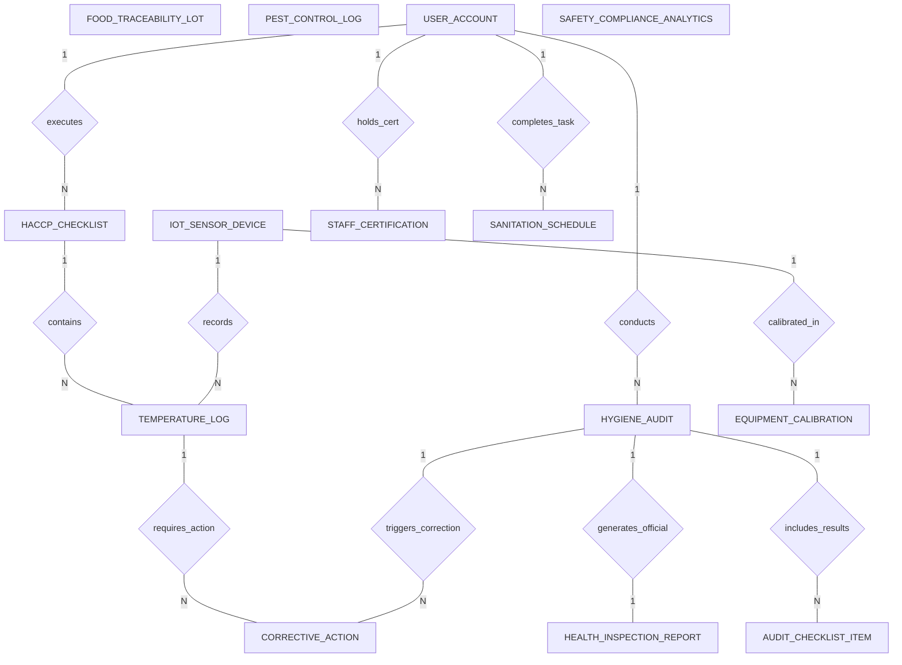

# Conceptual ERD — Food Safety & Hygiene Management System

## Mermaid Code

## Entity Description Table | Bang mo ta Entity

| # | Entity Name | Vietnamese Name | Description | Key Attributes | Main Relationships |
|---|-------------|-----------------|-------------|----------------|-------------------|
| 1 | HACCP_CHECKLIST | Bang kiem tra HACCP | Daily digital checklist container holding scheduled temperature monitoring tasks and compliance statuses. | checklist_id, checklist_name, shift_type, executed_at, compliance_status | Belongs to USER_ACCOUNT; One-to-Many with TEMPERATURE_LOG |
| 2 | TEMPERATURE_LOG | Nhat ky nhiet do | Individual food or cooler temperature measurement log, capturing Celsius reading, limits, and Pass/Fail state. | log_id, checklist_id, device_id, temp_celsius, pass_fail_status, recorded_at | Belongs to HACCP_CHECKLIST, IOT_SENSOR_DEVICE; One-to-Many with CORRECTIVE_ACTION |
| 3 | IOT_SENSOR_DEVICE | Thiet bi cam bien IoT | Wireless Bluetooth/WiFi sensor device hardware installed in walk-in coolers, freezers, and probe tools. | device_id, sensor_code, location_name, current_temp_celsius, is_online | One-to-Many with TEMPERATURE_LOG, EQUIPMENT_CALIBRATION |
| 4 | CORRECTIVE_ACTION | Hanh dong khac phuc | Corrective action ticket mandatory when temperature checks fail or audit violations occur, logging food disposition and root cause. | action_id, log_id, audit_id, deviation_type, action_taken, food_disposition, status | Belongs to TEMPERATURE_LOG, HYGIENE_AUDIT |
| 5 | HYGIENE_AUDIT | Kiem tra ve sinh | Food safety inspection audit record storing overall score percentage, letter grades, and inspection dates. | audit_id, inspector_user_id, audit_date, audit_type, overall_score_percent, letter_grade | Belongs to USER_ACCOUNT; One-to-Many with AUDIT_CHECKLIST_ITEM, CORRECTIVE_ACTION; One-to-One with HEALTH_INSPECTION_REPORT |
| 6 | AUDIT_CHECKLIST_ITEM | Hang muc kiem tra | Specific inspection item evaluation result within an audit (e.g., Handwashing Setup, Raw/Cooked Separation). | item_id, audit_id, category_name, compliance_level, notes, photo_url | Belongs to HYGIENE_AUDIT |
| 7 | FOOD_TRACEABILITY_LOT | Lô nguyen lieu truy xuat | Tracked raw ingredient shipment lot record, supplier lot numbers, receiving dates, and quarantine flags. | lot_id, ingredient_name, supplier_lot_number, internal_batch_code, quarantine_status | Standalone traceability record |
| 8 | STAFF_CERTIFICATION | Chung chi an toan nhan vien | Employee food safety credential record (ServSafe, Food Handler Card), issue dates, and expiration renewal tracking. | cert_id, staff_user_id, cert_type, cert_number, issue_date, expiry_date | Belongs to USER_ACCOUNT |
| 9 | SANITATION_SCHEDULE | Lich ve sinh khu vuc | Scheduled kitchen cleaning and sanitization task, frequency, due date, completion timestamp, and supervisor sign-off. | task_id, area_name, task_description, frequency, due_at, completed_at | Belongs to USER_ACCOUNT |
| 10 | EQUIPMENT_CALIBRATION | Hieu chuan thiet bi | Periodic thermometer and IoT sensor calibration audit record, testing variance offset against iced water standards. | cal_id, device_id, calibrated_at, test_reading_celsius, variance_offset | Belongs to IOT_SENSOR_DEVICE |
| 11 | PEST_CONTROL_LOG | Nhat ky kham con trung | Log of third-party pest exterminator visits, bait station inspection checks, pest activity findings, and recommendations. | pest_log_id, inspection_date, vendor_name, bait_stations_checked, activity_findings | Standalone inspection log |
| 12 | HEALTH_INSPECTION_REPORT | Bao cao kiem tra y te | Official government health department inspection report, official permit numbers, and critical violation counts. | report_id, audit_id, health_dept_agency, official_permit_number, total_critical_violations | One-to-One with HYGIENE_AUDIT |
| 13 | USER_ACCOUNT | Tai khoan he thong | Core security authentication account holding credentials, password hashes, and user role definitions. | user_id, username, password_hash, role_name | One-to-Many with HACCP_CHECKLIST, HYGIENE_AUDIT, STAFF_CERTIFICATION, SANITATION_SCHEDULE |
| 14 | SAFETY_COMPLIANCE_ANALYTICS | Thong ke tuan thu an toan | Aggregated store analytics tracking average audit scores, total temperature breaches, corrective action counts, and risk levels. | analytics_id, metric_date, avg_audit_score, total_temp_breaches, compliance_percent | Aggregated metrics table |

## Relationship Description | Mo ta Quan he

| # | From Entity | Cardinality | To Entity | Relationship Label | Business Explanation |
|---|-------------|-------------|-----------|-------------------|----------------------|
| 1 | USER_ACCOUNT | One-to-Many | HACCP_CHECKLIST | executes | Nhan vien nha bep thuc hien cac bang kiem tra nhiet do HACCP hang ngay. |
| 2 | USER_ACCOUNT | One-to-Many | HYGIENE_AUDIT | conducts | Nhan vien QA hoac thanh tra thuc hien cac ca kiem tra ve sinh va danh gia. |
| 3 | USER_ACCOUNT | One-to-Many | STAFF_CERTIFICATION | holds_cert | Nhan vien so huu cac chung chi an toan thuc pham (ServSafe, Food Handler). |
| 4 | HACCP_CHECKLIST | One-to-Many | TEMPERATURE_LOG | contains | Bang kiem tra HACCP chua nhieu nhat ky do nhiet do cac mon an va tu dong. |
| 5 | IOT_SENSOR_DEVICE | One-to-Many | TEMPERATURE_LOG | records | Thiet bi cam bien IoT phat va ghi nhan du lieu nhiet do va nhat ky dinh ky. |
| 6 | TEMPERATURE_LOG | One-to-Many | CORRECTIVE_ACTION | requires_action | Nhat ky nhiet do vi pham gioi han kich hoat hanh dong khac phuc bat buoc. |
| 7 | HYGIENE_AUDIT | One-to-Many | AUDIT_CHECKLIST_ITEM | includes_results | Mot ca kiem tra ve sinh bao gom ket qua danh gia nhieu hang muc kiem tra. |
| 8 | HYGIENE_AUDIT | One-to-Many | CORRECTIVE_ACTION | triggers_correction | Mot ca kiem tra ve sinh phat hien vi pham phat sinh phi phi hanh dong khac phuc. |
| 9 | HYGIENE_AUDIT | One-to-One | HEALTH_INSPECTION_REPORT | generates_official | Ca kiem tra ket xuat thanh mot bao cao kiem tra y te chinh thuc. |
| 10 | IOT_SENSOR_DEVICE | One-to-Many | EQUIPMENT_CALIBRATION | calibrated_in | Thiet bi cam bien va nhiet ke duoc kiem tra hieu chuan dinh ky theo nhat ky. |
| 11 | USER_ACCOUNT | One-to-Many | SANITATION_SCHEDULE | completes_task | Nhan vien thuc hien va danh dau hoan thanh cac nhiem vu ve sinh theo lich. |
