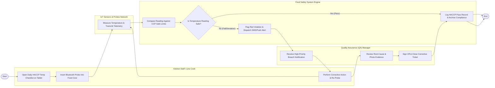

# Swimlane Diagram — Food Safety & Hygiene Management System

## Mermaid Code

## Flow Description | Mo ta luong

| Lane | Actor | Role in Flow |
|------|-------|-------------|
| **Lane 1** | Kitchen Staff / Line Cook | Opens daily HACCP tablet checklists, uses wireless Bluetooth probes to measure core temperatures, executes food disposition actions if limits fail, and re-probes food. |
| **Lane 2** | IoT Sensors & Probes Network | Captures hardware sensor temperature readings and transmits telemetry payloads to the system via Bluetooth/WiFi gateways. |
| **Lane 3** | Quality Assurance (QA) Manager | Receives high-priority temperature breach alerts, reviews staff root-cause notes and photo evidence, and signs off on closed corrective action tickets. |
| **Lane 4** | Food Safety System Engine | Compares temperature readings against CCP limits, flags out-of-range violations, dispatches SMS/push alerts, and archives compliance logs. |

### Process Execution Steps | Cac buoc thuc hien quy trinh

1. **Checklist Access & Probe Reading**: Kitchen Staff opens HACCP checklist (`C1`) and inserts Bluetooth probe into food item (`C2`). IoT Sensor measures temperature and transmits telemetry (`P1`).
2. **CCP Boundary Evaluation**: Food Safety System Engine compares reading against CCP limits (`S1`) and evaluates compliance (`S2`).
   - If **Yes (Pass)**: Engine archives HACCP pass record (`S4`), ending the check process (`Finish`).
   - If **No (Fail/Deviation)**: Engine flags red violation and sends SMS/push alert (`S3`).
3. **Corrective Action & QA Sign-Off**: QA Manager receives breach alert (`A1`). Kitchen Staff performs corrective action (e.g., rapid re-heat or discard) and re-probes food (`C3`). QA Manager reviews root cause and photo proof (`A2`), approving resolution (`A3`). Engine updates compliance records (`S4`), ending the process (`Finish`).
