# Action Tree — Food Safety & Hygiene Management System

## Mermaid Code

```mermaid
graph TD
    Root["Food Safety & Hygiene Management System"]

    Root --> M1["HACCP Temperature Logging & IoT Telemetry"]
    Root --> M2["Sanitation, Cleaning & Equipment Calibration"]
    Root --> M3["Food Traceability & Recall Management"]
    Root --> M4["Hygiene Audits & Corrective Actions"]
    Root --> M5["Staff Health & Certification Compliance"]
    Root --> M6["Receiving Inspections & Supplier Safety"]
    Root --> M7["Compliance Analytics & Regulatory Reporting"]

    M1 --> A11["Execute Daily Bluetooth Probe Checks"]
    M1 --> A12["Ingest Ambient IoT Cooler Telemetry"]
    M1 --> A13["Configure HACCP CCP Temperature Limits"]
    M1 --> A14["Trigger SMS & Push Breach Alerts"]

    M2 --> A21["Schedule Master Kitchen Cleaning Tasks"]
    M2 --> A22["Verify Sanitizer Chemical Concentrations"]
    M2 --> A23["Log Thermometer Calibration Audits"]
    M2 --> A24["Track Pest Control Inspection Logs"]

    M3 --> A31["Record Ingredient Supplier Lot Numbers"]
    M3 --> A32["Trace Contaminated Lot Usage in 60s"]
    M3 --> A33["Trigger Automated POS Stockout Locks 86ing"]
    M3 --> A34["Generate FDA Batch Recall Reports"]

    M4 --> A41["Perform Digital Hygiene Audit Inspections"]
    M4 --> A42["Capture Photo Evidence of Violations"]
    M4 --> A43["Log Root-Cause & Food Dispositions"]
    M4 --> A44["Approve QA Corrective Action Tickets"]

    M5 --> A51["Capture Pre-Shift Staff Illness Declarations"]
    M5 --> A52["Track Food Handler Card Expiration Dates"]
    M5 --> A53["Upload ServSafe Staff Certifications"]
    M5 --> A54["Manage Staff Health Exclusion Alerts"]

    M6 --> A61["Inspect Receiving Truck Temperatures"]
    M6 --> A62["Verify Supplier Certificate of Analysis CoA"]
    M6 --> A63["Log Raw Material Rejection Notices"]
    M6 --> A64["Rate Supplier Food Safety Quality"]

    M7 --> A71["Monitor Store Food Safety Compliance Index"]
    M7 --> A72["Analyze Temperature Breach Frequencies"]
    M7 --> A73["Export Government Health Audit Files"]
    M7 --> A74["Manage User Roles & Security Controls"]
```

## Module Description | Mo ta Module

| # | Module | Description | Actions |
|---|--------|-------------|---------|
| 1 | HACCP Temperature Logging & IoT Telemetry | Handles daily Bluetooth probe temperature logging, continuous IoT ambient cooler sensor telemetry ingestion, CCP limit configuration, and high-priority SMS alerts. | Execute Daily Bluetooth Probe Checks, Ingest Ambient IoT Cooler Telemetry, Configure HACCP CCP Temperature Limits, Trigger SMS & Push Breach Alerts |
| 2 | Sanitation, Cleaning & Equipment Calibration | Controls master kitchen cleaning task schedules, chemical sanitizer concentration testing, thermometer calibration audits, and pest control inspection logs. | Schedule Master Kitchen Cleaning Tasks, Verify Sanitizer Chemical Concentrations, Log Thermometer Calibration Audits, Track Pest Control Inspection Logs |
| 3 | Food Traceability & Recall Management | Tracks ingredient supplier lot numbers, executes 60-second forward/backward recall searches, triggers automatic POS 86ing, and exports FDA recall reports. | Record Ingredient Supplier Lot Numbers, Trace Contaminated Lot Usage in 60s, Trigger Automated POS Stockout Locks 86ing, Generate FDA Batch Recall Reports |
| 4 | Hygiene Audits & Corrective Actions | Enables digital hygiene audit walkthroughs, photo evidence capturing, root-cause food disposition logging, and QA manager corrective ticket sign-offs. | Perform Digital Hygiene Audit Inspections, Capture Photo Evidence of Violations, Log Root-Cause & Food Dispositions, Approve QA Corrective Action Tickets |
| 5 | Staff Health & Certification Compliance | Captures pre-shift staff illness declarations, tracks food handler cards and ServSafe certifications, and manages health exclusion alerts. | Capture Pre-Shift Staff Illness Declarations, Track Food Handler Card Expiration Dates, Upload ServSafe Staff Certifications, Manage Staff Health Exclusion Alerts |
| 6 | Receiving Inspections & Supplier Safety | Verifies delivery truck temperatures at loading docks, checks Supplier Certificates of Analysis (CoA), logs goods rejection notices, and rates supplier quality. | Inspect Receiving Truck Temperatures, Verify Supplier Certificate of Analysis CoA, Log Raw Material Rejection Notices, Rate Supplier Food Safety Quality |
| 7 | Compliance Analytics & Regulatory Reporting | Provides analytical dashboards on store food safety compliance indices, temperature breach trends, government health inspection file exports, and user security permissions. | Monitor Store Food Safety Compliance Index, Analyze Temperature Breach Frequencies, Export Government Health Audit Files, Manage User Roles & Security Controls |
