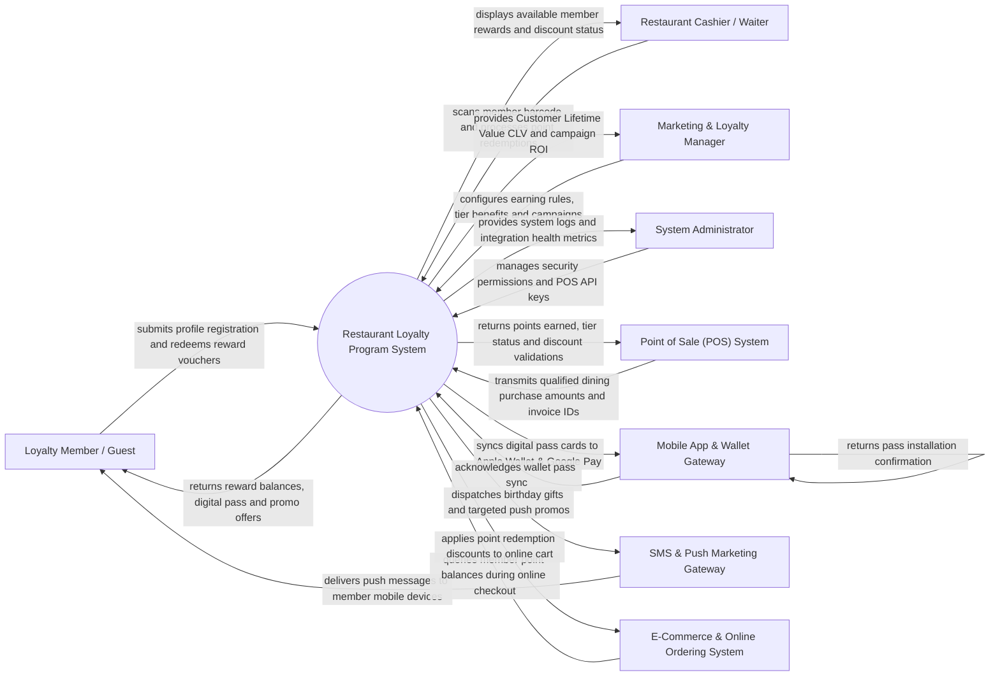

# Context Diagram — Restaurant Loyalty Program System

## Mermaid Code

## Actor & Interaction Table | Bang Actor & Tuong tac

| # | Actor | Actor Type | Data Sent TO System | Data Received FROM System | Notes |
|---|-------|------------|---------------------|---------------------------|-------|
| 1 | Loyalty Member / Guest | Primary | Registration details, phone number, birthday, preference tags, voucher redemption requests | Reward point balances, digital loyalty pass, tier status, birthday gifts | Interacts via guest mobile app, member portal, or Apple/Google Wallet. |
| 2 | Cashier / Waiter | Primary | Scanned member barcode, manual phone number lookup, redemption confirmation | Member tier level, available free vouchers, applied discount total | Uses counter POS terminal or handheld tablet. |
| 3 | Marketing & Loyalty Manager | Primary | Point earning ratio rules, tier threshold boundaries, promo campaigns, referral rewards | Customer Lifetime Value (CLV) reports, redemption rates, churn risk alerts | Accesses web-based marketing and loyalty administration console. |
| 4 | System Administrator | Primary | User credentials, security role policies, integration API keys, system backup settings | Integration health metrics, security event logs, hardware audit trails | Manages IT infrastructure, user permissions, and API connections. |
| 5 | Point of Sale (POS) System | Supporting | Qualified dining net spend, invoice numbers, store location IDs, line items | Points earned calculations, tier discount validations, voucher clearance tokens | Integrates via REST or WebSocket to calculate points per transaction. |
| 6 | Mobile App & Wallet Gateway | Supporting | Wallet pass installation status, push token updates | PKPASS digital loyalty card files, updated point balance pass cards | Integrates with Apple Wallet (PKPASS) and Google Pay API. |
| 7 | SMS & Push Marketing Gateway | Supporting | Message delivery receipts, SMS error logs | Personalized push notifications, automated birthday SMS, promo links | Dispatches push alerts via FCM/APNs and automated SMS messages. |
| 8 | E-Commerce & Online Ordering System | Supporting | Online order totals, customer member IDs, cart item lists | Applied reward voucher discounts, online point earnings | Connects online web/app ordering to the central loyalty points ledger. |

## System Boundary Description | Mo ta Pham vi He thong

The **Restaurant Loyalty Program System** manages customer retention, digital point accumulation ledgers, multi-tier membership benefits, reward voucher distribution, and targeted marketing automation for restaurant brands. Inside its boundary, the system handles member profile enrollment, real-time POS purchase point calculations, Apple/Google Wallet pass synchronization, automated birthday/anniversary gift triggers, referral tracking, Customer Lifetime Value (CLV) analytics, and churn risk prediction.

The system boundary excludes physical dining order processing and cash collection (handled by POS Systems), physical food preparation (handled by Kitchen Systems), direct credit card clearing (handled by Payment Gateways), and native push notification delivery hardware (handled by Apple/Google servers).
