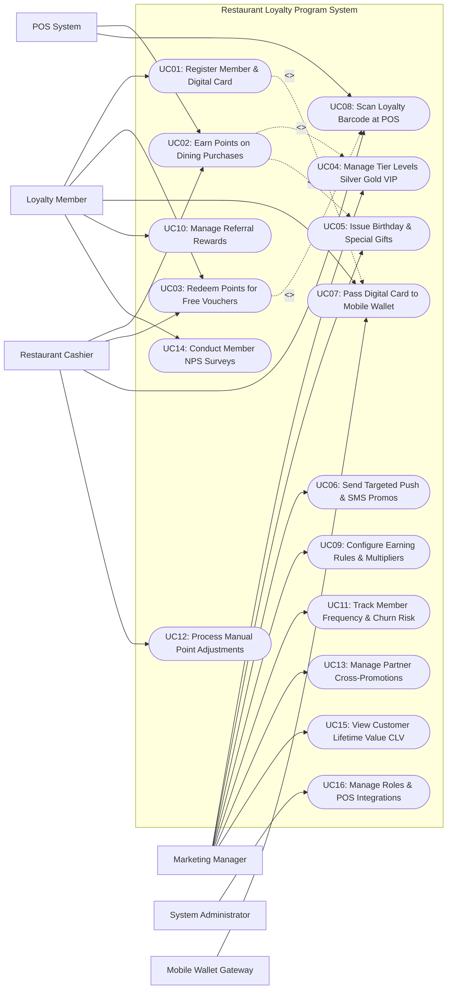

# Use Case Diagram — Restaurant Loyalty Program System

## Mermaid Code

## Actor Table | Bang Actor

| # | Actor | Actor Type | Role Description | Related Use Cases |
|---|-------|------------|------------------|-------------------|
| 1 | Loyalty Member | Primary | Guest enrolled in the restaurant reward program who earns points on dining, redeems vouchers, and saves digital cards. | UC01, UC03, UC07, UC10, UC14 |
| 2 | Restaurant Cashier | Primary | Store staff member who scans customer loyalty barcodes at counter POS, verifies reward vouchers, and applies point discounts. | UC02, UC03, UC08, UC12 |
| 3 | Marketing Manager | Primary | Brand manager configuring tier rules, earning point ratios, automated push campaigns, birthday gifts, and analyzing CLV metrics. | UC04, UC05, UC06, UC09, UC11, UC13, UC15 |
| 4 | Point of Sale (POS) System | Secondary System | External sales terminal sending dining purchase subtotals and receiving point calculation approvals and voucher validations. | UC02, UC08 |
| 5 | Mobile Wallet Gateway | Secondary System | Third-party mobile pass provider (Apple Wallet, Google Pay) hosting PKPASS digital loyalty cards on member smartphones. | UC07 |
| 6 | System Administrator | Primary | Technical admin managing user access permissions, security role policies, system settings, and POS API endpoints. | UC16 |

## Use Case Table | Bang Use Case

| # | UC ID | Use Case Name | Primary Actor | Secondary Actor | Description | Priority |
|---|-------|---------------|---------------|-----------------|-------------|----------|
| 1 | UC01 | Register Member & Digital Card | Member | Mobile Wallet | Enrolls new guests via phone number/email, creates digital member profile, and issues PKPASS loyalty card. | High |
| 2 | UC02 | Earn Points on Dining Purchases | Cashier | POS System | Calculates and credits reward points to member ledger based on net qualified POS dining spend ($1 spent = 1 point). | High |
| 3 | UC03 | Redeem Points for Free Vouchers | Member | Cashier | Converts accumulated points into e-vouchers for free appetizers, desserts, or percentage discounts at POS checkout. | High |
| 4 | UC04 | Manage Tier Levels Silver Gold VIP | Marketing Manager | POS System | Defines membership tier thresholds (Silver, Gold, Platinum VIP) and automates tier upgrades and multiplier perks. | High |
| 5 | UC05 | Issue Birthday & Special Gifts | System | Marketing Manager | Automatically generates and delivers free birthday meal vouchers to members 7 days prior to their birthday. | Medium |
| 6 | UC06 | Send Targeted Push & SMS Promos | Marketing Manager | Push Gateway | Dispatches personalized push/SMS promo campaigns based on dining preferences, favorite dishes, or inactivity. | High |
| 7 | UC07 | Pass Digital Card to Mobile Wallet | Member | Mobile Wallet | Exports digital loyalty card with live point balance pass to Apple Wallet (PKPASS) or Google Pay. | Medium |
| 8 | UC08 | Scan Loyalty Barcode at POS | Cashier | POS System | Reads member QR code/barcode at counter POS to identify member profile and unlock available reward vouchers. | High |
| 9 | UC09 | Configure Earning Rules & Multipliers | Marketing Manager | None | Sets point earning ratios (e.g., 10 points per $1) and double-point promotional multiplier windows (e.g., Happy Hour 2x Points). | High |
| 10 | UC10 | Manage Referral Rewards | Member | None | Generates personal member referral links and awards bonus points when referred friends complete their first dining visit. | Medium |
| 11 | UC11 | Track Member Frequency & Churn Risk | Marketing Manager | None | Identifies inactive members (e.g., no visit in 45 days) and triggers automated win-back discount campaigns. | High |
| 12 | UC12 | Process Manual Point Adjustments | Cashier | None | Allows authorized staff to manually add or deduct points for customer service gestures, order returns, or missed points. | Medium |
| 13 | UC13 | Manage Partner Cross-Promotions | Marketing Manager | None | Manages co-branded promotions with partner brands (e.g., Cinema tickets for 500 restaurant points). | Low |
| 14 | UC14 | Conduct Member NPS Surveys | Member | None | Prompts members to complete 1-click Net Promoter Score (NPS) surveys after dining visits, rewarding bonus points. | Medium |
| 15 | UC15 | View Customer Lifetime Value CLV | Marketing Manager | None | Generates analytical reports on Customer Lifetime Value (CLV), average visit frequency, redemption ROI, and revenue retention. | High |
| 16 | UC16 | Manage Roles & POS Integrations | System Admin | None | Configures user security access roles, POS API webhook tokens, system parameter settings, and audit logs. | High |

## Use Case Specification | Dac ta Use Case

---

### UC01 — Register Member & Digital Card

| Field | Detail |
|-------|--------|
| **UC ID** | UC01 |
| **Use Case Name** | Register Member & Digital Card |
| **Actor(s)** | Primary: Loyalty Member / Guest   Secondary: Mobile Wallet Gateway |
| **Description** | Enrolls a guest into the restaurant loyalty program via mobile app or web portal, creates a digital member profile, issues a unique member QR barcode, and syncs a PKPASS card to Apple/Google Wallet. |
| **Precondition** | 1. Guest mobile app or web portal registration page is active.   2. Mobile Wallet Gateway integration is connected. |
| **Main Flow** | 1. Guest opens registration screen, inputs Mobile Phone Number, Full Name, Email Address, Birthday, and Favorite Dining Location.   2. System sends a 6-digit OTP verification code to guest phone via SMS.   3. Guest inputs OTP code on screen to verify phone number ownership.   4. System creates a new Member Account record with status `Active`, initial tier `Silver Member`, and initial welcome bonus points (e.g., 50 Welcome Points).   5. System generates a unique 12-digit Member ID and dynamic QR barcode.   6. System generates an Apple Wallet (PKPASS) file and Google Pay pass token containing member name, tier badge, current points balance (50 pts), and QR code.   7. Guest taps "Add to Apple Wallet" / "Add to Google Pay".   8. System passes digital card token to Mobile Wallet Gateway; card installs on guest smartphone. |
| **Alternative Flow** | **AF1** — Quick registration at counter POS:   1. Cashier asks guest for phone number during POS checkout.   2. Cashier inputs phone number; System creates draft account and sends SMS registration link to guest.   3. Guest completes profile details on smartphone later. |
| **Exception Flow** | **EX1** — Phone number already registered:   1. At step 1, System detects phone number is already bound to an active member account.   2. System alerts Guest "Phone number already registered. Tap to Login instead." and redirects to OTP login screen. |
| **Postcondition** | Member profile is created, welcome points are credited, member QR code is generated, and digital wallet pass is installed. |
| **Business Rule** | **BR1**: Enrolled members must verify phone numbers via OTP before receiving welcome points or redeeming reward vouchers.   **BR2**: Membership is limited to 1 active account per unique phone number and email address. |

---

### UC02 — Earn Points on Dining Purchases

| Field | Detail |
|-------|--------|
| **UC ID** | UC02 |
| **Use Case Name** | Earn Points on Dining Purchases |
| **Actor(s)** | Primary: Restaurant Cashier / Waiter   Secondary: Point of Sale (POS) System |
| **Description** | Calculates and credits reward points to a member's digital points ledger based on net qualified dining spending at POS checkout, applying tier multipliers and promotional campaign bonuses. |
| **Precondition** | 1. Guest is an enrolled loyalty member.   2. POS transaction subtotals are finalized and cashier has identified the member account (UC08). |
| **Main Flow** | 1. Cashier scans member QR code (or enters phone number) at POS terminal during order checkout.   2. POS System sends real-time authorization payload to Loyalty System: Member ID, Store Location, Net Qualified Dining Spend (e.g., $45.00 excluding tax/tips), and Line Items.   3. System retrieves member tier status (e.g., Gold Member = 1.25x Point Multiplier).   4. System retrieves active earning policy rules (e.g., Base Rate: 1 Point per $1 spent).   5. System checks active promotional campaign multipliers (e.g., "Double Points Tuesday: 2x Multiplier").   6. System calculates Total Earned Points: `$45.00 spend x 1 point/$1 x 1.25 (Gold Tier) x 2.0 (Double Points Tuesday) = 112.5 Points` (rounded to 113 Points).   7. System credits 113 Points to member points ledger and updates lifetime tier spend accumulation.   8. System returns response payload to POS displaying: `113 Points Earned! New Balance: 650 Points`.   9. POS prints earned points line on customer paper receipt, and System dispatches instant push notification to member smartphone. |
| **Alternative Flow** | **AF1** — Claim missing points post-dining via receipt code:   1. Member forgot to scan barcode during dining.   2. Member opens app, inputs 16-digit Receipt Claim Code printed on paper receipt within 7 days.   3. System validates receipt code, calculates earned points, and credits member ledger. |
| **Exception Flow** | **EX1** — Non-qualified items excluded:   1. Order includes gift card purchases or catering delivery fees.   2. System excludes non-qualified items from points calculation per brand earning policy rules. |
| **Postcondition** | Earned points are credited to member ledger, tier progress is updated, and wallet pass balance refreshes. |
| **Business Rule** | **BR1**: Points are calculated strictly on net food and beverage spending excluding sales taxes, service charges, tips, and gift card purchases.   **BR2**: Earned points credit to member ledgers instantly upon POS checkout completion. |

---

### UC03 — Redeem Points for Free Vouchers

| Field | Detail |
|-------|--------|
| **UC ID** | UC03 |
| **Use Case Name** | Redeem Points for Free Vouchers |
| **Actor(s)** | Primary: Loyalty Member, Restaurant Cashier   Secondary: Point of Sale (POS) System |
| **Description** | Allows a member to convert accumulated points into e-vouchers (free appetizer, $10 discount coupon, free dessert) and apply the voucher discount at POS checkout. |
| **Precondition** | 1. Member has sufficient active point balance in ledger (e.g., 500 Points).   2. Reward voucher catalog is active. |
| **Main Flow** | 1. Member opens "Rewards Store" tab in guest app (or cashier opens rewards screen on POS).   2. System displays available reward vouchers and point costs (e.g., Free Cheeseburger = 400 pts; $10 Discount = 500 pts; Free Shake = 250 pts).   3. Member selects "$10 Off Total Bill" voucher (500 pts) and taps "Redeem Points".   4. System checks member point balance (650 pts >= 500 pts).   5. System deducts 500 Points from member ledger (Remaining Balance: 150 pts).   6. System generates a unique 8-digit E-Voucher Code and dynamic single-use QR barcode with 30-day expiration.   7. Member presents e-voucher QR code to Cashier at POS checkout.   8. Cashier scans e-voucher QR code at POS terminal (executing UC08).   9. POS validates voucher code, applies $10 discount to order subtotal, marks voucher as `Used / Redeemed`, and completes checkout. |
| **Alternative Flow** | **AF1** — Direct point redemption at POS counter without app:   1. Guest asks Cashier at POS: "Can I use my points for a discount?".   2. Cashier scans member barcode; POS displays "Available: 650 Pts. Redeem 500 Pts for $10 Off?".   3. Cashier taps "Redeem at POS"; System deducts 500 pts and applies $10 discount directly. |
| **Exception Flow** | **EX1** — Voucher expired or already redeemed:   1. At step 9, Cashier scans a voucher code that was used previously or expired yesterday.   2. POS displays error "Voucher Invalid: Already Redeemed" and rejects discount application. |
| **Postcondition** | Points are deducted from member ledger, e-voucher code is marked used, and discount applies to POS ticket. |
| **Business Rule** | **BR1**: Redeemed e-vouchers are single-use only and automatically expire after 30 days if unredeemed.   **BR2**: POS tickets allow maximum 1 reward voucher redemption per transaction unless configured for multi-voucher stacking. |

---

### UC04 — Manage Tier Levels Silver Gold VIP

| Field | Detail |
|-------|--------|
| **UC ID** | UC04 |
| **Use Case Name** | Manage Tier Levels Silver Gold VIP |
| **Actor(s)** | Primary: Marketing & Loyalty Manager   Secondary: Point of Sale (POS) System |
| **Description** | Configures membership tier structures (Silver, Gold, Platinum VIP), annual spend/visit threshold boundaries, tier multiplier perks, and automated tier upgrade/downgrade logic. |
| **Precondition** | 1. User is authenticated with Marketing Manager privileges.   2. Tier management module is open. |
| **Main Flow** | 1. Marketing Manager opens Tier Structure Management module on administration console.   2. Manager configures tier levels and annual spend thresholds:      - Tier 1: `Silver Member` (Default entry level; 1.0x point multiplier).      - Tier 2: `Gold Member` ($300 annual spend or 10 visits; 1.25x point multiplier; free birthday dessert).      - Tier 3: `Platinum VIP` ($800 annual spend or 25 visits; 1.5x point multiplier; priority seating; free birthday meal).   3. Manager configures tier evaluation period rules (e.g., Rolling 12-Month Window).   4. Manager saves tier configuration settings.   5. As members complete POS dining transactions (UC02), System automatically tracks annual cumulative spend.   6. When a member's 12-month cumulative spend reaches $300, System automatically upgrades member status from `Silver` to `Gold`.   7. System triggers automated congratulations push notification and updates digital Apple/Google Wallet pass badge to Gold. |
| **Alternative Flow** | **AF1** — Annual tier re-qualification downgrade:   1. At the end of 12-month evaluation window, a Gold member spent only $150 (below $300 threshold).   2. System sends grace period reminder SMS: "Spend $150 more this month to keep your Gold status!".   3. If threshold is not met by deadline, System adjusts member tier to Silver. |
| **Exception Flow** | **EX1** — Manual VIP tier override:   1. Marketing Manager manually upgrades a corporate client or food influencer profile directly to `Platinum VIP` status without meeting spend thresholds.   2. System logs manager override note in audit trail. |
| **Postcondition** | Tier thresholds and perk multipliers are saved, and member tier upgrades/downgrades process automatically. |
| **Business Rule** | **BR1**: Tier upgrades take effect instantly upon reaching the qualifying spend threshold.   **BR2**: Members maintaining higher tier levels retain their earned status for a minimum of 12 full calendar months. |

---

### UC06 — Send Targeted Push & SMS Promos

| Field | Detail |
|-------|--------|
| **UC ID** | UC06 |
| **Use Case Name** | Send Targeted Push & SMS Promos |
| **Actor(s)** | Primary: Marketing & Loyalty Manager   Secondary: Push & SMS Marketing Gateway |
| **Description** | Enables marketing managers to segment loyalty members based on dining habits, favorite dishes, tier levels, or inactivity, sending automated push and SMS promotional campaigns. |
| **Precondition** | 1. Member profile data, dining history logs, and marketing communication consent flags are active.   2. SMS & Push Marketing Gateway is connected. |
| **Main Flow** | 1. Marketing Manager opens "Campaign Builder & Audience Segmenter" module on marketing console.   2. Manager defines audience segment filter criteria (e.g., "Gold Tier Members who ordered Steak in the last 60 days but haven't visited in 30 days").   3. System queries database and displays audience match count (e.g., 1,420 members matched).   4. Manager crafts promotional message: "We miss you! Enjoy a FREE Glass of Wine on your next visit this week. Tap to claim voucher: [link]".   5. Manager attaches a promo voucher (e.g., Free Glass of Wine, valid 7 days).   6. Manager selects delivery channels (In-App Push Notification + SMS fallback for push-disabled users).   7. Manager sets launch schedule (Immediate or Scheduled for Thursday 11:00 AM).   8. Manager clicks "Launch Campaign".   9. System queues campaign, serializes message payloads, and dispatches via Push & SMS Marketing Gateway to target member devices.   10. System tracks real-time campaign engagement metrics (Delivery Rate, Open Rate, Link Clicks, Voucher Redemptions, Revenue Generated). |
| **Alternative Flow** | **AF1** — Automated recurring trigger campaign:   1. Manager configures an automated "Lapsed Guest Win-Back" campaign triggered whenever ANY member reaches 45 days without a dining visit.   2. System evaluates member inactivity daily and sends automated win-back offer without manual manager intervention. |
| **Exception Flow** | **EX1** — Member opted out of marketing communications:   1. Target member in segment has toggled "SMS Marketing Consent = OFF".   2. System excludes member from SMS broadcast list, respecting privacy compliance rules (TCPA/GDPR). |
| **Postcondition** | Targeted promotional messages and vouchers are delivered to member devices, and campaign ROI metrics are tracked. |
| **Business Rule** | **BR1**: Automated marketing messages must strictly respect member opt-out preferences and regional spam privacy laws (TCPA / GDPR).   **BR2**: Push/SMS marketing broadcasts must be restricted to local window hours (09:00 AM to 08:30 PM) to avoid disturbing members. |
