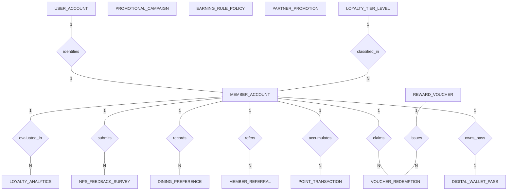

# Conceptual ERD — Restaurant Loyalty Program System

## Mermaid Code

## Entity Description Table | Bang mo ta Entity

| # | Entity Name | Vietnamese Name | Description | Key Attributes | Main Relationships |
|---|-------------|-----------------|-------------|----------------|-------------------|
| 1 | MEMBER_ACCOUNT | Tai khoan Hoi vien | Core loyalty member profile, unique member code, phone number, active point balance, and lifetime spend total. | member_id, user_id, tier_id, member_code, phone_number, active_points_balance, lifetime_spend_amount | Belongs to USER_ACCOUNT, LOYALTY_TIER_LEVEL; One-to-Many with POINT_TRANSACTION, VOUCHER_REDEMPTION, MEMBER_REFERRAL, DINING_PREFERENCE, NPS_FEEDBACK_SURVEY; One-to-One with DIGITAL_WALLET_PASS |
| 2 | LOYALTY_TIER_LEVEL | Hang hoi vien | Membership tier level definitions (Silver, Gold, Platinum VIP), annual qualifying spend limits, and point multipliers. | tier_id, tier_name, min_annual_spend, point_multiplier, tier_color_badge | One-to-Many with MEMBER_ACCOUNT |
| 3 | POINT_TRANSACTION | Giao dich tich/tieu diem | Points ledger transaction log recording earned points, redeemed points, POS invoice numbers, net spend, and timestamps. | transaction_id, member_id, pos_invoice_ref, transaction_type, points_amount, net_spend_amount | Belongs to MEMBER_ACCOUNT |
| 4 | REWARD_VOUCHER | Danh muc Voucher qua | Master reward catalog items (free appetizer, $10 discount coupon, free shake), point redemption cost, and validity days. | voucher_id, voucher_code, voucher_title, point_cost, discount_value, validity_days | One-to-Many with VOUCHER_REDEMPTION |
| 5 | VOUCHER_REDEMPTION | Luot doi voucher | Individual member voucher redemption record, unique 8-digit redemption code, expiration date, and redemption status (Active, Used, Expired). | redemption_id, member_id, voucher_id, redemption_code, redeemed_at, status | Belongs to MEMBER_ACCOUNT, REWARD_VOUCHER |
| 6 | PROMOTIONAL_CAMPAIGN | Chien dich Marketing | Marketing campaign configuration defining targeted member audience segments, message channels (Push/SMS), and active dates. | campaign_id, campaign_name, target_segment, channel_type, start_date | Standalone campaign entity |
| 7 | MEMBER_REFERRAL | Giao dich Gioi thieu | Tracks member peer referrals, referral codes, referred guest member accounts, bonus points awarded, and completion dates. | referral_id, referrer_member_id, referee_member_id, referral_code, points_awarded | Belongs to MEMBER_ACCOUNT |
| 8 | DIGITAL_WALLET_PASS | The Vi dien tu smartphone | Mobile wallet pass synchronization record linking member profiles to Apple Wallet (PKPASS) and Google Pay API pass tokens. | pass_id, member_id, pass_type, wallet_pass_token, last_synced_at | One-to-One with MEMBER_ACCOUNT |
| 9 | DINING_PREFERENCE | So thich am thuc | Member dining preferences including favorite store location, preferred food categories, and dietary tags. | pref_id, member_id, favorite_location, preferred_cuisine, dietary_tag | Belongs to MEMBER_ACCOUNT |
| 10 | NPS_FEEDBACK_SURVEY | Khao sat phan hoi NPS | Post-dining Net Promoter Score (NPS) 1-10 survey rating submission, guest written feedback comments, and invoice references. | survey_id, member_id, pos_invoice_ref, nps_score, feedback_comment | Belongs to MEMBER_ACCOUNT |
| 11 | EARNING_RULE_POLICY | Quy tac tich diem | System point earning ratio configuration (points per $1 spent), minimum spend thresholds, and promotional multiplier windows. | policy_id, policy_name, points_per_currency_unit, min_spend_threshold, is_active | Standalone policy entity |
| 12 | PARTNER_PROMOTION | Uu dai doi tac lien ket | Co-branded cross-promotions with partner brands (e.g., Cinema vouchers, Gas discounts) redeemable via loyalty points. | partner_promo_id, partner_name, offer_title, points_required, is_active | Standalone partner entity |
| 13 | USER_ACCOUNT | Tai khoan he thong | Core security authentication account holding credentials, password hashes, and security role definitions. | user_id, username, password_hash, role_name | One-to-One with MEMBER_ACCOUNT |
| 14 | LOYALTY_ANALYTICS | Thong ke hieu qua Loyalty | Aggregate daily analytics tracking total members, 30-day active members, Customer Lifetime Value (CLV), and voucher redemption rates. | analytics_id, metric_date, total_members, active_members_30d, clv_average, redemption_rate_percent | Evaluates MEMBER_ACCOUNT |

## Relationship Description | Mo ta Quan he

| # | From Entity | Cardinality | To Entity | Relationship Label | Business Explanation |
|---|-------------|-------------|-----------|-------------------|----------------------|
| 1 | USER_ACCOUNT | One-to-One | MEMBER_ACCOUNT | identifies | Tai khoan he thong xac thuc ho so hoi vien tich diem. |
| 2 | LOYALTY_TIER_LEVEL | One-to-Many | MEMBER_ACCOUNT | classified_in | Mot hang hoi vien (Silver, Gold, VIP) phan loai nhieu hoi vien tuong ung. |
| 3 | MEMBER_ACCOUNT | One-to-Many | POINT_TRANSACTION | accumulates | Mot hoi vien thuc hien nhieu giao dich tich va tieu diem theo thoi gian. |
| 4 | MEMBER_ACCOUNT | One-to-Many | VOUCHER_REDEMPTION | claims | Mot hoi vien thuc hien nhieu luot doi voucher uu dai tu diem tich luy. |
| 5 | REWARD_VOUCHER | One-to-Many | VOUCHER_REDEMPTION | issues | Mot phieu qua tang trong danh muc duoc phat hanh thanh nhieu luot doi cu the. |
| 6 | MEMBER_ACCOUNT | One-to-Many | MEMBER_REFERRAL | refers | Mot hoi vien co the gioi thieu nhieu ban be tham gia chuong trinh. |
| 7 | MEMBER_ACCOUNT | One-to-One | DIGITAL_WALLET_PASS | owns_pass | Mot hoi vien so huu mot the Vi dien tu smartphone (Apple/Google Wallet) tuong ung. |
| 8 | MEMBER_ACCOUNT | One-to-Many | DINING_PREFERENCE | records | Mot hoi vien duoc ghi nhan cac so thich am thuc va di ung khac nhau. |
| 9 | MEMBER_ACCOUNT | One-to-Many | NPS_FEEDBACK_SURVEY | submits | Mot hoi vien thuc hien nhieu khao sat phan hoi diem NPS sau khi an. |
| 10 | MEMBER_ACCOUNT | One-to-Many | LOYALTY_ANALYTICS | evaluated_in | Hoi vien duoc thong ke va danh gia gia tri vong đời CLV va ti le quay lai. |
