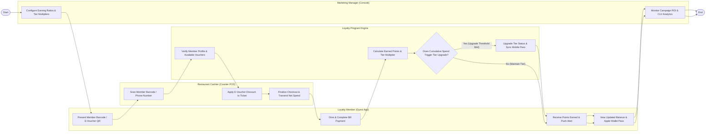

# Swimlane Diagram — Restaurant Loyalty Program System

## Mermaid Code

## Flow Description | Mo ta luong

| Lane | Actor | Role in Flow |
|------|-------|-------------|
| **Lane 1** | Loyalty Member (Guest App) | Presents digital member QR barcode or e-voucher at POS checkout, completes dining payment, receives instant points earned push alert, and views updated Apple/Google Wallet pass balance. |
| **Lane 2** | Restaurant Cashier (Counter POS) | Scans member barcode on counter POS, applies validated e-voucher discounts to the order ticket, and finalizes checkout to transmit net spend transaction. |
| **Lane 3** | Marketing Manager (Console) | Configures point earning rules and tier multipliers, monitors campaign conversion rates, and tracks Customer Lifetime Value (CLV) analytics. |
| **Lane 4** | Loyalty Program Engine | Validates member credentials, calculates earned points using tier multipliers, evaluates tier upgrade thresholds, updates digital wallet passes, and archives points ledger logs. |

### Process Execution Steps | Cac buoc thuc hien quy trinh

1. **Rule Setup & Member Identification**: Marketing Manager configures point earning ratios and tier multipliers (`M1`). Member presents digital barcode or e-voucher at POS checkout (`C1`). Cashier scans barcode (`K1`).
2. **Voucher Validation & POS Checkout**: Loyalty Engine verifies member profile and voucher eligibility (`S1`). Cashier applies discount to ticket (`K2`) and finalizes checkout (`K3`, `C2`).
3. **Point Calculation & Tier Evaluation**: Loyalty Engine calculates earned points by applying tier multipliers (`S2`) and evaluates annual cumulative spend (`S3`).
   - If **Yes (Upgrade Threshold Met)**: Engine upgrades member status (e.g., Silver -> Gold) and updates Apple/Google Wallet pass badge (`S4`).
   - If **No**: Engine maintains current tier level.
4. **Push Notification & Analytics**: Member receives instant points earned push notification (`C3`), checks updated wallet pass (`C4`), and Marketing Manager reviews campaign performance analytics (`M2`), completing execution (`Finish`).
