# Action Tree — Restaurant Loyalty Program System

## Mermaid Code

```mermaid
graph TD
    Root["Restaurant Loyalty Program System"]

    Root --> M1["Member Enrollment & Digital Card Management"]
    Root --> M2["Point Accumulation & Transaction Engine"]
    Root --> M3["Reward Voucher Catalog & Redemption"]
    Root --> M4["Tier Status & Benefit Automation"]
    Root --> M5["Targeted Marketing & SMS/Push Campaigns"]
    Root --> M6["Customer Analytics & Churn Prediction"]
    Root --> M7["System Administration & POS Integrations"]

    M1 --> A11["Register New Member Profiles"]
    M1 --> A12["Verify Phone Numbers via OTP"]
    M1 --> A13["Export Digital Apple & Google Wallet Passes"]
    M1 --> A14["Manage Member Profile Preferences"]

    M2 --> A21["Calculate Points on Net POS Spend"]
    M2 --> A22["Apply Tier & Promotional Multipliers"]
    M2 --> A23["Claim Missing Points via Receipt Codes"]
    M2 --> A24["Process Manual Staff Point Adjustments"]

    M3 --> A31["Configure Reward Voucher Catalog"]
    M3 --> A32["Redeem Points for E-Vouchers"]
    M3 --> A33["Validate Voucher QR Codes at POS"]
    M3 --> A34["Manage Partner Cross-Promotion Offers"]

    M4 --> A41["Configure Membership Tier Levels"]
    M4 --> A42["Automate Tier Spend Upgrades"]
    M4 --> A43["Issue Automated Birthday Gift Vouchers"]
    M4 --> A44["Track Tier Re-Qualification Deadlines"]

    M5 --> A51["Build Audience Segment Filters"]
    M5 --> A52["Dispatch Targeted Push & SMS Broadcasts"]
    M5 --> A53["Configure Automated Inactivity Win-Back Rules"]
    M5 --> A54["Track Campaign Conversion Rates"]

    M6 --> A61["Monitor Customer Lifetime Value CLV"]
    M6 --> A62["Predict Member Churn Risk Levels"]
    M6 --> A63["Analyze NPS Member Survey Scores"]
    M6 --> A64["Track Reward Redemption ROI Metrics"]

    M7 --> A71["Manage User Security Permissions"]
    M7 --> A72["Configure POS API Webhook Keys"]
    M7 --> A73["Manage Point Earning Policy Rules"]
    M7 --> A74["Audit System Activity Logs"]
```

## Module Description | Mo ta Module

| # | Module | Description | Actions |
|---|--------|-------------|---------|
| 1 | Member Enrollment & Digital Card Management | Handles guest registration, SMS OTP phone verification, digital Apple/Google Wallet pass exports, and dining preference profile tagging. | Register New Member Profiles, Verify Phone Numbers via OTP, Export Digital Apple & Google Wallet Passes, Manage Member Profile Preferences |
| 2 | Point Accumulation & Transaction Engine | Calculates earned points on qualified POS dining spending, applies tier/promo multipliers, processes receipt code point claims, and allows manual staff point adjustments. | Calculate Points on Net POS Spend, Apply Tier & Promotional Multipliers, Claim Missing Points via Receipt Codes, Process Manual Staff Point Adjustments |
| 3 | Reward Voucher Catalog & Redemption | Manages the reward voucher catalog, point redemption workflows, POS voucher QR code validations, and partner cross-promotions. | Configure Reward Voucher Catalog, Redeem Points for E-Vouchers, Validate Voucher QR Codes at POS, Manage Partner Cross-Promotion Offers |
| 4 | Tier Status & Benefit Automation | Configures membership tier levels (Silver, Gold, Platinum VIP), automates spend threshold upgrades, delivers birthday gifts, and tracks annual re-qualification deadlines. | Configure Membership Tier Levels, Automate Tier Spend Upgrades, Issue Automated Birthday Gift Vouchers, Track Tier Re-Qualification Deadlines |
| 5 | Targeted Marketing & SMS/Push Campaigns | Enables audience segmentation, dispatches push/SMS promo broadcasts, manages automated win-back triggers, and tracks campaign conversion rates. | Build Audience Segment Filters, Dispatch Targeted Push & SMS Broadcasts, Configure Automated Inactivity Win-Back Rules, Track Campaign Conversion Rates |
| 6 | Customer Analytics & Churn Prediction | Provides analytical dashboards on Customer Lifetime Value (CLV), member churn risk scoring, NPS survey feedback scores, and redemption ROI metrics. | Monitor Customer Lifetime Value CLV, Predict Member Churn Risk Levels, Analyze NPS Member Survey Scores, Track Reward Redemption ROI Metrics |
| 7 | System Administration & POS Integrations | Controls user access roles, POS API webhook integration tokens, point earning policy rules, and system security audit trails. | Manage User Security Permissions, Configure POS API Webhook Keys, Manage Point Earning Policy Rules, Audit System Activity Logs |
