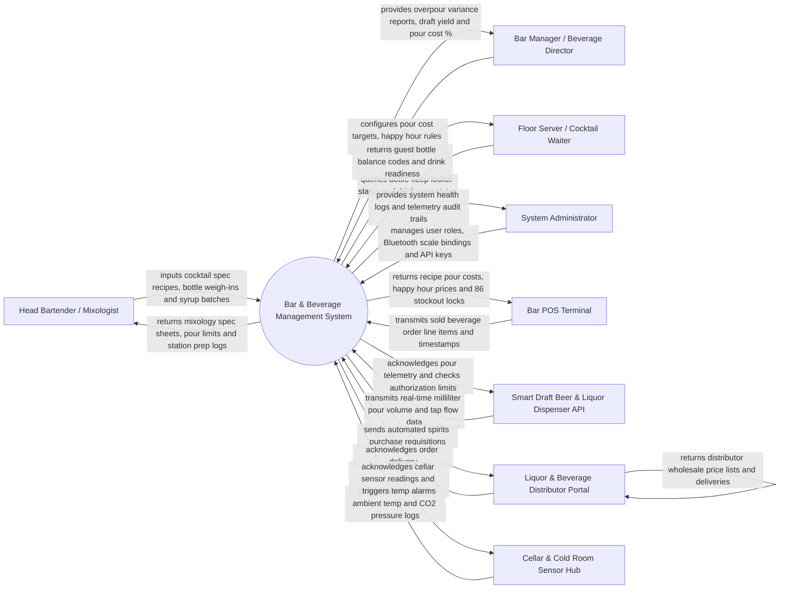

# Context Diagram — Bar & Beverage Management System

## Mermaid Code

## Actor & Interaction Table | Bang Actor & Tuong tac

| # | Actor | Actor Type | Data Sent TO System | Data Received FROM System | Notes |
|---|-------|------------|---------------------|---------------------------|-------|
| 1 | Head Bartender / Mixologist | Primary | Cocktail spec recipes, bottle weight logs (via Bluetooth scale), syrup/infusion sub-recipes, shift stock counts | Mixology standard spec sheets, portion limits, syrup prep batch ratios, station checklists | Creates cocktail specs and manages bar station prep and bottle weigh-ins. |
| 2 | Bar Manager / Beverage Director | Primary | Target pour cost percentages (e.g., 18%), happy hour pricing rules, bottle keep registration, waste logs | Overpour variance reports, draft beer yield analytics, bottle shrinkage alerts, profit margins | Oversees beverage profitability, inventory variance, and cellar management. |
| 3 | Floor Server / Cocktail Waiter | Primary | Guest bottle keep redemption requests, customer drink orders, table service notes | Active guest bottle keep balances, locker location codes, drink prep status | Interacts via mobile handheld POS or server tablet. |
| 4 | System Administrator | Primary | User credentials, security roles, smart dispenser API keys, Bluetooth scale pairings | Hardware connection status, API error logs, security audit trails | Manages software infrastructure, hardware sensor bindings, and network settings. |
| 5 | Bar POS Terminal | Supporting | Real-time sold drink item line items, modifier tags, cash/card payment timestamps | Recipe pour costs, happy hour promotional prices, beverage stockout (86) locks | Front-of-house POS system sending beverage transaction payloads. |
| 6 | Smart Draft Beer & Liquor Dispenser API | Supporting | Real-time poured liquor volume (ml), draft beer tap flow telemetry, dispenser bottle IDs | Pour authorization tokens, volume limit cutoffs, automated valve locks | Automated liquor pour meters (e.g., Berg/BarVision) and draft flow sensors. |
| 7 | Liquor & Beverage Distributor Portal | Supporting | Wholesale spirit/wine price lists, bottle pack sizes, delivery schedules | Automated spirits purchase requisitions, reorder requests, delivery confirmations | External vendor system for ordering wine, spirits, and keg supplies. |
| 8 | Cellar & Cold Room Sensor Hub | Supporting | Ambient wine cellar temperatures, keg room humidity, CO2 gas line pressure readings | Sensor ping acknowledgments, out-of-range alarm triggers, calibration logs | IoT environmental sensor network in wine cellars and keg storage rooms. |

## System Boundary Description | Mo ta Pham vi He thong

The **Bar & Beverage Management System** manages beverage inventory, cocktail mixology engineering, automated pour volume tracking, draft beer tap monitoring, and wine cellar logistics for bars, nightclubs, and restaurant beverage operations. Inside its boundary, the system handles cocktail recipe Bill of Materials (BOM) creation, smart Bluetooth bottle weighing, real-time comparison of poured ml versus POS sales (overpour auditing), draft keg yield tracking, VIP bottle keep locker management, happy hour pricing automation, and spirits purchase requisitions.

The system boundary excludes physical drink mixing by bartenders, physical draft beer line cleaning (handled by maintenance technicians), physical payment processing (handled by POS/Payment Gateways), and external liquor transport shipping.
