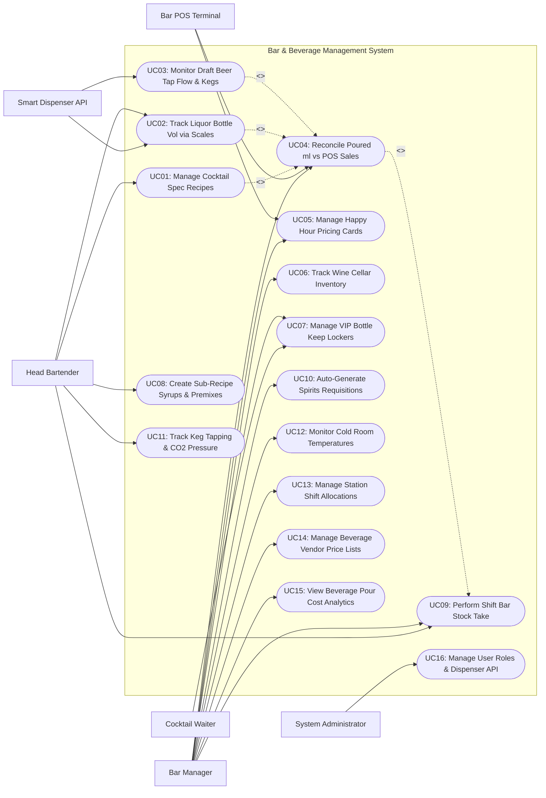

# Use Case Diagram — Bar & Beverage Management System

## Mermaid Code

## Actor Table | Bang Actor

| # | Actor | Actor Type | Role Description | Related Use Cases |
|---|-------|------------|------------------|-------------------|
| 1 | Smart Dispenser API | Secondary System | Automated liquor pour meters and draft beer tap flow sensors broadcasting real-time milliliter pour volume telemetry. | UC02, UC03 |
| 2 | Head Bartender | Primary | Lead mixologist creating cocktail specs, weighing open liquor bottles on Bluetooth scales, crafting syrups/premixes, and checking shift stock. | UC01, UC02, UC08, UC09, UC11 |
| 3 | Cocktail Waiter | Primary | Floor server querying guest VIP bottle keep locker balances and redeeming customer bottle deposits. | UC07 |
| 4 | Bar Manager | Primary | Beverage director auditing poured vs sold variances, setting happy hour prices, managing wine cellar stocks, and tracking pour cost %. | UC04, UC05, UC06, UC07, UC09, UC10, UC12, UC13, UC14, UC15 |
| 5 | Bar POS Terminal | Secondary System | Front-of-house POS sending sold beverage transaction line items to reconcile poured volume against sold revenue. | UC04, UC05 |
| 6 | System Administrator | Primary | Technical manager configuring dispenser API tokens, Bluetooth scale pairings, user permissions, and security audit logs. | UC16 |

## Use Case Table | Bang Use Case

| # | UC ID | Use Case Name | Primary Actor | Secondary Actor | Description | Priority |
|---|-------|---------------|---------------|-----------------|-------------|----------|
| 1 | UC01 | Manage Cocktail Spec Recipes | Head Bartender | None | Creates standardized mixology spec sheets, defining precise shot volumes (e.g., 45ml Gin, 15ml Vermouth), garnishes, and glassware. | High |
| 2 | UC02 | Track Liquor Bottle Vol via Scales | Head Bartender | Smart Dispenser API | Measures remaining liquor bottle volumes in seconds by weighing open bottles on Bluetooth smart scales or reading pour sensors. | High |
| 3 | UC03 | Monitor Draft Beer Tap Flow & Keg Levels | System | Smart Dispenser API | Ingests real-time flow meter telemetry from draft beer taps, calculating milliliter dispense volume and remaining keg capacity. | High |
| 4 | UC04 | Reconcile Poured ml vs POS Sales | Bar Manager | Bar POS Terminal | Compares total milliliters poured (from sensors/scales) against POS sold drink quantities to detect overpouring and free shots. | High |
| 5 | UC05 | Manage Happy Hour Pricing Cards | Bar Manager | Bar POS Terminal | Configures scheduled time-based happy hour discount rules, 2-for-1 drink promos, and automated POS price switches. | High |
| 6 | UC06 | Track Wine Cellar Inventory | Bar Manager | None | Manages fine wine cellar bottles, vintage years, bin locations, storage aging windows, and Sommelier tasting notes. | Medium |
| 7 | UC07 | Manage VIP Bottle Keep Lockers | Cocktail Waiter | Bar Manager | Registers guest-owned spirit bottles (e.g., Whiskey/Cognac) in VIP lockers, tagging remaining volume and expiration dates. | High |
| 8 | UC08 | Create Sub-Recipe Syrups & Premixes | Head Bartender | None | Builds batch recipe formulas for house-made syrups, infused spirits, and cocktail premixes, calculating per-ml batch costs. | Medium |
| 9 | UC09 | Perform Shift Bar Stock Take | Head Bartender | Bar Manager | Conducts end-of-shift stock audits on open/unopened spirit bottles, wine bottles, and kegs, logging breakage and waste. | High |
| 10 | UC10 | Auto-Generate Spirits Requisitions | Bar Manager | None | Generates automated purchase requisitions to liquor distributors when bottle/keg inventory drops below minimum safety thresholds. | High |
| 11 | UC11 | Track Keg Tapping & CO2 Pressure | Head Bartender | None | Logs draft beer keg tapping dates, foam loss allowances, gas line CO2/nitrogen pressure levels, and tap line cleaning cycles. | Medium |
| 12 | UC12 | Monitor Cold Room Temperatures | Bar Manager | None | Monitored ambient cellar and walk-in beer cooler storage temperatures, triggering alerts if temperatures drift out of spec. | Medium |
| 13 | UC13 | Manage Station Shift Allocations | Bar Manager | None | Assigns bartenders to specific bar stations (Main Bar, Service Bar, Terrace Bar) and tracks station beverage revenue and tip pools. | Medium |
| 14 | UC14 | Manage Beverage Vendor Price Lists | Bar Manager | None | Manages contracted liquor distributor wholesale price lists, case pack sizes, bottle deposit fees, and delivery schedules. | High |
| 15 | UC15 | View Beverage Pour Cost Analytics | Bar Manager | None | Displays real-time beverage pour cost percentage dashboards (target: 18-22%), category margins (Spirits vs Wine vs Beer), and shrinkage loss. | High |
| 16 | UC16 | Manage User Roles & Dispenser API | System Admin | None | Configures user access roles, smart dispenser hardware IP bindings, Bluetooth scale pairings, and API webhook security keys. | High |

## Use Case Specification | Dac ta Use Case

---

### UC01 — Manage Cocktail Spec Recipes

| Field | Detail |
|-------|--------|
| **UC ID** | UC01 |
| **Use Case Name** | Manage Cocktail Spec Recipes |
| **Actor(s)** | Primary: Head Bartender / Mixologist   Secondary: None |
| **Description** | Creates standardized mixology cocktail specification sheets, defining exact spirit shot volumes (ml/oz), mixers, house-made syrups, ice types, glassware, and step-by-step preparation method. |
| **Precondition** | 1. User is authenticated with Head Bartender or Mixologist privileges.   2. Master spirit and beverage ingredient catalog is active. |
| **Main Flow** | 1. Head Bartender opens "Cocktail Recipe Builder" module.   2. Bartender inputs header information: Cocktail Name (e.g., Signature Old Fashioned), Category (Classic Cocktails), Glassware (Rocks Glass), Ice Type (Large Ice Cube), and Target Preparation Time (90 seconds).   3. Bartender builds Bill of Materials (BOM) ingredient list:      - 60 ml Bourbon Whiskey (Primary Spirit)      - 10 ml House Demerara Syrup (Sub-recipe)      - 3 dashes Angostura Bitters      - 1 Orange Twist Garnish   4. Bartender inputs step-by-step preparation steps: "Muddle syrup and bitters in mixing glass, add bourbon and ice, stir 30 seconds, strain over large ice cube, express orange peel".   5. System calls cost engine to calculate Theoretical Pour Cost per Drink based on current bottle purchase prices (e.g., $1.80 per drink).   6. Bartender enters Target POS Selling Price (e.g., $12.00).   7. System calculates Theoretical Pour Cost Percentage: `($1.80 / $12.00) * 100 = 15.0%`.   8. Bartender attaches high-resolution cocktail presentation photo and clicks "Publish Spec Sheet".   9. System locks spec sheet version, updates POS recipe mapping, and publishes digital recipe card to bar station tablets. |
| **Alternative Flow** | **AF1** — Create seasonal cocktail variation:   1. Bartender modifies published recipe to create a seasonal variant (e.g., Smoked Maple Old Fashioned).   2. System saves as new cocktail spec record while linking base mixology category. |
| **Exception Flow** | **EX1** — Missing spirit unit cost:   1. At step 5, System detects an ingredient (e.g., Rare Japanese Whiskey) has no purchase price recorded.   2. System flags warning "Missing Bottle Cost" and sets pour cost % to "Pending Pricing". |
| **Postcondition** | Cocktail spec recipe is published, theoretical pour cost is calculated, and recipe cards display on station tablets. |
| **Business Rule** | **BR1**: Cocktail shot volumes must be specified in exact milliliter (ml) or fluid ounce (oz) measurements to enable accurate overpour auditing.   **BR2**: Theoretical pour cost percentage for cocktails must default to target range (15% - 22%). |

---

### UC02 — Track Liquor Bottle Vol via Scales

| Field | Detail |
|-------|--------|
| **UC ID** | UC02 |
| **Use Case Name** | Track Liquor Bottle Vol via Scales |
| **Actor(s)** | Primary: Head Bartender   Secondary: Smart Dispenser API |
| **Description** | Enables fast end-of-shift bottle inventory weighing using Bluetooth smart scales or automatic pour meter sensors, calculating remaining bottle liquid volume in seconds. |
| **Precondition** | 1. Bluetooth smart scale is paired with bar tablet (or smart pour sensors are attached to bottle necks).   2. Master bottle tare weight database (empty bottle weight vs full bottle weight) is configured. |
| **Main Flow** | 1. Head Bartender selects "Shift Bottle Weigh-In" mode on bar station tablet.   2. Bartender turns on Bluetooth smart scale; System verifies scale connectivity.   3. Bartender places an open liquor bottle (e.g., Grey Goose Vodka 750ml) onto the scale.   4. Scale measures gross weight (e.g., 920 grams) and transmits reading via Bluetooth to app.   5. System looks up bottle profile: Full Weight (1,250g), Empty Tare Weight (500g), Net Fluid Weight (750g = 750ml).   6. System calculates remaining net liquid weight: `920g gross - 500g tare = 420g liquid` -> `420 ml remaining` (56% full).   7. System displays green checkmark: **Grey Goose Vodka: 420 ml (14.0 shots remaining)** and plays audio confirmation beep.   8. Bartender repeats steps 3-7 for all open spirit bottles at the bar station (weighing ~30 bottles in under 3 minutes).   9. System totals station open bottle volume and records inventory timestamp. |
| **Alternative Flow** | **AF1** — Automated pour sensor tracking (No scale needed):   1. Bottle is equipped with a Smart Pour Meter spout.   2. As bartender pours a shot, spout measures exact poured volume (45 ml) and transmits via wireless API.   3. System automatically decrements bottle volume perpetually. |
| **Exception Flow** | **EX1** — Unrecognized bottle or missing tare weight:   1. At step 5, System cannot find tare weight for a newly introduced craft gin bottle.   2. System prompts Bartender: "Weigh an empty bottle or enter visual tenths estimate (e.g., 0.6 full)". |
| **Postcondition** | Open bottle liquid volume is calculated, open inventory ledger is updated, and data is ready for POS reconciliation. |
| **Business Rule** | **BR1**: Bottle weigh-in calculations must account for fluid density variations (e.g., heavy sugar liqueurs vs light spirits).   **BR2**: Weigh-in inventory audits must complete within 5 seconds per bottle to enable rapid shift handovers. |

---

### UC03 — Monitor Draft Beer Tap Flow & Keg Levels

| Field | Detail |
|-------|--------|
| **UC ID** | UC03 |
| **Use Case Name** | Monitor Draft Beer Tap Flow & Keg Levels |
| **Actor(s)** | Primary: System   Secondary: Smart Dispenser API |
| **Description** | Ingests continuous telemetry from flow meters attached to draft beer taps, calculating precise dispense volume per pour, monitoring remaining keg capacity, and alerting on keg depletion. |
| **Precondition** | 1. Digital flow meters are installed on draft beer lines and connected to IoT gateway.   2. Tap-to-Keg mapping (e.g., Tap #3 = Heineken 50L Keg ID #K-402) is configured. |
| **Main Flow** | 1. Bartender pulls Tap #3 handle to pour a pint of draft beer.   2. Digital flow meter measures fluid volume flowing through the line (e.g., 500 ml).   3. Flow meter gateway transmits telemetry payload to System: Tap ID #3, Dispensed Volume (500 ml), Pour Duration (8.2 seconds), Timestamp.   4. System receives payload, logs pour transaction, and deducts 500 ml from active Keg ID #K-402 balance.   5. System updates real-time Bar Tap Dashboard displaying: **Tap #3 Heineken: 8.5 Liters Remaining (17 Pints Left)**.   6. When keg balance drops below 5.0 Liters (minimum safety threshold), System displays amber warning on bar screen: "Tap #3 Heineken Low — Prepare Replacement Keg".   7. When keg balance reaches 0 Liters, System flags keg as `Empty / Needs Tapping` and prompts staff to log keg change. |
| **Alternative Flow** | **AF1** — Foam waste / Line flushing allowance:   1. Bartender flushes foam lines during fresh keg tapping.   2. Bartender taps "Log Line Cleaning / Foam Loss" on bar tablet, allocating 1.5 Liters as line waste rather than sold pour. |
| **Exception Flow** | **EX1** — Unrecorded draft pour flow (Pour during closed hours):   1. Flow meter detects 2.0 Liters poured on Tap #1 at 03:00 AM (after bar closing).   2. System flags high-priority security alert **Unauthorized Draft Dispense** to Bar Manager. |
| **Postcondition** | Draft pour volume is logged, keg inventory balance is decremented, and low-keg alerts trigger. |
| **Business Rule** | **BR1**: Draft flow meters must measure fluid volume with a precision of +/- 5 milliliters.   **BR2**: Flow meter data must be cross-referenced against POS draft beer sales to calculate draft foam shrinkage percentages. |

---

### UC04 — Reconcile Poured ml vs POS Sales

| Field | Detail |
|-------|--------|
| **UC ID** | UC04 |
| **Use Case Name** | Reconcile Poured ml vs POS Sales |
| **Actor(s)** | Primary: Bar Manager   Secondary: Bar POS Terminal |
| **Description** | Compares total physical liquid volume poured (from smart scales, pour sensors, and flow meters) against POS sold drink quantities, detecting overpouring, unrecorded free shots, and shrinkage losses. |
| **Precondition** | 1. End-of-shift bottle weigh-in (UC02) or flow meter telemetry (UC03) is completed.   2. POS sales transaction data for the shift is ingested. |
| **Main Flow** | 1. Bar Manager opens "Overpour & Variance Reconciliation" module for ended shift.   2. System retrieves Total Physical Volume Consumed for each spirit/beverage item: `Opening Inventory + Stock Transfers - Ending Inventory` (e.g., Grey Goose Vodka consumed = 1,500 ml).   3. System retrieves POS sales data for the shift and calculates Total Theoretical Recipe Volume Sold: Sum of recipe spec shot volumes for all sold drinks (e.g., 20 Vodka Sodas x 45ml + 5 Martinis x 60ml = 1,200 ml theoretical).   4. System calculates Volume Variance: `Physical Consumed - Theoretical Sold` (`1,500 ml - 1,200 ml = +300 ml Unaccounted Loss`).   5. System calculates Monetary Variance Loss: `300 ml x Wholesale Cost ($0.04/ml) = -$12.00 Loss` (Equivalent to 6.6 unrecorded shots / 25% overpour rate).   6. System generates Variance Breakdown Table by station and spirit category (Spirits, Draft Beer, Wine by Glass).   7. Manager reviews variance alerts (e.g., **Red Alert: Station 1 Premium Vodka Overpour +25%**).   8. Manager investigates root cause (overpouring, unrecorded giveaway shots, spillages), logs manager notes, and saves shift audit report. |
| **Alternative Flow** | **AF1** — Underpouring detection:   1. Physical volume consumed is LESS than POS theoretical sold volume (-150 ml).   2. System flags **Yellow Warning: Potential Underpouring**, indicating guests are receiving short shots. |
| **Exception Flow** | **EX1** — Unmapped POS drink item:   1. POS sold a custom cocktail "Bartender Special" that has no recipe BOM mapped in system.   2. System flags "Unmapped POS Line Item" and excludes sales from automated reconciliation until recipe is mapped. |
| **Postcondition** | Shift overpour variance report is generated, monetary shrinkage loss is calculated, and audit logs are archived. |
| **Business Rule** | **BR1**: Overpour variance percentages exceeding 8.0% of total consumed volume must trigger mandatory manager investigation flags.   **BR2**: Spilled or comped drinks must be logged at POS with manager approval to prevent flagging as overpour shrinkage. |

---

### UC07 — Manage VIP Bottle Keep Lockers

| Field | Detail |
|-------|--------|
| **UC ID** | UC07 |
| **Use Case Name** | Manage VIP Bottle Keep Lockers |
| **Actor(s)** | Primary: Cocktail Waiter, Bar Manager   Secondary: None |
| **Description** | Registers, tracks, and manages guest-owned spirit/wine bottles stored in VIP bottle keep lockers, recording customer ownership, remaining bottle liquid volume, locker numbers, and expiry dates. |
| **Precondition** | 1. Customer purchases a full bottle of premium spirit/wine (e.g., Macallan 18 Year Scotch) for bottle keep storage.   2. Physical VIP bottle keep lockers are numbered and available. |
| **Main Flow** | 1. Cocktail Waiter opens "VIP Bottle Keep" module on handheld tablet.   2. Waiter inputs Customer Details: Name, Mobile Phone Number, VIP Tier, and Selects Purchased Bottle (Macallan 18 Year 750ml).   3. Waiter weighs initial open bottle on Bluetooth scale (UC02) or inputs starting volume (e.g., 600 ml remaining after initial table service).   4. System assigns an available physical locker compartment (e.g., Locker #B-12).   5. System generates a unique 8-digit Bottle Keep Claim Code and digital QR ticket.   6. System prints physical bottle tag with customer name, bottle ID, remaining volume (600 ml), and claim code.   7. Waiter attaches physical tag to bottle neck, places bottle in Locker #B-12, and locks door.   8. System dispatches SMS confirmation ticket to customer smartphone: "Your Macallan 18 Year (600ml) is stored in Locker #B-12 at The Speakeasy Bar. Claim Code: BK-9921."   9. When customer returns on a future visit, Waiter scans claim QR code, retrieves bottle from Locker #B-12, weighs bottle after service, and updates remaining volume in system. |
| **Alternative Flow** | **AF1** — Bottle finished / Locker released:   1. Customer finishes remaining liquid in stored bottle.   2. Waiter taps "Bottle Consumed / Close Keeper".   3. System marks bottle record `Finished` and resets Locker #B-12 status to `Available`. |
| **Exception Flow** | **EX1** — Bottle keep expiration alert (Unclaimed > 90 days):   1. Stored bottle remains unclaimed past 90-day storage policy deadline.   2. System sends automated reminder SMS to customer: "Your stored Macallan 18 expires in 7 days! Visit us to enjoy."   3. If uncollected by deadline, Manager marks bottle `Expired / Forfeited` per bar policy. |
| **Postcondition** | VIP bottle keep record is active, bottle weight and locker assignment are logged, and customer receives claim code. |
| **Business Rule** | **BR1**: Bottle keep items must be weighed on smart scales before storage and after redemption to verify exact liquid volume.   **BR2**: Stored VIP bottles automatically expire 90 days after registration unless renewed by Bar Manager. |
