# Conceptual ERD — Bar & Beverage Management System

## Mermaid Code

```mermaid
graph TD
    %% Định dạng hình dạng: [] là Thực thể (Hình chữ nhật), {} là Mối quan hệ (Hình thoi)

    COCKTAIL_RECIPE["COCKTAIL_RECIPE"]
    RECIPE_INGREDIENT_BOM["RECIPE_INGREDIENT_BOM"]
    BEVERAGE_ITEM["BEVERAGE_ITEM"]
    BOTTLE_WEIGHT_LOG["BOTTLE_WEIGHT_LOG"]
    DRAFT_KEG_TAP["DRAFT_KEG_TAP"]
    POUR_VARIANCE_AUDIT["POUR_VARIANCE_AUDIT"]
    BOTTLE_KEEP_LOCKER["BOTTLE_KEEP_LOCKER"]
    BAR_HAPPY_HOUR_PRICE["BAR_HAPPY_HOUR_PRICE"]
    SUB_RECIPE_PREMIX["SUB_RECIPE_PREMIX"]
    BAR_STOCK_TAKE["BAR_STOCK_TAKE"]
    BEVERAGE_PURCHASE_REQ["BEVERAGE_PURCHASE_REQ"]
    DISTRIBUTOR_PRICE_LIST["DISTRIBUTOR_PRICE_LIST"]
    USER_ACCOUNT["USER_ACCOUNT"]
    BEVERAGE_COST_ANALYTICS["BEVERAGE_COST_ANALYTICS"]

    %% Các khối hình thoi quan hệ
    rel_defines_bom{"defines_bom"}
    rel_used_in_cocktail{"used_in_cocktail"}
    rel_weighed_in{"weighed_in"}
    rel_tapped_on{"tapped_on"}
    rel_audited_for_overpour{"audited_for_overpour"}
    rel_stored_in_locker{"stored_in_locker"}
    rel_discounted_in{"discounted_in"}
    rel_premixed_as{"premixed_as"}
    rel_counted_in{"counted_in"}
    rel_triggers_reorder{"triggers_reorder"}
    rel_priced_by{"priced_by"}
    rel_records_weigh_in{"records_weigh_in"}
    rel_aggregates_variance{"aggregates_variance"}

    %% Kết nối 1-1
    COCKTAIL_RECIPE ---|1| rel_premixed_as ---|1| SUB_RECIPE_PREMIX

    %% Kết nối 1-N
    COCKTAIL_RECIPE ---|1| rel_defines_bom ---|N| RECIPE_INGREDIENT_BOM
    BEVERAGE_ITEM ---|1| rel_used_in_cocktail ---|N| RECIPE_INGREDIENT_BOM
    BEVERAGE_ITEM ---|1| rel_weighed_in ---|N| BOTTLE_WEIGHT_LOG
    BEVERAGE_ITEM ---|1| rel_tapped_on ---|N| DRAFT_KEG_TAP
    BEVERAGE_ITEM ---|1| rel_audited_for_overpour ---|N| POUR_VARIANCE_AUDIT
    BEVERAGE_ITEM ---|1| rel_stored_in_locker ---|N| BOTTLE_KEEP_LOCKER
    COCKTAIL_RECIPE ---|1| rel_discounted_in ---|N| BAR_HAPPY_HOUR_PRICE
    BEVERAGE_ITEM ---|1| rel_counted_in ---|N| BAR_STOCK_TAKE
    BEVERAGE_ITEM ---|1| rel_triggers_reorder ---|N| BEVERAGE_PURCHASE_REQ
    BEVERAGE_ITEM ---|1| rel_priced_by ---|N| DISTRIBUTOR_PRICE_LIST
    USER_ACCOUNT ---|1| rel_records_weigh_in ---|N| BOTTLE_WEIGHT_LOG
    BEVERAGE_COST_ANALYTICS ---|1| rel_aggregates_variance ---|N| POUR_VARIANCE_AUDIT

```

## Entity Description Table | Bang mo ta Entity

| # | Entity Name | Vietnamese Name | Description | Key Attributes | Main Relationships |
|---|-------------|-----------------|-------------|----------------|-------------------|
| 1 | COCKTAIL_RECIPE | Cong thuc Cocktail | Master mixology cocktail recipe specification, glassware, target pour cost, selling price, and pour cost %. | recipe_id, recipe_name, category_name, glassware_type, theoretical_pour_cost, selling_price, pour_cost_percent | One-to-Many with RECIPE_INGREDIENT_BOM, BAR_HAPPY_HOUR_PRICE; One-to-One with SUB_RECIPE_PREMIX |
| 2 | RECIPE_INGREDIENT_BOM | Dinh muc nguyen lieu bar | Line item in a cocktail recipe BOM specifying exact spirit shot volume in milliliters and unit ingredient cost. | bom_id, recipe_id, item_id, shot_volume_ml, ingredient_unit_cost | Belongs to COCKTAIL_RECIPE, BEVERAGE_ITEM |
| 3 | BEVERAGE_ITEM | Danh muc do uong & ruou | Master spirit, wine, beer, and mixer catalog, full/empty bottle tare weights, net fluid volume, and stock counts. | item_id, item_code, item_name, category_type, full_bottle_weight_g, tare_bottle_weight_g, current_stock_qty | One-to-Many with RECIPE_INGREDIENT_BOM, BOTTLE_WEIGHT_LOG, DRAFT_KEG_TAP, POUR_VARIANCE_AUDIT, BOTTLE_KEEP_LOCKER, BAR_STOCK_TAKE, BEVERAGE_PURCHASE_REQ, DISTRIBUTOR_PRICE_LIST |
| 4 | BOTTLE_WEIGHT_LOG | Nhat ky can ruou | Log of open bottle weigh-ins using Bluetooth scales, capturing gross weight, net liquid ml, and remaining %. | log_id, item_id, bartender_user_id, gross_weight_g, net_liquid_ml, remaining_percent, weighed_at | Belongs to BEVERAGE_ITEM, USER_ACCOUNT |
| 5 | DRAFT_KEG_TAP | Voi bia hoi & Keg | Draft beer tap flow meter status, tap number, total keg capacity, remaining liquid volume, and CO2 pressure PSI. | tap_id, item_id, tap_number, keg_capacity_liters, remaining_volume_ml, co2_pressure_psi | Belongs to BEVERAGE_ITEM |
| 6 | POUR_VARIANCE_AUDIT | Kiem ke chênh lech rot | Shift audit log comparing physical ml consumed vs POS theoretical ml sold to calculate overpour loss amount. | audit_id, item_id, shift_date, physical_consumed_ml, pos_theoretical_ml, variance_ml, variance_cost | Belongs to BEVERAGE_ITEM; Evaluated in BEVERAGE_COST_ANALYTICS |
| 7 | BOTTLE_KEEP_LOCKER | Tu gui ruou VIP | VIP customer bottle keep locker registration, customer contact, stored bottle item ID, remaining ml, and expiry date. | locker_id, item_id, locker_number, customer_name, customer_phone, current_liquid_ml, stored_at, expiry_date | Belongs to BEVERAGE_ITEM |
| 8 | BAR_HAPPY_HOUR_PRICE | Gia Happy Hour Quay bar | Time-based promotional price card rules for cocktails during happy hour windows, start/end times, and prices. | promo_id, recipe_id, promo_name, start_time, end_time, happy_hour_price, is_active | Belongs to COCKTAIL_RECIPE |
| 9 | SUB_RECIPE_PREMIX | Cong thuc siro & Premix | Batch recipe specifications for house-made syrups, infused spirits, and premixes, batch yield ml, and per-ml cost. | premix_id, recipe_id, premix_name, batch_yield_ml, cost_per_ml | One-to-One with COCKTAIL_RECIPE |
| 10 | BAR_STOCK_TAKE | Kiem ke kho quay bar | Periodic bar stock take audit log recording opening bottle count, received bottles, closing count, and spoilage/breakage. | stock_take_id, item_id, audit_date, opening_qty, received_qty, closing_qty, spoilage_qty | Belongs to BEVERAGE_ITEM |
| 11 | BEVERAGE_PURCHASE_REQ | De xuat mua ruou | Automated reorder requisition to liquor distributors when bottle or keg stock falls below safety reorder points. | req_id, item_id, reorder_cases_qty, estimated_cost, req_status, generated_at | Belongs to BEVERAGE_ITEM |
| 12 | DISTRIBUTOR_PRICE_LIST | Bang gia nha phan phoi | Contracted wholesale price lists from liquor distributors, case pack sizes, bottle unit costs, and effective dates. | price_id, item_id, distributor_name, case_pack_cost, bottle_unit_cost, effective_date | Belongs to BEVERAGE_ITEM |
| 13 | USER_ACCOUNT | Tai khoan he thong | Core security authentication account holding credentials, password hashes, and security role definitions. | user_id, username, password_hash, role_name | One-to-Many with BOTTLE_WEIGHT_LOG |
| 14 | BEVERAGE_COST_ANALYTICS | Thong ke chi phi quay bar | Daily analytical dashboard tracking total beverage sales, total pour cost amount, overall pour cost %, and overpour losses. | analytics_id, metric_date, total_beverage_sales, total_pour_cost_amount, overall_pour_cost_percent | Aggregates POUR_VARIANCE_AUDIT |

## Relationship Description | Mo ta Quan he

| # | From Entity | Cardinality | To Entity | Relationship Label | Business Explanation |
|---|-------------|-------------|-----------|-------------------|----------------------|
| 1 | COCKTAIL_RECIPE | One-to-Many | RECIPE_INGREDIENT_BOM | defines_bom | Mot cong thuc cocktail dinh nghia nhieu thanh phan nguyen lieu ruou va mixer. |
| 2 | BEVERAGE_ITEM | One-to-Many | RECIPE_INGREDIENT_BOM | used_in_cocktail | Mot mat hang ruou/mixer duoc su dung trong dinh muc cua nhieu cong thuc cocktail. |
| 3 | BEVERAGE_ITEM | One-to-Many | BOTTLE_WEIGHT_LOG | weighed_in | Mot chai ruou mo duoc can dung tich va ghi nhat ky nhieu lan qua thoi gian. |
| 4 | BEVERAGE_ITEM | One-to-Many | DRAFT_KEG_TAP | tapped_on | Mot mat hang bia hoi duoc noi va theo doi qua cac voi bia draft. |
| 5 | BEVERAGE_ITEM | One-to-Many | POUR_VARIANCE_AUDIT | audited_for_overpour | Mot mat hang do uong duoc doi soat chênh lech giua luong rot va doanh so POS. |
| 6 | BEVERAGE_ITEM | One-to-Many | BOTTLE_KEEP_LOCKER | stored_in_locker | Mot chai ruou cao cap duoc gui trong tu VIP bottle keep cua khach hang. |
| 7 | COCKTAIL_RECIPE | One-to-Many | BAR_HAPPY_HOUR_PRICE | discounted_in | Mot cong thuc cocktail co cac muc gia khuyen mai trong khung gio Happy Hour. |
| 8 | COCKTAIL_RECIPE | One-to-One | SUB_RECIPE_PREMIX | premixed_as | Mot cong thuc co the duoc pha che thanh mot lo premix/siro dung chung. |
| 9 | BEVERAGE_ITEM | One-to-Many | BAR_STOCK_TAKE | counted_in | Mot mat hang do uong duoc kiem ke so luong mo/dong chai theo ca lam viec. |
| 10 | BEVERAGE_ITEM | One-to-Many | BEVERAGE_PURCHASE_REQ | triggers_reorder | Mot mat hang sap het kho kich hoat de xuat mua hang tu dong den nha phan phoi. |
| 11 | BEVERAGE_ITEM | One-to-Many | DISTRIBUTOR_PRICE_LIST | priced_by | Mot chai ruou co nhieu bang gia tu cac nha phan phoi ruou khac nhau. |
| 12 | USER_ACCOUNT | One-to-Many | BOTTLE_WEIGHT_LOG | records_weigh_in | Nhan vien pha che thuc hien ghi nhat ky can chai ruou mo cuoi ca. |
