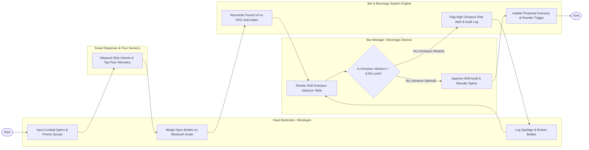

# Swimlane Diagram — Bar & Beverage Management System

## Mermaid Code

## Flow Description | Mo ta luong

| Lane | Actor | Role in Flow |
|------|-------|-------------|
| **Lane 1** | Head Bartender / Mixologist | Inputs cocktail recipes and syrup premixes, weighs open liquor bottles on Bluetooth scales at shift end, and logs spoilage or broken bottles. |
| **Lane 2** | Smart Dispenser & Pour Sensors | Measures real-time shot volumes and draft beer tap flow telemetry, broadcasting pour data to the central system. |
| **Lane 3** | Bar Manager / Beverage Director | Evaluates shift overpour variance tables, investigates poured vs sold discrepancies, approves shift stock audits, and reorders spirits. |
| **Lane 4** | Bar & Beverage System Engine | Reconciles poured milliliters against POS sold transactions, flags overpour red alerts, updates perpetual inventory, and triggers reorders. |

### Process Execution Steps | Cac buoc thuc hien quy trinh

1. **Recipe Setup & Telemetry Collection**: Bartender inputs cocktail specs (`C1`). Smart Dispenser sensors capture pour volume telemetry (`P1`). Bartender weighs open bottles on Bluetooth scales at shift end (`C2`).
2. **Reconciliation & Variance Evaluation**: Bar Engine compares total poured volume against POS sold transactions (`S1`). Bar Manager reviews overpour variance table (`A1`) and evaluates threshold (`A2`).
   - If **Yes (Overpour Breach > 8%)**: System flags high overpour red alert (`S2`). Bartender logs detailed spoilage and comp notes (`C3`) for manager re-audit (`A1`).
   - If **No (Variance Optimal)**: Manager approves shift audit (`A3`). System updates perpetual inventory and triggers supplier reorders (`S3`), completing execution (`Finish`).
