# Action Tree — Bar & Beverage Management System

## Mermaid Code

```mermaid
graph TD
    Root["Bar & Beverage Management System"]

    Root --> M1["Mixology & Cocktail Recipe Engineering"]
    Root --> M2["Smart Bottle & Draft Tap Telemetry"]
    Root --> M3["Overpour & POS Sales Reconciliation Audits"]
    Root --> M4["Wine Cellar & VIP Bottle Keep Lockers"]
    Root --> M5["Shift Stock Take & Keg Tracking"]
    Root --> M6["Distributor Procurement & Requisitions"]
    Root --> M7["Beverage Pour Cost & Margin Analytics"]

    M1 --> A11["Build Cocktail Spec Recipe BOMs"]
    M1 --> A12["Configure House Syrup & Premix Batches"]
    M1 --> A13["Set Glassware & Mixology Standards"]
    M1 --> A14["Configure Happy Hour Price Cards"]

    M2 --> A21["Weigh Open Bottles on Bluetooth Scales"]
    M2 --> A22["Ingest Smart Pour Meter Telemetry"]
    M2 --> A23["Monitor Draft Beer Tap Flow Meters"]
    M2 --> A24["Track Cellar Temperature & CO2 Pressure"]

    M3 --> A31["Reconcile Poured ml vs POS Sold Sales"]
    M3 --> A32["Flag Red Overpour & Giveaway Alerts"]
    M3 --> A33["Calculate Unaccounted Shrinkage Losses"]
    M3 --> A34["Audit Unmapped POS Drink Line Items"]

    M4 --> A41["Track Fine Wine Cellar Bin Locations"]
    M4 --> A42["Register Guest VIP Bottle Keep Lockers"]
    M4 --> A43["Track VIP Bottle Volume Redemptions"]
    M4 --> A44["Send Expiring Locker Storage SMS Alerts"]

    M5 --> A51["Conduct End-of-Shift Bar Stock Take"]
    M5 --> A52["Log Bottle Breakage & Spoilage"]
    M5 --> A53["Track Keg Tapping & Line Foam Loss"]
    M5 --> A54["Allocate Bartender Station Tip Pools"]

    M6 --> A61["Import Distributor Wholesale Price Lists"]
    M6 --> A62["Auto-Generate Spirits Purchase Orders"]
    M6 --> A63["Track Case Pack Sizes & Bottle Deposits"]
    M6 --> A64["Log Goods Receiving Rejections"]

    M7 --> A71["Monitor Beverage Pour Cost Percentage"]
    M7 --> A72["Compare Category Margins Spirits/Wine/Beer"]
    M7 --> A73["Export Bar Financial Profitability Reports"]
    M7 --> A74["Manage User Roles & Security Controls"]
```

## Module Description | Mo ta Module

| # | Module | Description | Actions |
|---|--------|-------------|---------|
| 1 | Mixology & Cocktail Recipe Engineering | Controls cocktail specification BOM creation, house-made syrup batching, glassware standards, and scheduled happy hour pricing rules. | Build Cocktail Spec Recipe BOMs, Configure House Syrup & Premix Batches, Set Glassware & Mixology Standards, Configure Happy Hour Price Cards |
| 2 | Smart Bottle & Draft Tap Telemetry | Ingests Bluetooth scale bottle weights, smart pour meter telemetry, draft beer tap flow telemetry, and wine cellar environmental sensor logs. | Weigh Open Bottles on Bluetooth Scales, Ingest Smart Pour Meter Telemetry, Monitor Draft Beer Tap Flow Meters, Track Cellar Temperature & CO2 Pressure |
| 3 | Overpour & POS Sales Reconciliation Audits | Reconciles physical poured volume against POS sold drinks, flags overpour and giveaway alerts, calculates monetary shrinkage loss, and audits unmapped items. | Reconcile Poured ml vs POS Sold Sales, Flag Red Overpour & Giveaway Alerts, Calculate Unaccounted Shrinkage Losses, Audit Unmapped POS Drink Line Items |
| 4 | Wine Cellar & VIP Bottle Keep Lockers | Manages wine cellar bin storage locations, guest-owned VIP bottle keep lockers, remaining liquid volume redemptions, and locker expiration reminders. | Track Fine Wine Cellar Bin Locations, Register Guest VIP Bottle Keep Lockers, Track VIP Bottle Volume Redemptions, Send Expiring Locker Storage SMS Alerts |
| 5 | Shift Stock Take & Keg Tracking | Handles end-of-shift bar stock counts, bottle breakage logs, draft beer keg tapping waste, and bartender station revenue/tip pool allocations. | Conduct End-of-Shift Bar Stock Take, Log Bottle Breakage & Spoilage, Track Keg Tapping & Line Foam Loss, Allocate Bartender Station Tip Pools |
| 6 | Distributor Procurement & Requisitions | Imports liquor distributor wholesale price lists, auto-generates spirit purchase requisitions, tracks case pack sizes, and records delivery rejections. | Import Distributor Wholesale Price Lists, Auto-Generate Spirits Purchase Orders, Track Case Pack Sizes & Bottle Deposits, Log Goods Receiving Rejections |
| 7 | Beverage Pour Cost & Margin Analytics | Provides executive dashboards on beverage pour cost percentages (target 18-22%), category gross margins, bar financial reports, and user access permissions. | Monitor Beverage Pour Cost Percentage, Compare Category Margins Spirits/Wine/Beer, Export Bar Financial Profitability Reports, Manage User Roles & Security Controls |
