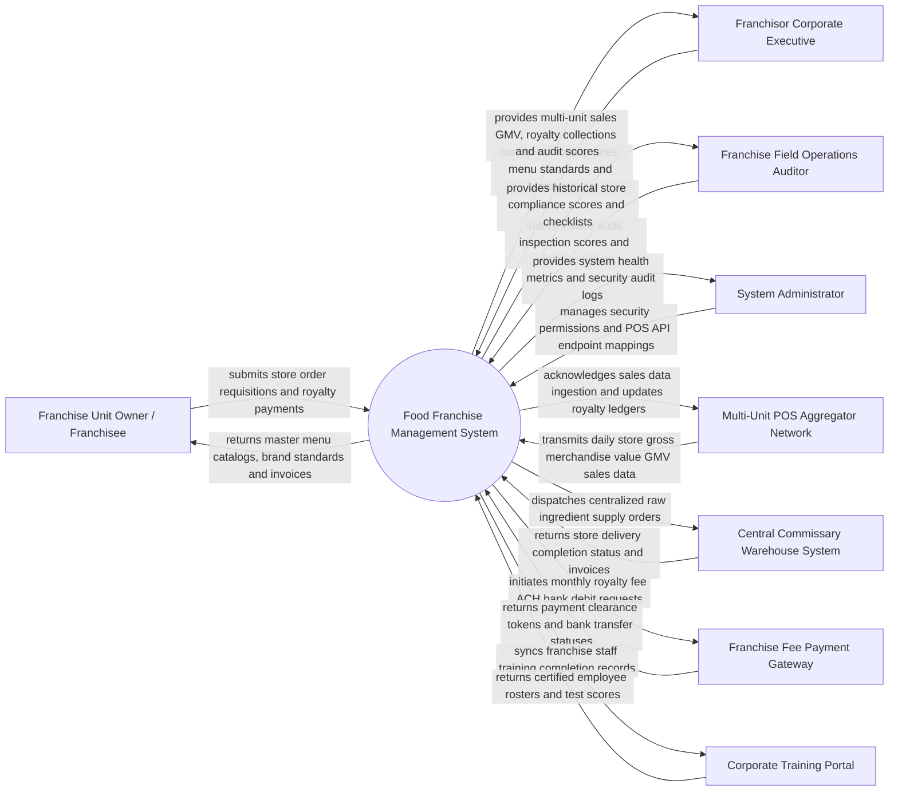

# Context Diagram — Food Franchise Management System

## Mermaid Code

## Actor & Interaction Table | Bang Actor & Tuong tac

| # | Actor | Actor Type | Data Sent TO System | Data Received FROM System | Notes |
|---|-------|------------|---------------------|---------------------------|-------|
| 1 | Franchise Unit Owner (Franchisee) | Primary | Central supply orders, monthly royalty payments, site opening progress, support tickets | Master brand catalogs, standardized recipe specs, royalty invoices, store benchmarks | Operates an individual or multi-unit franchise store location. |
| 2 | Franchisor Corporate Executive | Primary | Royalty percentage rates (e.g., 5% Sales + 2% Ad Fund), master menu updates, territory boundaries | Multi-unit network GMV sales, royalty fee collections, store audit rankings, renewal alerts | Oversees global or regional brand franchise network operations. |
| 3 | Field Operations Auditor | Primary | Digital store audit scores, brand standard violation citations, photo proof uploads | Historical store compliance scores, audit checklists, action plan tickets | Corporate field consultant auditing unit store operational quality. |
| 4 | System Administrator | Primary | User credentials, security roles, multi-unit POS API tokens, system parameters | Hardware health metrics, integration error logs, security audit logs | Manages cloud software infrastructure and corporate integration endpoints. |
| 5 | Multi-Unit POS Aggregator Network | Supporting | Real-time and daily store gross sales totals, transaction counts, item line sales | Sales ingestion acknowledgments, menu PLU updates, brand pricing syncs | Aggregates POS sales across hundreds of franchised store locations. |
| 6 | Central Commissary Warehouse | Supporting | Supply shipment delivery confirmations, wholesale ingredient invoices | Centralized store replenishment purchase requisitions, store addresses | Corporate-approved central warehouse supplying proprietary ingredients. |
| 7 | Franchise Fee Payment Gateway | Supporting | Bank ACH debit clearance tokens, payment failure notifications, wire confirmations | Monthly royalty fee auto-debit charge requests, initial franchise fee invoices | Financial provider clearing monthly royalty fee ACH bank drafts. |
| 8 | Corporate Training Portal | Supporting | Franchise staff course completion records, food safety exam scores, certified rosters | Staff training enrollment requests, role assignment updates | Learning Management System (LMS) verifying franchise staff certifications. |

## System Boundary Description | Mo ta Pham vi He thong

The **Food Franchise Management System** manages multi-unit food franchise network operations, corporate brand compliance, central supply chain requisitions, and automated royalty billing. Inside its boundary, the system handles new franchisee onboarding, territory zone protection mapping, master menu catalog distribution, automated monthly royalty/marketing fund calculations, field quality audit scoring, central commissary purchasing, and multi-unit sales benchmarking.

The system boundary excludes local front-of-house store customer billing (handled by local Store POS Systems), physical food preparation inside kitchens, raw credit card processing (handled by Payment Gateways), and physical construction of new store units.
