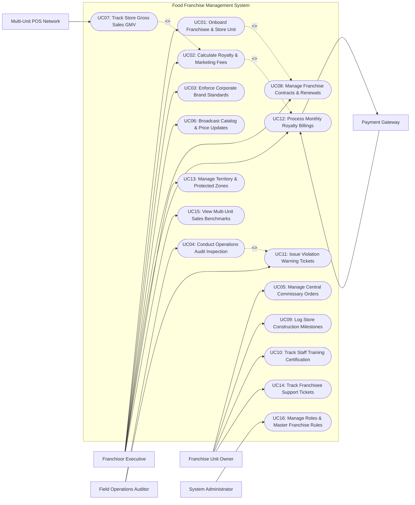

# Use Case Diagram — Food Franchise Management System

## Mermaid Code

## Actor Table | Bang Actor

| # | Actor | Actor Type | Role Description | Related Use Cases |
|---|-------|------------|------------------|-------------------|
| 1 | Multi-Unit POS Network | Secondary System | POS aggregator network sending daily sales transaction totals across all franchised store locations. | UC07 |
| 2 | Franchise Unit Owner | Primary | Franchisee operator running unit store locations, placing central supply orders, logging construction tasks, and opening support tickets. | UC05, UC09, UC10, UC14 |
| 3 | Field Operations Auditor | Primary | Corporate field consultant auditing unit store compliance, scoring cleanliness/quality, and issuing violation warning tickets. | UC04, UC11 |
| 4 | Franchisor Executive | Primary | Corporate brand executive onboarding franchisees, setting royalty fee percentage rates, enforcing master menu catalogs, and managing territory rights. | UC01, UC02, UC03, UC06, UC08, UC12, UC13, UC15 |
| 5 | Payment Gateway | Secondary System | Financial provider executing automated monthly ACH bank debits for royalty fees and marketing fund contributions. | UC12 |
| 6 | System Administrator | Primary | Technical manager configuring user security roles, POS API integration tokens, system parameter settings, and audit logs. | UC16 |

## Use Case Table | Bang Use Case

| # | UC ID | Use Case Name | Primary Actor | Secondary Actor | Description | Priority |
|---|-------|---------------|---------------|-----------------|-------------|----------|
| 1 | UC01 | Onboard Franchisee & Store Unit | Franchisor Executive | None | Registers new franchisee entity profiles, assigns unit store location IDs, uploads legal entity docs, and establishes territory boundaries. | High |
| 2 | UC02 | Calculate Royalty & Marketing Fees | Franchisor Executive | POS Network | Automatically calculates monthly royalty fees (e.g., 5% GMV) and ad fund fees (e.g., 2% GMV) based on ingested POS store sales. | High |
| 3 | UC03 | Enforce Corporate Brand Standards | Franchisor Executive | None | Mandates standardized master menu recipes, approved equipment lists, uniform specs, and brand operational guidelines across stores. | High |
| 4 | UC04 | Conduct Operations Audit Inspection | Field Auditor | None | Performs digital store quality inspections on mobile tablet, scoring food safety, cleanliness, service speed, and brand compliance. | High |
| 5 | UC05 | Manage Central Commissary Orders | Franchisee | None | Enables franchisees to place mandatory central supply orders for proprietary ingredients, packaging, and branded merchandise. | High |
| 6 | UC06 | Broadcast Catalog & Price Updates | Franchisor Executive | POS Network | Instantly pushes master menu updates, seasonal dish rollouts, ingredient spec changes, and price ceiling rules to all stores. | High |
| 7 | UC07 | Track Store Gross Sales GMV | System | POS Network | Ingests and aggregates daily gross merchandise value (GMV) sales data, transaction counts, and average check sizes across stores. | High |
| 8 | UC08 | Manage Franchise Contracts & Renewals | Franchisor Executive | None | Manages 5-10 year franchise agreement contracts, initial franchise fee payments, territory exclusivity clauses, and renewal deadlines. | High |
| 9 | UC09 | Log Store Construction Milestones | Franchisee | None | Tracks pre-opening store buildout progress (site selection, lease sign, architectural plan, equipment delivery, grand opening). | Medium |
| 10 | UC10 | Track Staff Training Certification | Franchisee | None | Verifies that unit store managers and kitchen staff complete mandatory corporate food safety and brand training courses. | Medium |
| 11 | UC11 | Issue Violation Warning Tickets | Field Auditor | None | Issues official non-compliance violation tickets (e.g., unapproved ingredient use, dirty kitchen), enforcing mandatory cure periods. | High |
| 12 | UC12 | Process Monthly Royalty Billings | Franchisor Executive | Payment Gateway | Generates monthly royalty invoices and executes automated ACH bank transfers from franchisee bank accounts to corporate. | High |
| 13 | UC13 | Manage Territory & Protected Zones | Franchisor Executive | None | Maps geographic exclusive territory boundaries (e.g., 3-mile radius protection) to prevent cannibalization between stores. | High |
| 14 | UC14 | Track Franchisee Support Tickets | Franchisee | None | Manages franchisee operational helpdesk tickets (equipment breakdown, POS glitch, supply delay) with SLA response tracking. | Medium |
| 15 | UC15 | View Multi-Unit Sales Benchmarks | Franchisor Executive | None | Generates analytical reports comparing store sales performance rankings, store profit margins, average check sizes, and growth trends. | High |
| 16 | UC16 | Manage Roles & Master Franchise Rules | System Admin | None | Configures security role permissions, master franchise agreement parameters, POS API endpoints, and system audit trails. | High |

## Use Case Specification | Dac ta Use Case

---

### UC01 — Onboard Franchisee & Store Unit

| Field | Detail |
|-------|--------|
| **UC ID** | UC01 |
| **Use Case Name** | Onboard Franchisee & Store Unit |
| **Actor(s)** | Primary: Franchisor Corporate Executive   Secondary: None |
| **Description** | Onboards a new franchisee business entity, registers new unit store locations, attaches legal franchise agreements, and defines assigned territory boundaries. |
| **Precondition** | 1. User is authenticated with Franchisor Executive privileges.   2. Franchise fee structure and legal contract templates are configured in system. |
| **Main Flow** | 1. Executive opens "Franchisee Onboarding Wizard" and selects "Create New Franchisee Profile".   2. Executive inputs Franchisee Legal Entity details: Company Name, Principal Owner Name, Tax ID, Corporate Address, Phone Number, and Primary Email.   3. Executive attaches executed Franchise Agreement contract document (executing UC08), specifying Initial Franchise Fee (e.g., $35,000), Royalty Rate (5.0%), Marketing Fund Rate (2.0%), and Contract Term (10 Years).   4. Executive registers unit store location: Store Name (e.g., Unit #108 - Downtown), Physical Address, GPS Coordinates, Target Opening Date, and Store Type (Drive-Thru, Food Court, In-Line).   5. Executive configures Protected Territory Zone (executing UC13) assigning a 3.0-mile exclusive radius around store location.   6. System generates unique Franchisee ID (e.g., FR-502) and Store Unit ID (e.g., STORE-108).   7. System sends welcome email and portal login activation link to Franchisee Owner.   8. System initializes Pre-Opening Construction Milestone Tracker (executing UC09). |
| **Alternative Flow** | **AF1** — Multi-Unit Developer Onboarding:   1. Executive onboards an Area Developer purchasing rights to open 5 stores in a region.   2. System creates 1 Franchisee Entity bound to 5 prospective Store Unit IDs with development schedule milestones. |
| **Exception Flow** | **EX1** — Territory overlap conflict:   1. At step 5, System detects proposed store address falls within an existing franchisee's protected 3-mile radius.   2. System flags territory boundary conflict error and blocks registration until territory encroachment waiver is uploaded. |
| **Postcondition** | Franchisee profile and store unit record are active, contract terms are bound, and portal access is granted. |
| **Business Rule** | **BR1**: Store unit IDs must be unique across the global franchise network and permanently bound to legal franchise agreements.   **BR2**: Initial franchise fee payments must be recorded as cleared before store construction milestones can be initiated. |

---

### UC02 — Calculate Royalty & Marketing Fees

| Field | Detail |
|-------|--------|
| **UC ID** | UC02 |
| **Use Case Name** | Calculate Royalty & Marketing Fees |
| **Actor(s)** | Primary: Franchisor Corporate Executive   Secondary: Multi-Unit POS Aggregator Network |
| **Description** | Automatically calculates monthly royalty fees and national marketing fund contributions for all franchised store units based on ingested POS gross sales (GMV) data. |
| **Precondition** | 1. Monthly store sales data is ingested from POS Network (UC07).   2. Store franchise agreement terms (Royalty % and Marketing Fund %) are active. |
| **Main Flow** | 1. System receives monthly POS gross sales payload for target billing cycle (e.g., Month of June) for Store Unit #108.   2. System retrieves verified Monthly Gross Merchandise Value (GMV) sales (e.g., $120,000.00 gross sales).   3. System checks franchise agreement contract terms for Store Unit #108: Royalty Fee Rate = 5.0%; Marketing Fund Rate = 2.0%; Technology License Fee = $250.00/month.   4. System calculates Royalty Fee Amount: `$120,000.00 GMV * 5.0% = $6,000.00`.   5. System calculates Marketing Fund Amount: `$120,000.00 GMV * 2.0% = $2,400.00`.   6. System calculates Total Monthly Fee Due: `$6,000.00 (Royalty) + $2,400.00 (Ad Fund) + $250.00 (Tech Fee) = $8,650.00`.   7. System populates itemized Monthly Royalty Billing Invoice (executing UC12).   8. System updates store financial ledger and dispatches invoice notification to Franchisee Owner. |
| **Alternative Flow** | **AF1** — Tiered royalty rate calculation:   1. Franchise agreement specifies tiered royalty (5% on first $100k sales; 4% on sales above $100k).   2. System calculates `$100k * 5% ($5,000) + $20k * 4% ($800) = $5,800 Royalty`. |
| **Exception Flow** | **EX1** — Unreported / Missing POS sales data:   1. Store Unit #108 fails to transmit POS sales data by the 5th of the month cutoff.   2. System calculates estimated sales based on historical 3-month average + 10% penalty fee, issuing an "Estimated Royalty Invoice" with audit flag. |
| **Postcondition** | Monthly royalty, ad fund, and tech fee totals are calculated and billing invoices are generated. |
| **Business Rule** | **BR1**: Royalty fees are calculated on Gross Sales minus local sales taxes; discounts or comps must be capped at 2% unless approved by corporate.   **BR2**: Fee calculations must execute automatically on the 1st business day following billing period close. |

---

### UC03 — Enforce Corporate Brand Standards

| Field | Detail |
|-------|--------|
| **UC ID** | UC03 |
| **Use Case Name** | Enforce Corporate Brand Standards |
| **Actor(s)** | Primary: Franchisor Corporate Executive   Secondary: None |
| **Description** | Mandates standardized master menu recipes, approved equipment vendor lists, uniform dress codes, and operational SOP guidelines across all franchised store units. |
| **Precondition** | 1. Corporate Brand Standards Repository is active.   2. Master menu recipes and supplier specs are configured. |
| **Main Flow** | 1. Corporate Executive opens "Brand Standards & Operational SOPs" management module.   2. Executive defines Master Menu Catalog specifications: Dish Names, Mandatory Ingredients, Approved Supplier Part Numbers, Standard Portion Sizes, and Maximum Retail Price (MRP) Ceilings.   3. Executive uploads Approved Vendor List (AVL) specifying required kitchen equipment models (e.g., Fryer Model X, Espresso Machine Y) and packaging specs.   4. Executive attaches digital Brand SOP Manual (Food Safety, Hospitality Service Steps, Uniform Code, Store Cleaning Schedules).   5. Executive clicks "Publish & Enforce Brand Standards".   6. System broadcasts updated brand standards to all franchisee portal accounts and syncs master menu catalogs directly to store POS systems (executing UC06).   7. System updates Field Operations Audit Checklists (UC04) to include new brand compliance items for upcoming auditor site visits. |
| **Alternative Flow** | **AF1** — Regional menu item exception approval:   1. Franchisee in Vietnam requests adding a regional dish ("Pho Beef Bowl") to menu.   2. Corporate Executive reviews recipe and approves "Regional Menu Addendum" for specific store units. |
| **Exception Flow** | **EX1** — Unapproved supplier ingredient detected during audit:   1. Field Auditor detects store is using unapproved local sauce instead of corporate commissary sauce.   2. System issues high-priority Brand Standard Violation Ticket (UC11). |
| **Postcondition** | Corporate brand standards, master menu specs, and approved vendor lists are published network-wide. |
| **Business Rule** | **BR1**: Franchisees are strictly prohibited from modifying core recipe BOMs or purchasing unapproved core ingredients from non-AVL vendors.   **BR2**: Master menu catalog updates broadcast by corporate must sync to unit store POS systems within 24 hours. |

---

### UC04 — Conduct Operations Audit Inspection

| Field | Detail |
|-------|--------|
| **UC ID** | UC04 |
| **Use Case Name** | Conduct Operations Audit Inspection |
| **Actor(s)** | Primary: Field Operations Auditor   Secondary: None |
| **Description** | Enables corporate field consultants to perform digital unannounced or scheduled store quality audits, evaluating food safety, brand cleanliness, service speed, and issuing compliance scores. |
| **Precondition** | 1. Auditor is authenticated on mobile tablet audit app.   2. Master Brand Standards audit checklist templates (UC03) are active. |
| **Main Flow** | 1. Field Auditor arrives at Store Unit #108 and opens "New Field Audit" on tablet app.   2. Auditor selects audit type: `Unannounced Quality Audit`, `Food Safety Check`, or `Grand Opening Evaluation`.   3. Auditor conducts site inspection walkthrough across sections:      - Section 1: Brand & Facility Image (Exterior signage, dining room cleanliness, uniform compliance).      - Section 2: Food Quality & Safety (HACCP temps, ingredient freshness, approved supplier check).      - Section 3: Speed of Service & Hospitality (Drive-thru SOS timer compliance, guest friendliness).      - Section 4: Equipment & Maintenance (Equipment cleanliness, calibration logs).   4. Auditor rates items: `Pass`, `Minor Deficiency`, or `Critical Brand Violation`.   5. For non-compliant items, Auditor takes photo proof using tablet camera, enters corrective notes, and assigns a 14-day cure deadline.   6. System calculates Overall Audit Score (e.g., 94% - Grade A).   7. Auditor and Franchisee Store Manager review findings on screen and sign digital signature block.   8. System publishes audit report, notifies Corporate Executive, and generates Non-Compliance Violation Tickets if critical flaws exist (executing UC11). |
| **Alternative Flow** | **AF1** — Failed audit re-inspection trigger:   1. Store scores 68% (Below 75% Passing Threshold).   2. System flags store status as `Audit Failed / Probation` and automatically schedules mandatory 30-day follow-up re-inspection. |
| **Exception Flow** | **EX1** — Immediate health hazard shutdown:   1. Auditor discovers severe food safety violation (e.g., active pest infestation or no hot water).   2. Auditor taps "Emergency Closure Order"; System alerts Corporate Vice President and issues immediate store suspension order. |
| **Postcondition** | Store audit inspection report is scored, photo evidence is archived, and corrective action tickets are dispatched. |
| **Business Rule** | **BR1**: Stores receiving an audit score below 75% must be placed on 60-day operational probation and undergo mandatory re-inspection.   **BR2**: Audit reports signed by store managers serve as binding legal evidence for franchise agreement compliance enforcement. |

---

### UC12 — Process Monthly Royalty Billings

| Field | Detail |
|-------|--------|
| **UC ID** | UC12 |
| **Use Case Name** | Process Monthly Royalty Billings |
| **Actor(s)** | Primary: Franchisor Corporate Executive   Secondary: Payment Gateway |
| **Description** | Generates monthly royalty invoices and executes automated ACH bank transfers from franchisee corporate bank accounts to franchisor accounts on scheduled billing dates. |
| **Precondition** | 1. Monthly royalty fee calculation (UC02) is completed for all store units.   2. Franchisee pre-authorized ACH bank draft agreements are registered. |
| **Main Flow** | 1. System initiates automated monthly royalty billing batch execution on the 10th day of the month.   2. System compiles itemized invoice for each franchisee (e.g., Franchisee FR-502 / Store Unit #108):      - Royalty Fee (5% of GMV): $6,000.00      - National Ad Fund (2% of GMV): $2,400.00      - Tech & POS License Fee: $250.00      - Total Amount Due: $8,650.00   3. System formats electronic invoice PDF and dispatches billing email to Franchisee.   4. System serializes pre-authorized ACH bank debit request payload (Routing Number, Account Number, Amount $8,650.00).   5. System transmits payment request to Franchise Fee Payment Gateway.   6. Payment Gateway processes ACH bank draft and returns HTTP 200 Transaction Authorization Code.   7. System marks invoice status `Paid / Settled`, updates corporate general ledger, and issues payment receipt to Franchisee. |
| **Alternative Flow** | **AF1** — Manual wire transfer payment:   1. Franchisee pays via manual bank wire transfer instead of automated ACH.   2. Corporate Accountant verifies wire receipt and manually marks invoice status `Paid via Wire`. |
| **Exception Flow** | **EX1** — ACH bank debit returned for Insufficient Funds (NSF):   1. At step 6, Payment Gateway returns ACH Error Code R01 (`Insufficient Funds / NSF`).   2. System updates invoice status to `Payment Default / Overdue`, applies $50.00 NSF late fee, and dispatches urgent payment demand alert to Franchisee and Corporate Legal. |
| **Postcondition** | Monthly royalty invoice is settled via ACH debit or flagged overdue, and corporate accounting ledger is updated. |
| **Business Rule** | **BR1**: Pre-authorized ACH bank drafts for royalty fees must process on the 10th calendar day of each month.   **BR2**: Invoices remaining unpaid past 15 days incur a 1.5% monthly late interest penalty and trigger default warning notices. |
