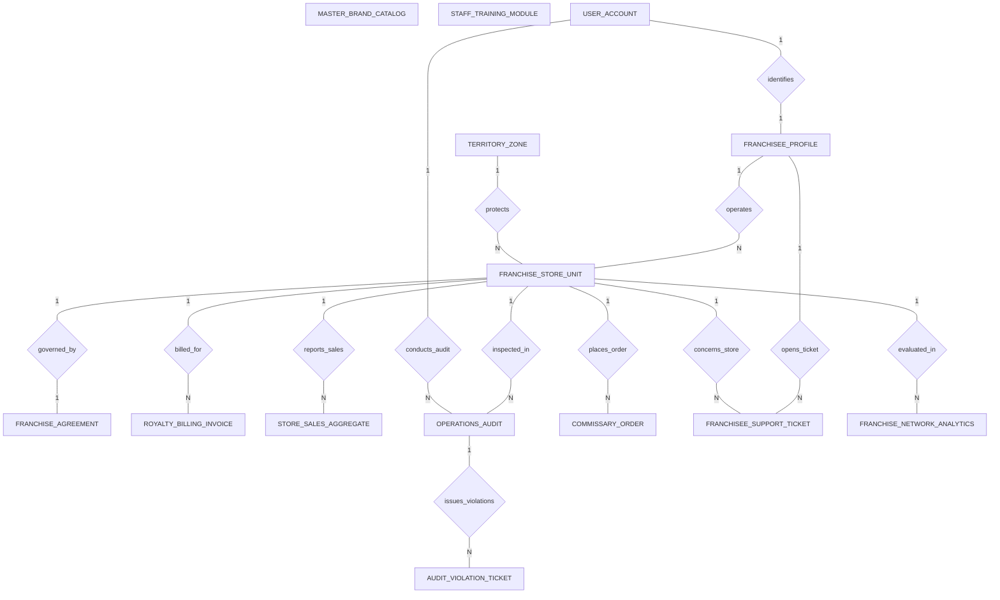

# Conceptual ERD — Food Franchise Management System

## Mermaid Code

## Entity Description Table | Bang mo ta Entity

| # | Entity Name | Vietnamese Name | Description | Key Attributes | Main Relationships |
|---|-------------|-----------------|-------------|----------------|-------------------|
| 1 | FRANCHISEE_PROFILE | Ho so Bên nhuong quyen | Profile of the franchisee corporate entity or principal owner operating one or more unit stores. | franchisee_id, user_id, company_name, principal_owner_name, tax_id, email | Belongs to USER_ACCOUNT; One-to-Many with FRANCHISE_STORE_UNIT, FRANCHISEE_SUPPORT_TICKET |
| 2 | FRANCHISE_STORE_UNIT | Cua hang thanh vien | Registered unit store location in the franchise network, store code, address, status, and opening date. | store_id, franchisee_id, territory_id, store_code, store_name, store_status | Belongs to FRANCHISEE_PROFILE, TERRITORY_ZONE; One-to-One with FRANCHISE_AGREEMENT; One-to-Many with ROYALTY_BILLING_INVOICE, STORE_SALES_AGGREGATE, OPERATIONS_AUDIT, COMMISSARY_ORDER, FRANCHISEE_SUPPORT_TICKET |
| 3 | FRANCHISE_AGREEMENT | Hop dong nhuong quyen | Legal franchise agreement contract detailing initial franchise fee, royalty %, ad fund %, start/expiry dates. | agreement_id, store_id, initial_fee, royalty_percent, ad_fund_percent, start_date, expiry_date | One-to-One with FRANCHISE_STORE_UNIT |
| 4 | ROYALTY_BILLING_INVOICE | Hoa don phi nhuong quyen | Monthly royalty fee billing invoice detailing gross sales (GMV), royalty fee, ad fund fee, and payment status. | invoice_id, store_id, billing_period_start, gross_sales_gmv, royalty_amount, payment_status | Belongs to FRANCHISE_STORE_UNIT |
| 5 | MASTER_BRAND_CATALOG | Danh muc thuc don nhan hieu | Master corporate brand menu catalog listing mandatory dishes, ingredient specs, and maximum retail prices. | item_id, item_code, item_name, category, max_retail_price, is_mandatory | Network master catalog |
| 6 | STORE_SALES_AGGREGATE | Tong hop doanh so cua hang | Daily and monthly gross merchandise value (GMV) sales aggregate ingested from unit store POS systems. | sales_id, store_id, sales_date, daily_gross_sales, total_transaction_count, average_check_size | Belongs to FRANCHISE_STORE_UNIT |
| 7 | OPERATIONS_AUDIT | Kiem tra van hanh cua hang | Field quality audit inspection record storing auditor ID, overall score percentage, letter grade, and audit date. | audit_id, store_id, auditor_user_id, audit_date, audit_score_percent, letter_grade | Belongs to FRANCHISE_STORE_UNIT, USER_ACCOUNT; One-to-Many with AUDIT_VIOLATION_TICKET |
| 8 | AUDIT_VIOLATION_TICKET | Phieu vi pham chuan nhan hieu | Specific non-compliance violation ticket issued during an audit, violation category, cure deadline, and status. | ticket_id, audit_id, violation_category, description, cure_deadline, violation_status | Belongs to OPERATIONS_AUDIT |
| 9 | COMMISSARY_ORDER | Don hang kho trung tam | Central supply chain order placed by franchisee for mandatory proprietary ingredients and branded packaging. | order_id, store_id, order_date, total_order_cost, delivery_status | Belongs to FRANCHISE_STORE_UNIT |
| 10 | TERRITORY_ZONE | Vung lanh tho nhuong quyen | Protected geographic territory zone mapping exclusive mile radius boundaries around a franchised unit store. | territory_id, zone_code, zone_name, protected_radius_miles | One-to-Many with FRANCHISE_STORE_UNIT |
| 11 | STAFF_TRAINING_MODULE | Module dao tao nhan vien | Corporate staff training course module, target roles, passing score percentage, and mandatory completion rules. | module_id, module_title, role_target, passing_score_percent, is_mandatory | Network training module |
| 12 | FRANCHISEE_SUPPORT_TICKET | Phieu ho tro franchisee | Operational helpdesk support ticket submitted by franchisee for POS, equipment, or supply chain assistance. | support_id, franchisee_id, store_id, subject, priority_level, ticket_status | Belongs to FRANCHISEE_PROFILE, FRANCHISE_STORE_UNIT |
| 13 | USER_ACCOUNT | Tai khoan he thong | Core security authentication account holding credentials, password hashes, and user role definitions. | user_id, username, password_hash, role_name | One-to-One with FRANCHISEE_PROFILE; One-to-Many with OPERATIONS_AUDIT |
| 14 | FRANCHISE_NETWORK_ANALYTICS | Thong ke toan chuoi nhuong quyen | Network-wide executive analytics tracking active stores, total network GMV, royalty collections, and average audit scores. | analytics_id, metric_date, total_active_stores, total_network_gmv, total_royalty_collected | Evaluates FRANCHISE_STORE_UNIT |

## Relationship Description | Mo ta Quan he

| # | From Entity | Cardinality | To Entity | Relationship Label | Business Explanation |
|---|-------------|-------------|-----------|-------------------|----------------------|
| 1 | USER_ACCOUNT | One-to-One | FRANCHISEE_PROFILE | identifies | Tai khoan he thong xac thuc ho so chu so huu nhuong quyen. |
| 2 | FRANCHISEE_PROFILE | One-to-Many | FRANCHISE_STORE_UNIT | operates | Mot nha nhuong quyen co the van hanh nhieu cua hang thanh vien. |
| 3 | TERRITORY_ZONE | One-to-Many | FRANCHISE_STORE_UNIT | protects | Mot vung lanh tho doc quyen bao ve pham vi hoat dong cua cua hang nhuong quyen. |
| 4 | FRANCHISE_STORE_UNIT | One-to-One | FRANCHISE_AGREEMENT | governed_by | Mot cua hang thanh vien duoc quan ly bang mot hop dong nhuong quyen phap ly. |
| 5 | FRANCHISE_STORE_UNIT | One-to-Many | ROYALTY_BILLING_INVOICE | billed_for | Mot cua hang thanh vien nhan hoa don phi nhuong quyen va phi marketing hang thang. |
| 6 | FRANCHISE_STORE_UNIT | One-to-Many | STORE_SALES_AGGREGATE | reports_sales | Mot cua hang thanh vien bao cao doanh so GMV hang ngay tu he thong POS. |
| 7 | FRANCHISE_STORE_UNIT | One-to-Many | OPERATIONS_AUDIT | inspected_in | Mot cua hang thanh vien duoc kiem tra danh gia chat luong van hanh dinh ky. |
| 8 | OPERATIONS_AUDIT | One-to-Many | AUDIT_VIOLATION_TICKET | issues_violations | Ca kiem tra phat hien vi pham phat hanh cac phieu canh bao vi pham chuan nhan hieu. |
| 9 | FRANCHISE_STORE_UNIT | One-to-Many | COMMISSARY_ORDER | places_order | Mot cua hang thanh vien dat hang nguyen lieu tu kho cung ung trung tam. |
| 10 | FRANCHISEE_PROFILE | One-to-Many | FRANCHISEE_SUPPORT_TICKET | opens_ticket | Mot franchisee gui cac phieu yeu cau ho tro ky thuat va van hanh len tong cong ty. |
| 11 | USER_ACCOUNT | One-to-Many | OPERATIONS_AUDIT | conducts_audit | Chuyen vien kiem sot chat luong thuc hien cac ca kiem tra tai cua hang. |
