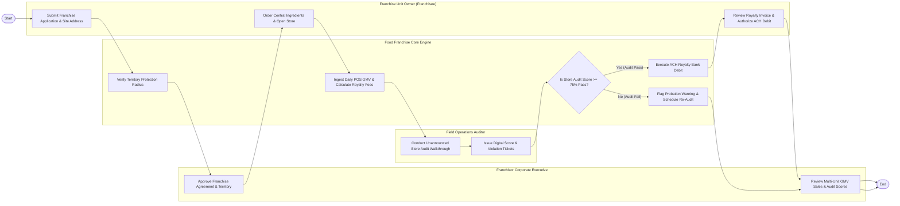

# Swimlane Diagram — Food Franchise Management System

## Mermaid Code

## Flow Description | Mo ta luong

| Lane | Actor | Role in Flow |
|------|-------|-------------|
| **Lane 1** | Franchise Unit Owner | Submits franchisee onboarding applications, orders mandatory proprietary ingredients from central commissary, opens store unit, and approves monthly royalty invoices. |
| **Lane 2** | Field Operations Auditor | Performs unannounced digital store quality audits, captures photo proof of violations, scores compliance, and issues non-compliance warning tickets. |
| **Lane 3** | Franchisor Corporate Executive | Approves franchisee legal agreements and protected territory boundaries, enforces brand standards, and monitors multi-unit network sales GMV. |
| **Lane 4** | Food Franchise Core Engine | Verifies territory 3-mile radius protection, ingests daily store POS sales data, calculates monthly royalty fees (5% GMV), and executes automated ACH bank debits. |

### Process Execution Steps | Cac buoc thuc hien quy trinh

1. **Onboarding & Territory Verification**: Franchisee submits application (`C1`). Core Engine verifies protected territory radius (`S1`). Corporate Executive approves franchise agreement (`M1`).
2. **Store Opening & Sales Tracking**: Franchisee orders central supply ingredients and opens store (`C2`). Core Engine ingests daily POS sales GMV and calculates monthly royalty fees (`S2`).
3. **Quality Audit Inspection**: Field Auditor conducts site quality audit (`A1`) and inputs scores (`A2`). Core Engine evaluates compliance (`S3`).
   - If **Yes (Audit Pass >= 75%)**: Core Engine executes automated monthly ACH royalty debit (`S4`). Franchisee reviews invoice (`C3`), and Corporate Executive reviews network performance analytics (`M2`), completing execution (`Finish`).
   - If **No (Audit Fail < 75%)**: Core Engine flags probation warning and schedules mandatory 30-day re-inspection (`S5`), completing audit cycle (`Finish`).
