# Action Tree — Food Franchise Management System

## Mermaid Code

```mermaid
graph TD
    Root["Food Franchise Management System"]

    Root --> M1["Franchise Onboarding & Territory Licensing"]
    Root --> M2["Royalty Fee Calculation & Automated Billing"]
    Root --> M3["Brand Standards & Master Catalog Distribution"]
    Root --> M4["Quality Audits & Compliance Enforcement"]
    Root --> M5["Central Supply Chain & Requisition Management"]
    Root --> M6["Staff Training & Franchisee Support Portal"]
    Root --> M7["Franchise Benchmarking & Corporate Analytics"]

    M1 --> A11["Onboard New Franchisee Profiles"]
    M1 --> A12["Register Unit Store Locations"]
    M1 --> A13["Manage Franchise Agreement Contracts"]
    M1 --> A14["Map Protected Territory Zones"]

    M2 --> A21["Ingest POS Store Gross Sales GMV"]
    M2 --> A22["Calculate Monthly Royalty & Ad Fund Fees"]
    M2 --> A23["Generate Itemized Royalty Invoices"]
    M2 --> A24["Execute Automated ACH Bank Debits"]

    M3 --> A31["Configure Master Menu Catalogs"]
    M3 --> A32["Set Recipe BOM & Portion Standards"]
    M3 --> A33["Manage Approved Vendor Lists AVL"]
    M3 --> A34["Broadcast Price Updates to Store POS"]

    M4 --> A41["Execute Mobile Store Quality Audits"]
    M4 --> A42["Capture Photo Proof of Violations"]
    M4 --> A43["Issue Non-Compliance Warning Tickets"]
    M4 --> A44["Schedule Re-Inspection Audits"]

    M5 --> A51["Process Central Commissary Store Orders"]
    M5 --> A52["Manage Proprietary Ingredient Supplies"]
    M5 --> A53["Track Shipment Delivery Status"]
    M5 --> A54["Audit Store Order Compliance"]

    M6 --> A61["Enroll Franchise Staff in LMS Courses"]
    M6 --> A62["Verify Food Safety Certifications"]
    M6 --> A63["Manage Franchisee Support Tickets"]
    M6 --> A64["Track Store Pre-Opening Milestones"]

    M7 --> A71["Compare Multi-Unit Sales Rankings"]
    M7 --> A72["Monitor Network Royalty Collection Rates"]
    M7 --> A73["Analyze Store Audit Performance Heatmaps"]
    M7 --> A74["Export Corporate Franchise Tax Reports"]
```

## Module Description | Mo ta Module

| # | Module | Description | Actions |
|---|--------|-------------|---------|
| 1 | Franchise Onboarding & Territory Licensing | Manages franchisee entity onboarding, store unit registrations, legal agreement contracts, and protected 3-mile territory zone mapping. | Onboard New Franchisee Profiles, Register Unit Store Locations, Manage Franchise Agreement Contracts, Map Protected Territory Zones |
| 2 | Royalty Fee Calculation & Automated Billing | Ingests daily store POS gross sales (GMV), calculates monthly royalty (5%) and ad fund (2%) fees, issues invoices, and executes ACH bank debits. | Ingest POS Store Gross Sales GMV, Calculate Monthly Royalty & Ad Fund Fees, Generate Itemized Royalty Invoices, Execute Automated ACH Bank Debits |
| 3 | Brand Standards & Master Catalog Distribution | Configures corporate master menu catalogs, recipe portion standards, approved vendor lists (AVL), and broadcasts catalog/price updates to store POS systems. | Configure Master Menu Catalogs, Set Recipe BOM & Portion Standards, Manage Approved Vendor Lists AVL, Broadcast Price Updates to Store POS |
| 4 | Quality Audits & Compliance Enforcement | Enables mobile store quality inspections, photo evidence capturing, non-compliance violation tickets, and mandatory re-inspection scheduling. | Execute Mobile Store Quality Audits, Capture Photo Proof of Violations, Issue Non-Compliance Warning Tickets, Schedule Re-Inspection Audits |
| 5 | Central Supply Chain & Requisition Management | Manages central commissary purchase orders for proprietary ingredients, tracks shipment delivery statuses, and audits store order compliance. | Process Central Commissary Store Orders, Manage Proprietary Ingredient Supplies, Track Shipment Delivery Status, Audit Store Order Compliance |
| 6 | Staff Training & Franchisee Support Portal | Enrolls store staff in corporate LMS training courses, verifies food safety certifications, manages franchisee support tickets, and tracks store buildout milestones. | Enroll Franchise Staff in LMS Courses, Verify Food Safety Certifications, Manage Franchisee Support Tickets, Track Store Pre-Opening Milestones |
| 7 | Franchise Benchmarking & Corporate Analytics | Provides executive reporting on store sales GMV rankings, royalty collection rates, audit score heatmaps, and corporate franchise tax reports. | Compare Multi-Unit Sales Rankings, Monitor Network Royalty Collection Rates, Analyze Store Audit Performance Heatmaps, Export Corporate Franchise Tax Reports |
