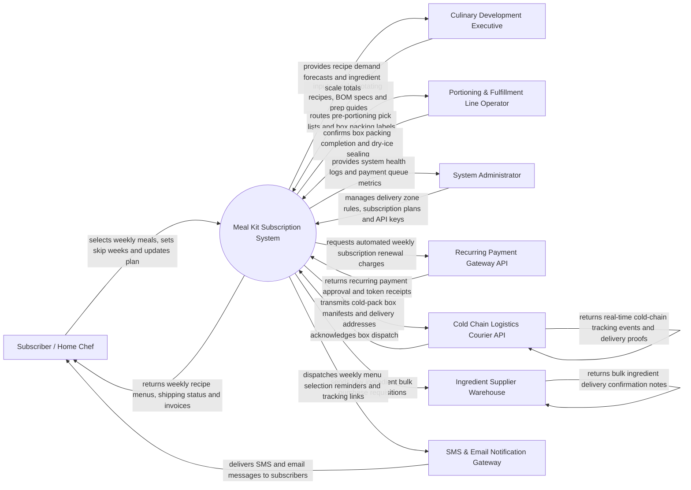

# Context Diagram — Meal Kit Subscription System

## Mermaid Code

## Actor & Interaction Table | Bang Actor & Tuong tac

| # | Actor | Actor Type | Data Sent TO System | Data Received FROM System | Notes |
|---|-------|------------|---------------------|---------------------------|-------|
| 1 | Subscriber / Home Chef | Primary | Weekly meal recipe selections, serving count changes, skip-week requests, delivery address, dietary tags | Weekly rotating menu catalog, order confirmations, tracking numbers, recipe step cards | Manages personal meal kit subscription via web or mobile app. |
| 2 | Culinary Development Executive | Primary | Weekly rotating recipe menus, ingredient portion Bill of Materials (BOM), step-by-step cooking instructions, allergen tags | Recipe popularity rankings, raw ingredient demand forecasts, ingredient cost analysis | Designs chef-curated weekly meal kit recipes and portion specs. |
| 3 | Portioning & Fulfillment Operator | Primary | Pre-portioning status updates, box packing completion confirmations, dry-ice gel pack verifications | Automated ingredient pick lists, color-coded pouch labels, box packing manifests | Operates automated or manual ingredient pre-portioning and box assembly lines. |
| 4 | System Administrator | Primary | User credentials, security roles, delivery ZIP code cutoff schedules, payment gateway tokens | System logs, batch billing queues, API integration health dashboards | Manages cloud platform infrastructure, delivery schedules, and security. |
| 5 | Recurring Payment Gateway API | Supporting | Recurring charge clearance tokens, credit card expiration alerts, ACH payment approvals | Automated weekly subscription charge requests, retry attempts, refund instructions | Processes weekly recurring subscription credit card and ACH debits. |
| 6 | Cold Chain Logistics Courier API | Supporting | Real-time box delivery tracking status, temperature sensor alerts, delivery proof photos | Shipping manifests, cold-pack box pickup requests, recipient address records | Specialized refrigerated or insulated courier service (e.g., FedEx, Cold Express). |
| 7 | Ingredient Supplier Warehouse | Supporting | Bulk ingredient shipment delivery notes, lot numbers, wholesale market costs | Weekly aggregated raw ingredient bulk purchase requisitions | Supplies raw fresh produce, proteins, and spice packs to fulfillment hub. |
| 8 | SMS & Email Notification Gateway | Supporting | Message delivery receipts, bounce notifications | Weekly menu selection reminders, order cutoff warnings, delivery tracking links | Sends automated transactional SMS and email notifications to subscribers. |

## System Boundary Description | Mo ta Pham vi He thong

The **Meal Kit Subscription System** automates recurring weekly meal kit planning, recipe selection, pre-portioned ingredient fulfillment, and cold-pack shipping logistics. Inside its boundary, the system handles subscriber plan management (weekly meal choices, skip-week scheduling, plan pausing), automated weekly recurring billing execution, raw ingredient demand forecasting, fulfillment line pick list generation, dry-ice insulated box packing workflows, and cold-chain courier tracking integration.

The system boundary excludes physical cooking of meals by subscribers at home, physical bulk produce harvesting (handled by farms/suppliers), raw credit card clearing execution (handled by Payment Gateways), and physical courier truck driving.
