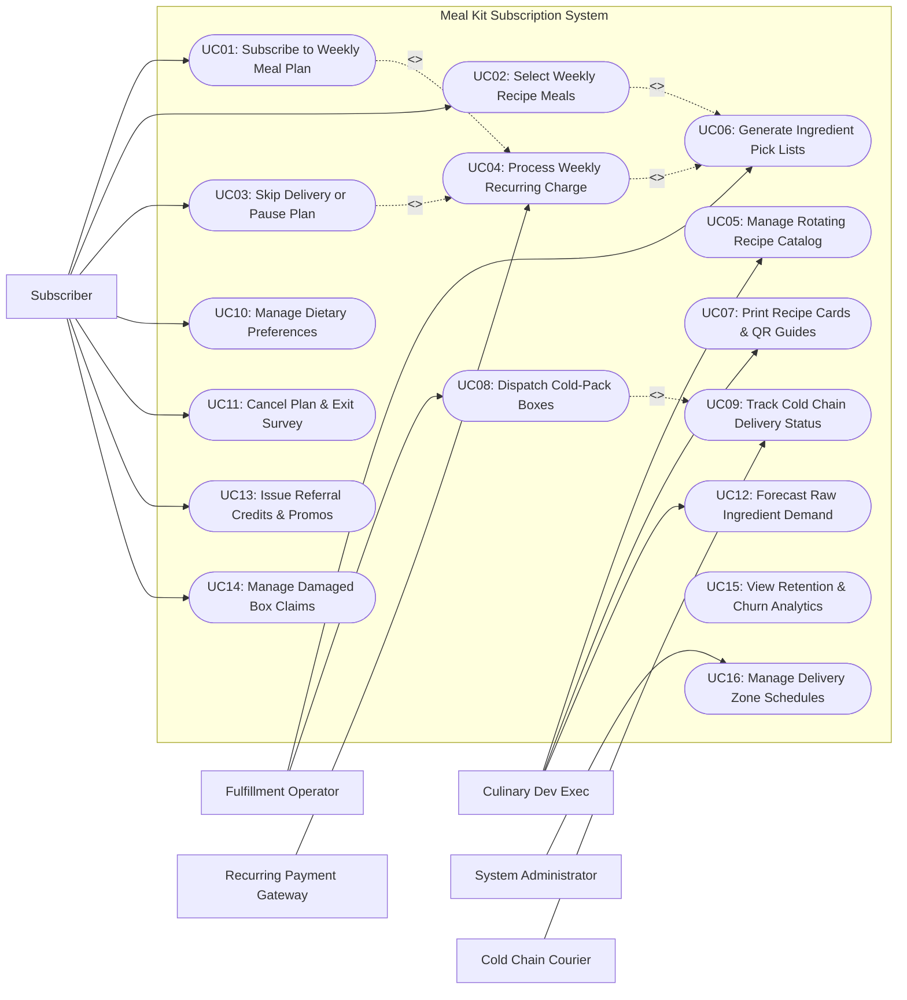

# Use Case Diagram — Meal Kit Subscription System

## Mermaid Code

## Actor Table | Bang Actor

| # | Actor | Actor Type | Role Description | Related Use Cases |
|---|-------|------------|------------------|-------------------|
| 1 | Subscriber | Primary | Home chef customer who chooses meal plan packages, selects weekly recipes, manages skip weeks, and receives cold-pack boxes. | UC01, UC02, UC03, UC10, UC11, UC13, UC14 |
| 2 | Culinary Dev Exec | Primary | Chef lead designing weekly rotating recipe catalogs, portion Bill of Materials (BOM), step-by-step instruction guides, and ingredient forecasts. | UC05, UC07, UC12 |
| 3 | Fulfillment Operator | Primary | Warehouse packing staff managing pre-portioning lines, ingredient pick lists, dry-ice gel pack assembly, and shipping box manifests. | UC06, UC08 |
| 4 | Cold Chain Courier | Secondary System | Third-party refrigerated logistics provider transmitting real-time box delivery tracking and temperature sensor data. | UC09 |
| 5 | Recurring Payment Gateway | Secondary System | Financial payment provider executing automated weekly subscription credit card charges and recurring billing renewals. | UC04 |
| 6 | System Administrator | Primary | Technical manager configuring delivery ZIP code schedules, user security roles, cutoff deadlines, and system parameters. | UC16 |

## Use Case Table | Bang Use Case

| # | UC ID | Use Case Name | Primary Actor | Secondary Actor | Description | Priority |
|---|-------|---------------|---------------|-----------------|-------------|----------|
| 1 | UC01 | Subscribe to Weekly Meal Plan | Subscriber | Payment Gateway | Registers new subscriber account, selects meal plan tier (2-person vs 4-person; 3-5 meals/week), and authorizes payment. | High |
| 2 | UC02 | Select Weekly Recipe Meals | Subscriber | None | Allows subscribers to browse weekly rotating menu (15-20 options) and select preferred recipes before weekly cutoff deadline. | High |
| 3 | UC03 | Skip Delivery or Pause Plan | Subscriber | None | Enables subscribers to skip specific weekly box deliveries or pause subscription for up to 8 weeks with no financial charge. | High |
| 4 | UC04 | Process Weekly Recurring Charge | System | Payment Gateway | Automatically charges subscriber credit cards weekly on designated cutoff days (e.g., Wednesday midnight) for upcoming box shipments. | High |
| 5 | UC05 | Manage Rotating Recipe Catalog | Culinary Dev Exec | None | Configures weekly rotating recipe menus 6-8 weeks in advance, defining portion weights, prep times, and allergen tags. | High |
| 6 | UC06 | Generate Ingredient Pick Lists | Fulfillment Op | None | Calculates aggregated raw ingredient pre-portioning weights and generates barcode pick lists for warehouse packing lines. | High |
| 7 | UC07 | Print Recipe Cards & QR Guides | Culinary Dev Exec | None | Generates high-resolution full-color step-by-step recipe instruction cards and digital QR video cooking guides. | Medium |
| 8 | UC08 | Dispatch Cold-Pack Boxes | Fulfillment Op | Cold Chain Courier | Packs pre-portioned ingredient pouches into insulated foil boxes with calculated dry-ice gel packs, affixing courier labels. | High |
| 9 | UC09 | Track Cold Chain Delivery Status | Cold Chain Courier | None | Ingests real-time shipment GPS tracking points, transit temperature sensor logs, and delivery proof photos. | High |
| 10 | UC10 | Manage Dietary Preferences | Subscriber | None | Configures dietary filter preferences (Keto, Vegetarian, Calorie Smart, Pescatarian) and excludes specific allergen ingredients. | High |
| 11 | UC11 | Cancel Plan & Exit Survey | Subscriber | None | Processes subscription cancellation requests, prompts mandatory exit feedback surveys, and offers retention discounts. | Medium |
| 12 | UC12 | Forecast Raw Ingredient Demand | Culinary Dev Exec | None | Predicts total bulk ingredient purchase quantities required for upcoming menu weeks based on active subscriber counts and choices. | High |
| 13 | UC13 | Issue Referral Credits & Promos | Subscriber | None | Generates subscriber referral codes, awarding $20 billing credits to both referrer and referee upon first box shipment. | Medium |
| 14 | UC14 | Manage Damaged Box Claims | Subscriber | None | Captures missing ingredient or damaged package claims, issuing instant automated billing credits or replacement box shipments. | Medium |
| 15 | UC15 | View Retention & Churn Analytics | System Admin | None | Generates analytical reports on subscriber retention cohorts, weekly churn rates, recipe popularity rankings, and customer LTV. | High |
| 16 | UC16 | Manage Delivery Zone Schedules | System Admin | None | Configures regional delivery ZIP code cutoff schedules, courier dispatch windows, shipping fees, and security permissions. | High |

## Use Case Specification | Dac ta Use Case

---

### UC01 — Subscribe to Weekly Meal Plan

| Field | Detail |
|-------|--------|
| **UC ID** | UC01 |
| **Use Case Name** | Subscribe to Weekly Meal Plan |
| **Actor(s)** | Primary: Subscriber / Home Chef   Secondary: Recurring Payment Gateway API |
| **Description** | Enrolls a new customer into a recurring weekly meal kit subscription plan, allowing them to select plan size, serving counts, delivery day, and authorize recurring credit card billing. |
| **Precondition** | 1. Customer accesses meal kit web portal or mobile app.   2. Payment Gateway is online and configured for recurring subscription tokens. |
| **Main Flow** | 1. Customer accesses sign-up flow and inputs delivery ZIP Code.   2. System validates ZIP code against regional delivery zone coverage (UC16) and displays available delivery days (e.g., Tuesday or Thursday).   3. Customer selects Dietary Preference (e.g., Chef's Choice, Veggie, Low Calorie, Family Friendly).   4. Customer selects Plan Box Size: Number of People (2-Person vs 4-Person) and Meals Per Week (3, 4, or 5 meals/week).   5. System displays base plan pricing (e.g., 2-Person / 3-Meals = $59.94/week + $9.99 shipping).   6. Customer creates account credentials (Email, Password) and enters shipping address.   7. Customer inputs Credit Card payment details and authorizes recurring weekly billing subscription.   8. System sends payment token request to Payment Gateway.   9. Payment Gateway authorizes initial charge (or $0 auth token check) and returns subscription token.   10. System creates Subscriber Account record, locks delivery day, and redirects customer to select their first week's meal recipes (UC02). |
| **Alternative Flow** | **AF1** — Promotional discount code signup:   1. Customer applies promo code "SAVE60" (e.g., $20 off first 3 boxes).   2. System applies discount schedule to subscription account and displays modified initial invoice. |
| **Exception Flow** | **EX1** — Delivery ZIP Code out of coverage:   1. At step 2, Customer enters a ZIP code outside courier delivery zones.   2. System displays alert "We don't deliver to your area yet!", prompts customer to join waitlist email list, and halts signup. |
| **Postcondition** | Active subscriber account is created, recurring payment token is bound, and first week meal selection is initialized. |
| **Business Rule** | **BR1**: Subscriptions are recurring weekly contracts that automatically bill subscribers on designated weekly cutoff days unless skipped or canceled.   **BR2**: First box shipments include mandatory welcome recipe cards and insulated cold-pack storage guides. |

---

### UC02 — Select Weekly Recipe Meals

| Field | Detail |
|-------|--------|
| **UC ID** | UC02 |
| **Use Case Name** | Select Weekly Recipe Meals |
| **Actor(s)** | Primary: Subscriber / Home Chef   Secondary: None |
| **Description** | Allows subscribers to browse the weekly rotating recipe catalog (15-20 options) and select their preferred meal kit choices before the weekly order cutoff deadline. |
| **Precondition** | 1. Subscriber has an active subscription account.   2. Weekly rotating recipe menu catalog (UC05) for target delivery week is published. |
| **Main Flow** | 1. Subscriber opens "My Weekly Menu" on mobile app or web portal for upcoming delivery week (e.g., Week of August 10).   2. System displays weekly order cutoff countdown timer (e.g., "Order locks in 2 days, 14 hours").   3. System renders pre-selected default meals based on subscriber's dietary preferences (e.g., 3 vegetarian meals selected).   4. Subscriber reviews weekly menu options (18 chef-curated recipes available, including premium upgrades and add-ons).   5. Subscriber swaps default meals by selecting alternative recipes (e.g., replaces Tofu Stir-Fry with Creamy Garlic Chicken).   6. Subscriber optionally adds Premium Upgrades (e.g., Gourmet Ribeye Steak + $5.99/serving) or Add-On Extras (Desserts, Breakfast Bites, Extra Protein Packs).   7. System updates weekly order total and summary checklist.   8. Subscriber taps "Save Weekly Selections".   9. System records selection payload, locks choices, and sends email confirmation receipt. |
| **Alternative Flow** | **AF1** — Automatic selection lock (No user action):   1. Subscriber takes no action before weekly cutoff deadline passes.   2. System automatically locks pre-selected default meals based on subscriber's dietary profile and dispatches confirmation. |
| **Exception Flow** | **EX1** — Selection attempt past order cutoff deadline:   1. Subscriber attempts to change meals 2 hours after weekly order cutoff deadline has passed.   2. System locks menu editor, displays alert "Cutoff passed! Your order is already in fulfillment", and opens menu editor for the following week. |
| **Postcondition** | Weekly recipe selection payload is saved and queued for raw ingredient demand forecasting and fulfillment line pick lists. |
| **Business Rule** | **BR1**: Weekly meal selections must lock exactly at the order cutoff deadline (e.g., 5 days prior to delivery date at 11:59 PM) to allow ingredient procurement.   **BR2**: Premium recipe upgrades surcharge amounts must be clearly itemized before saving selections. |

---

### UC03 — Skip Delivery or Pause Plan

| Field | Detail |
|-------|--------|
| **UC ID** | UC03 |
| **Use Case Name** | Skip Delivery or Pause Plan |
| **Actor(s)** | Primary: Subscriber / Home Chef   Secondary: None |
| **Description** | Enables subscribers to skip specific weekly box deliveries (e.g., when traveling) or pause their subscription for up to 8 weeks without financial penalty or cancellation. |
| **Precondition** | 1. Subscriber has an active subscription account.   2. Target delivery week is currently open for editing (before order cutoff deadline). |
| **Main Flow** | 1. Subscriber opens "Delivery Calendar" view on app.   2. System displays upcoming 8 weeks of scheduled box deliveries.   3. Subscriber selects a specific upcoming week (e.g., Week of August 17) and taps "Skip This Week".   4. System prompts confirmation: "Skip delivery for August 17th? You won't be charged."   5. Subscriber confirms skip action.   6. System updates status for target week to `Skipped / No Delivery`, sets billing amount to $0.00, and releases ingredient demand allocation.   7. System displays green confirmation banner on calendar: **August 17th Delivery Skipped**.   8. System dispatches email confirmation notice to subscriber. |
| **Alternative Flow** | **AF1** — Multi-week subscription pause:   1. Subscriber selects "Pause Subscription" for extended vacation.   2. Subscriber selects resume date (e.g., Pause for 4 weeks; resume on September 15).   3. System marks intermediate 4 weeks as `Paused` and sets automated resume trigger. |
| **Exception Flow** | **EX1** — Skip attempt past cutoff deadline:   1. Subscriber attempts to skip a delivery after weekly cutoff deadline has passed.   2. System displays error "Cannot skip this box — fulfillment has already started" and offers to redirect delivery address to a neighbor. |
| **Postcondition** | Target delivery week is marked `Skipped`, recurring charge is suppressed, and ingredient demand is adjusted. |
| **Business Rule** | **BR1**: Subscribers can skip unlimited individual weeks up to 8 weeks in advance without incurring any fees.   **BR2**: Skip requests must be recorded before the weekly order cutoff deadline to prevent unbilled fulfillment costs. |

---

### UC04 — Process Weekly Recurring Charge

| Field | Detail |
|-------|--------|
| **UC ID** | UC04 |
| **Use Case Name** | Process Weekly Recurring Charge |
| **Actor(s)** | Primary: System   Secondary: Recurring Payment Gateway API |
| **Description** | Automatically executes weekly recurring credit card subscription charges on designated order cutoff days for all active, non-skipped subscriber accounts. |
| **Precondition** | 1. Order cutoff deadline for target delivery week has passed.   2. Subscriber account status is `Active` and week status is NOT `Skipped` or `Paused`. |
| **Main Flow** | 1. System triggers automated batch billing engine on cutoff day (e.g., Wednesday at 12:01 AM).   2. System queries all active subscriber accounts scheduled for delivery in upcoming week.   3. For each active subscriber, System calculates Final Weekly Order Invoice:      - Base Plan Price (e.g., 2-Person / 3-Meals = $59.94)      - Premium Recipe Upgrades (e.g., +$5.99)      - Add-On Extras (e.g., +$8.00)      - Shipping Fee (e.g., $9.99)      - Applied Referral Credits (e.g., -$20.00)      - Total Charge Amount: $63.92.   4. System serializes payment request payload with stored subscriber payment token.   5. System sends payment request to Recurring Payment Gateway API.   6. Payment Gateway processes transaction and returns HTTP 200 Authorization Code.   7. System updates order status to `Payment Cleared / Queued for Fulfillment`, logs transaction receipt, and dispatches invoice email to subscriber.   8. System dispatches order details to Fulfillment Warehouse (UC06). |
| **Alternative Flow** | **AF1** — Automated payment retry sequence (Declined Card):   1. Payment Gateway returns credit card decline error (e.g., Insufficient Funds / Expired Card).   2. System marks order status `Payment Failed / Billing Retry`.   3. System dispatches urgent SMS/Email alert to subscriber: "Payment declined for your upcoming meal kit! Update card in 12 hours to receive box."   4. System executes automated retry attempt 12 hours later. |
| **Exception Flow** | **EX1** — Unresolved payment failure:   1. Secondary payment retry fails past the hard fulfillment deadline.   2. System updates order status to `Cancelled - Unpaid`, removes order from fulfillment queue, and pauses subscriber account. |
| **Postcondition** | Weekly subscription payment is cleared, transaction receipt is stored, and order moves to fulfillment queue. |
| **Business Rule** | **BR1**: Weekly charges must execute immediately following the order cutoff deadline to authorize fulfillment.   **BR2**: Unpaid orders past the hard fulfillment deadline must be automatically dropped from production queues to prevent loss. |

---

### UC06 — Generate Ingredient Pick Lists

| Field | Detail |
|-------|--------|
| **UC ID** | UC06 |
| **Use Case Name** | Generate Ingredient Pick Lists |
| **Actor(s)** | Primary: Fulfillment Operator   Secondary: None |
| **Description** | Aggregates pre-portioned ingredient requirements across all cleared weekly subscriber orders and generates barcode pick lists and pouch labels for warehouse packing lines. |
| **Precondition** | 1. Weekly batch billing (UC04) is completed and order choices are locked.   2. Pre-portioning line mapping and warehouse bin locations are active. |
| **Main Flow** | 1. Fulfillment Operator opens "Warehouse Fulfillment & Pick List Engine" module for target delivery batch.   2. System queries all cleared subscriber orders for the delivery batch (e.g., 5,000 subscriber boxes).   3. System un-nests recipe Bill of Materials (BOM) for all selected meals (e.g., 3,200 Garlic Chicken Kits, 1,800 Beef Tacos Kits).   4. System aggregates exact pre-portioned ingredient pouch requirements across all boxes:      - 3,200 Pouches of Pre-Cut Chicken (300g per pouch)      - 3,200 Pouches of Garlic Herb Sauce (50ml per pouch)      - 6,400 Spice Packets (Seasoning Blend A)      - 1,800 Packs of Tortillas (6 pcs per pack).   5. System generates Pre-Portioning Batch Work Orders for kitchen prep lines.   6. System generates Barcode Pick Lists organized by warehouse packing station and box assembly line.   7. System prints color-coded ingredient pouch barcode labels and box packing manifests detailing exact customer recipes.   8. Warehouse operators scan barcode pick lists to assemble pre-portioned ingredient pouches into customer cold-pack shipping boxes (UC08). |
| **Alternative Flow** | **AF1** — Customized recipe allergy pick list adjustment:   1. Order contains a custom allergen exclusion (e.g., No Peanuts).   2. System flags red barcode label "ALLERGY CUSTOMIZATION: Omit Peanut Sauce Pouch" and routes box to specialized custom packing lane. |
| **Exception Flow** | **EX1** — Ingredient pouch stockout on packing line:   1. Packing operator scans pick list, but bin for "Garlic Herb Sauce Pouch" is empty.   2. System triggers emergency prep line alert "Restock Pouch Bin 14B" and temporarily holds affected box assembly. |
| **Postcondition** | Aggregated ingredient pick lists, pre-portioning work orders, and box packing manifests are printed for warehouse lines. |
| **Business Rule** | **BR1**: Pick lists must group identical ingredient pouches to maximize warehouse picking speed and minimize error rates.   **BR2**: Allergen-free customized meal kits must pass mandatory dual-barcode scan verification before box sealing. |
