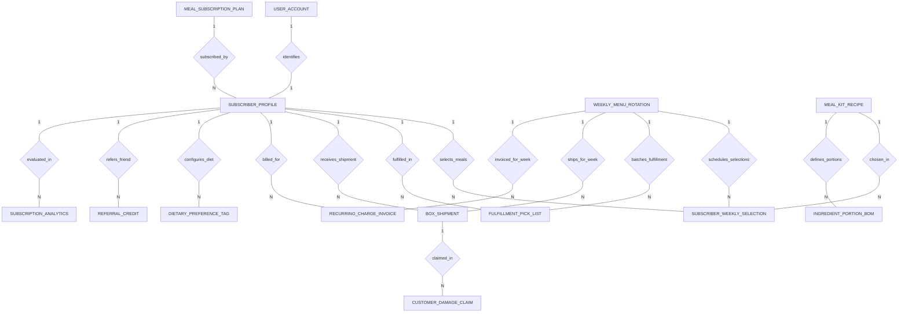

# Conceptual ERD — Meal Kit Subscription System

## Mermaid Code

## Entity Description Table | Bang mo ta Entity

| # | Entity Name | Vietnamese Name | Description | Key Attributes | Main Relationships |
|---|-------------|-----------------|-------------|----------------|-------------------|
| 1 | SUBSCRIBER_PROFILE | Ho so Nguoi dang ky | Core subscriber account details, delivery address, preferred delivery day, subscription plan ID, and status. | subscriber_id, user_id, plan_id, phone_number, delivery_address, account_status | Belongs to USER_ACCOUNT, MEAL_SUBSCRIPTION_PLAN; One-to-Many with SUBSCRIBER_WEEKLY_SELECTION, FULFILLMENT_PICK_LIST, BOX_SHIPMENT, RECURRING_CHARGE_INVOICE, DIETARY_PREFERENCE_TAG, REFERRAL_CREDIT, SUBSCRIPTION_ANALYTICS |
| 2 | MEAL_SUBSCRIPTION_PLAN | Goi dang ky bo nguyen lieu | Master subscription plan pricing tiers (2-Person vs 4-Person; 3-5 meals/week), base weekly price, and shipping fees. | plan_id, plan_name, people_count, meals_per_week, base_weekly_price, shipping_fee | One-to-Many with SUBSCRIBER_PROFILE |
| 3 | WEEKLY_MENU_ROTATION | Thuc don xoay vang tuan | Weekly menu calendar record specifying week start date, order cutoff deadline, delivery date, and publishing status. | menu_week_id, week_start_date, order_cutoff_date, delivery_date, is_published | One-to-Many with SUBSCRIBER_WEEKLY_SELECTION, FULFILLMENT_PICK_LIST, BOX_SHIPMENT, RECURRING_CHARGE_INVOICE |
| 4 | MEAL_KIT_RECIPE | Cong thuc Meal Kit | Chef-curated recipe specifications, recipe codes, titles, prep times, cuisine styles, and premium upcharge fees. | recipe_id, recipe_code, recipe_title, prep_time_minutes, premium_upcharge, is_active | One-to-Many with SUBSCRIBER_WEEKLY_SELECTION, INGREDIENT_PORTION_BOM |
| 5 | SUBSCRIBER_WEEKLY_SELECTION | Lựa chon mon tuan | Specific recipe choices selected by a subscriber for a given menu week, serving counts, and skip-week status. | selection_id, subscriber_id, menu_week_id, recipe_id, portion_servings, is_skipped | Belongs to SUBSCRIBER_PROFILE, WEEKLY_MENU_ROTATION, MEAL_KIT_RECIPE |
| 6 | INGREDIENT_PORTION_BOM | Dinh muc nguyen lieu so che | Pre-portioned raw ingredient BOM specs for a recipe, portion weights in grams, UOM, and allergen classification tags. | portion_id, recipe_id, ingredient_name, portion_weight_grams, allergen_tag | Belongs to MEAL_KIT_RECIPE |
| 7 | FULFILLMENT_PICK_LIST | Danh sach nhat hang kho | Automated warehouse fulfillment pick list, barcode manifest, total ingredient pouch count, and packing status. | pick_list_id, menu_week_id, subscriber_id, barcode_manifest, packing_status | Belongs to SUBSCRIBER_PROFILE, WEEKLY_MENU_ROTATION |
| 8 | BOX_SHIPMENT | Lo hang hop bao quan | Insulated cold-pack box shipment record, courier tracking number, delivery status, dispatch, and delivery timestamps. | shipment_id, subscriber_id, menu_week_id, tracking_number, courier_partner, delivery_status | Belongs to SUBSCRIBER_PROFILE, WEEKLY_MENU_ROTATION; One-to-Many with CUSTOMER_DAMAGE_CLAIM |
| 9 | RECURRING_CHARGE_INVOICE | Hoa don gia han tuan | Weekly recurring subscription charge invoice detailing base plan cost, upgrades, credits applied, and net charged amount. | invoice_id, subscriber_id, menu_week_id, plan_subtotal, addons_amount, net_charged_amount, payment_status | Belongs to SUBSCRIBER_PROFILE, WEEKLY_MENU_ROTATION |
| 10 | DIETARY_PREFERENCE_TAG | The so thich an uong | Subscriber dietary preference configurations (Keto, Veggie, Low Calorie) and explicit allergen exclusion tags. | preference_id, subscriber_id, diet_type, allergen_exclusion | Belongs to SUBSCRIBER_PROFILE |
| 11 | REFERRAL_CREDIT | Tín dung gioi thieu | Peer referral billing credit transaction awarded when a referred friend subscribes and receives their first box. | credit_id, referrer_subscriber_id, referee_subscriber_id, credit_amount, is_applied | Belongs to SUBSCRIBER_PROFILE |
| 12 | CUSTOMER_DAMAGE_CLAIM | Yeucau boi thuong thiet hai | Customer claim ticket for missing ingredient pouches or damaged cold-pack shipping boxes, photo proof, and credit issued. | claim_id, shipment_id, claim_reason, photo_url, credit_issued_amount, resolution_status | Belongs to BOX_SHIPMENT |
| 13 | USER_ACCOUNT | Tai khoan he thong | Core security authentication account holding credentials, password hashes, and user role definitions. | user_id, username, password_hash, role_name | One-to-One with SUBSCRIBER_PROFILE |
| 14 | SUBSCRIPTION_ANALYTICS | Thong ke hieu qua dang ky | Aggregate daily analytics tracking total active subscribers, weekly recurring revenue (MRR/ARR), churn rate, and recipe ratings. | analytics_id, metric_date, active_subscribers_count, weekly_recurring_revenue, subscriber_churn_rate | Evaluates SUBSCRIBER_PROFILE |

## Relationship Description | Mo ta Quan he

| # | From Entity | Cardinality | To Entity | Relationship Label | Business Explanation |
|---|-------------|-------------|-----------|-------------------|----------------------|
| 1 | USER_ACCOUNT | One-to-One | SUBSCRIBER_PROFILE | identifies | Tai khoan he thong xac thuc ho so nguoi dang ky bo nguyen lieu. |
| 2 | MEAL_SUBSCRIPTION_PLAN | One-to-Many | SUBSCRIBER_PROFILE | subscribed_by | Mot goi dang ky (2 nguoi, 4 nguoi) duoc nhieu nguoi dang ky lua chon. |
| 3 | SUBSCRIBER_PROFILE | One-to-Many | SUBSCRIBER_WEEKLY_SELECTION | selects_meals | Mot nguoi dang ky thuc hien chon cac mon an theo tuan hoac bo qua tuan. |
| 4 | WEEKLY_MENU_ROTATION | One-to-Many | SUBSCRIBER_WEEKLY_SELECTION | schedules_selections | Mot thuc don tuan quan ly cac lua chon mon an cua khach hang trong tuan do. |
| 5 | MEAL_KIT_RECIPE | One-to-Many | SUBSCRIBER_WEEKLY_SELECTION | chosen_in | Mot cong thuc meal kit duoc chon trong nhieu don dang ky cua khach hang. |
| 6 | MEAL_KIT_RECIPE | One-to-Many | INGREDIENT_PORTION_BOM | defines_portions | Mot cong thuc meal kit dinh nghia cac tui nguyen lieu so che va trong luong. |
| 7 | SUBSCRIBER_PROFILE | One-to-Many | FULFILLMENT_PICK_LIST | fulfilled_in | Mot nguoi dang ky co danh sach nhat hang kho tuong ung voi don tuan. |
| 8 | WEEKLY_MENU_ROTATION | One-to-Many | FULFILLMENT_PICK_LIST | batches_fulfillment | Mot thuc don tuan gom cum toan bo danh sach nhat hang cho kho dong goi. |
| 9 | SUBSCRIBER_PROFILE | One-to-Many | BOX_SHIPMENT | receives_shipment | Mot nguoi dang ky nhan nhieu hop hang bao quan lanh theo tung tuan. |
| 10 | WEEKLY_MENU_ROTATION | One-to-Many | BOX_SHIPMENT | ships_for_week | Mot thuc don tuan phat hanh nhieu hop hang giao den khach hang. |
| 11 | SUBSCRIBER_PROFILE | One-to-Many | RECURRING_CHARGE_INVOICE | billed_for | Mot nguoi dang ky thanh toan hoa don gia han dinh ky hang tuan. |
| 12 | WEEKLY_MENU_ROTATION | One-to-Many | RECURRING_CHARGE_INVOICE | invoiced_for_week | Mot thuc don tuan phat hanh cac hoa don thanh toan tu dong cho dot giao hang. |
| 13 | SUBSCRIBER_PROFILE | One-to-Many | DIETARY_PREFERENCE_TAG | configures_diet | Mot nguoi dang ky thiet lap cac the so thich an uong va di ung thuc pham. |
| 14 | SUBSCRIBER_PROFILE | One-to-Many | REFERRAL_CREDIT | refers_friend | Mot nguoi dang ky gioi thieu ban be va nhan tin dung gia han hop hang. |
| 15 | BOX_SHIPMENT | One-to-Many | CUSTOMER_DAMAGE_CLAIM | claimed_in | Mot hop hang bi loi/thieu nguyen lieu duoc ghi nhan yeu cau boi thuong. |
| 16 | SUBSCRIBER_PROFILE | One-to-Many | SUBSCRIPTION_ANALYTICS | evaluated_in | Ho so nguoi dang ky duoc thong ke ti le duy trì (retention) va ti le roi bo (churn). |
