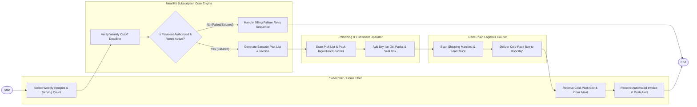

# Swimlane Diagram — Meal Kit Subscription System

## Mermaid Code

## Flow Description | Mo ta luong

| Lane | Actor | Role in Flow |
|------|-------|-------------|
| **Lane 1** | Subscriber / Home Chef | Browses weekly rotating menus, selects recipe choices, receives weekly billing invoice push alerts, receives insulated cold-pack box, and cooks meals. |
| **Lane 2** | Portioning & Fulfillment Operator | Scans barcode pick lists on warehouse packing lines, packs pre-portioned ingredient pouches, inserts dry-ice gel packs, and seals insulated shipping boxes. |
| **Lane 3** | Cold Chain Logistics Courier | Scans shipping manifests, loads insulated boxes onto refrigerated transit trucks, and delivers packages to subscriber doorsteps with photo proof. |
| **Lane 4** | Meal Kit Subscription Core Engine | Verifies weekly cutoff deadlines, authorizes automated recurring credit card charges, generates warehouse pick lists, and streams delivery tracking updates. |

### Process Execution Steps | Cac buoc thuc hien quy trinh

1. **Recipe Selection & Cutoff Verification**: Subscriber selects weekly recipes (`C1`). Core Engine verifies weekly order cutoff deadline (`S1`) and evaluates billing status (`S2`).
2. **Recurring Charge & Pick List Generation**:
   - If **No (Payment Failed or Week Skipped)**: Core Engine suppresses fulfillment and initiates billing retry sequence (`S4`), completing execution (`Finish`).
   - If **Yes (Cleared)**: Core Engine authorizes recurring charge, generates barcode pick list (`S3`), and sends payment receipt (`C2`).
3. **Fulfillment & Cold-Pack Assembly**: Warehouse Operator scans pick list, packs ingredient pouches (`K1`), inserts dry-ice gel packs, and seals insulated box (`K2`).
4. **Cold Chain Transport & Delivery**: Courier scans shipping manifest (`L1`), transports cold-pack box, delivers package to doorstep (`L2`), subscriber receives box and cooks meal (`C3`), completing execution (`Finish`).
