# Action Tree — Meal Kit Subscription System

## Mermaid Code

```mermaid
graph TD
    Root["Meal Kit Subscription System"]

    Root --> M1["Subscription Plan & Weekly Menu Management"]
    Root --> M2["Meal Selection & Customization Engine"]
    Root --> M3["Recurring Billing & Automated Renewals"]
    Root --> M4["Pre-Portioning & Fulfillment Line Operations"]
    Root --> M5["Cold-Pack Shipping & Courier Tracking"]
    Root --> M6["Subscriber Support & Claims Resolution"]
    Root --> M7["Retention Analytics & Churn Prediction"]

    M1 --> A11["Configure Subscription Plan Tiers"]
    M1 --> A12["Publish Weekly Rotating Menu Catalogs"]
    M1 --> A13["Set Delivery ZIP Code Coverage Zones"]
    M1 --> A14["Forecast Raw Ingredient Demand"]

    M2 --> A21["Process Subscriber Weekly Recipe Choices"]
    M2 --> A22["Configure Dietary Preferences & Allergens"]
    M2 --> A23["Process Skip-Week & Pause Requests"]
    M2 --> A24["Select Premium Upgrades & Add-On Extras"]

    M3 --> A31["Execute Weekly Recurring Credit Card Charges"]
    M3 --> A32["Handle Failed Billing Retry Sequences"]
    M3 --> A33["Apply Referral & Promotional Credits"]
    M3 --> A34["Generate Weekly Tax Invoices"]

    M4 --> A41["Generate Barcode Ingredient Pick Lists"]
    M4 --> A42["Batch Pre-Portioned Ingredient Pouches"]
    M4 --> A43["Calculate Dry-Ice Gel Pack Ratios"]
    M4 --> A44["Print Step Recipe Cards & QR Guides"]

    M5 --> A51["Generate Courier Cold-Pack Shipping Labels"]
    M5 --> A52["Ingest Real-Time Transit GPS Telemetry"]
    M5 --> A53["Monitor Cold Chain Box Temperature Logs"]
    M5 --> A54["Send Delivery Arrival SMS Notifications"]

    M6 --> A61["Process Damaged Package & Missing Item Claims"]
    M6 --> A62["Issue Automated Billing Credit Refunds"]
    M6 --> A63["Process Subscription Cancellation Surveys"]
    M6 --> A64["Manage Win-Back Retention Discount Offers"]

    M7 --> A71["Monitor Weekly Recurring Revenue MRR"]
    M7 --> A72["Analyze Subscriber Cohort Retention Rates"]
    M7 --> A73["Predict Churn Risk Levels"]
    M7 --> A74["Track Recipe Popularity Ratings"]
```

## Module Description | Mo ta Module

| # | Module | Description | Actions |
|---|--------|-------------|---------|
| 1 | Subscription Plan & Weekly Menu Management | Configures subscription plan pricing tiers (2-Person vs 4-Person), publishes weekly rotating recipe catalogs 6 weeks in advance, sets ZIP coverage, and forecasts demand. | Configure Subscription Plan Tiers, Publish Weekly Rotating Menu Catalogs, Set Delivery ZIP Code Coverage Zones, Forecast Raw Ingredient Demand |
| 2 | Meal Selection & Customization Engine | Manages subscriber weekly recipe choices, dietary preference filters (Keto, Veggie), skip-week scheduling, and premium recipe upgrades. | Process Subscriber Weekly Recipe Choices, Configure Dietary Preferences & Allergens, Process Skip-Week & Pause Requests, Select Premium Upgrades & Add-On Extras |
| 3 | Recurring Billing & Automated Renewals | Executes automated weekly subscription credit card charges, handles failed payment retries, applies referral credits, and issues tax invoices. | Execute Weekly Recurring Credit Card Charges, Handle Failed Billing Retry Sequences, Apply Referral & Promotional Credits, Generate Weekly Tax Invoices |
| 4 | Pre-Portioning & Fulfillment Line Operations | Generates barcode ingredient pick lists, batch pre-portions ingredient pouches, calculates dry-ice gel pack amounts, and prints step recipe instruction cards. | Generate Barcode Ingredient Pick Lists, Batch Pre-Portioned Ingredient Pouches, Calculate Dry-Ice Gel Pack Ratios, Print Step Recipe Cards & QR Guides |
| 5 | Cold-Pack Shipping & Courier Tracking | Creates courier shipping labels, ingests real-time transit GPS tracking points, monitors box temperature logs, and dispatches delivery SMS alerts. | Generate Courier Cold-Pack Shipping Labels, Ingest Real-Time Transit GPS Telemetry, Monitor Cold Chain Box Temperature Logs, Send Delivery Arrival SMS Notifications |
| 6 | Subscriber Support & Claims Resolution | Captures damaged box and missing ingredient claims, issues automated billing credit refunds, processes cancellation exit surveys, and triggers win-back offers. | Process Damaged Package & Missing Item Claims, Issue Automated Billing Credit Refunds, Process Subscription Cancellation Surveys, Manage Win-Back Retention Discount Offers |
| 7 | Retention Analytics & Churn Prediction | Provides executive reporting on Monthly/Weekly Recurring Revenue (MRR), subscriber cohort retention rates, churn risk scoring, and recipe popularity ratings. | Monitor Weekly Recurring Revenue MRR, Analyze Subscriber Cohort Retention Rates, Predict Churn Risk Levels, Track Recipe Popularity Ratings |
