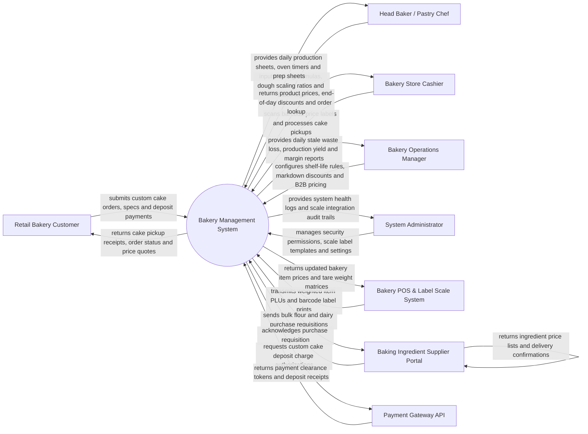

# Context Diagram — Bakery Management System

## Mermaid Code

## Actor & Interaction Table | Bang Actor & Tuong tac

| # | Actor | Actor Type | Data Sent TO System | Data Received FROM System | Notes |
|---|-------|------------|---------------------|---------------------------|-------|
| 1 | Retail Bakery Customer | Primary | Custom cake design choices (flavor, tiers, inscription, photo), deposit payments, pickup date/time | Cake order confirmation chits, pickup reminders, custom cake price quotes | Orders custom cakes online or at retail bakery counter. |
| 2 | Head Baker / Pastry Chef | Primary | Dough formulas (Baker's Percentage), batch mixing logs, oven timer completions, stale waste logs | Daily production sheets, scaled ingredient prep sheets, cake assembly guides | Manages baking production, dough proofing, and pastry decoration. |
| 3 | Bakery Store Cashier | Primary | Scanned barcode price labels, custom cake pickup claim codes, retail cash/card payments | Item prices, applied end-of-day markdown discounts, custom cake pickup details | Operates front-of-house bakery retail POS counter. |
| 4 | Bakery Operations Manager | Primary | Shelf-life expiration rules, end-of-day markdown discount percentages, wholesale B2B pricing | Stale bread waste analytics, daily production yield, product profit margins | Oversees bakery profitability, waste reduction, and wholesale accounts. |
| 5 | System Administrator | Primary | User credentials, security role permissions, barcode label scale templates, system settings | Integration health logs, device scale status alerts, audit trail logs | Manages IT infrastructure, label scale pairings, and user permissions. |
| 6 | Bakery POS & Label Scale System | Supporting | Weighted item PLUs, printed barcode label payloads, transaction totals | Item pricing master, tare weight matrices, barcode format rules | Integrated printing scales generating barcode price labels for bread/pastries. |
| 7 | Baking Ingredient Supplier Portal | Supporting | Ingredient wholesale price lists, delivery confirmations, lot numbers | Automated bulk purchasing requisitions (Flour, Yeast, Butter, Sugar) | External supplier portal for ordering commercial baking supplies. |
| 8 | Payment Gateway API | Supporting | Custom cake deposit authorization tokens, card transaction approvals | Pre-order deposit charge requests, refund instructions | Clears credit card deposit payments for pre-ordered custom cakes. |

## System Boundary Description | Mo ta Pham vi He thong

The **Bakery Management System** automates retail bakery operations, custom cake pre-orders, dough formula scaling using Baker's Percentages, oven batch production scheduling, barcode weight labeling, and shelf-life expiration management. Inside its boundary, the system handles custom cake design tracking, automated dough recipe scaling based on target loaf yield, barcode price label printing integration, end-of-day stale waste logging, wholesale B2B order management, and daily baking profitability analytics.

The system boundary excludes physical baking inside ovens, manual dough kneading, physical counter bread packaging, and direct credit card clearing (handled by Payment Gateways).
