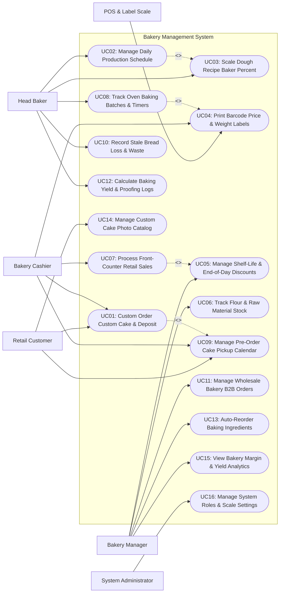

# Use Case Diagram — Bakery Management System

## Mermaid Code

## Actor Table | Bang Actor

| # | Actor | Actor Type | Role Description | Related Use Cases |
|---|-------|------------|------------------|-------------------|
| 1 | Retail Customer | Primary | Guest ordering custom celebration cakes, browsing cake catalogs, and picking up pre-ordered baked goods. | UC01, UC09, UC14 |
| 2 | POS & Label Scale | Secondary System | Integrated weighing scale and thermal printing hardware generating barcode price labels for fresh bread and pastries. | UC04 |
| 3 | Head Baker | Primary | Pastry chef managing daily baking schedules, scaling dough formulas using Baker's Percentages, tracking oven batches, and logging yield. | UC02, UC03, UC08, UC10, UC12 |
| 4 | Bakery Cashier | Primary | Retail counter staff taking custom cake orders, processing retail bread sales, scanning barcode labels, and managing cake pickups. | UC01, UC04, UC07, UC09 |
| 5 | Bakery Manager | Primary | Operations lead managing shelf-life expiration rules, end-of-day markdown discounts, wholesale B2B accounts, and ingredient reordering. | UC05, UC06, UC11, UC13, UC15 |
| 6 | System Administrator | Primary | Technical manager configuring barcode scale templates, user roles, security access levels, and bakery system parameters. | UC16 |

## Use Case Table | Bang Use Case

| # | UC ID | Use Case Name | Primary Actor | Secondary Actor | Description | Priority |
|---|-------|---------------|---------------|-----------------|-------------|----------|
| 1 | UC01 | Custom Order Custom Cake & Deposit | Customer / Cashier | None | Customizes wedding/birthday cake specs (flavor, tiers, inscription, photo), calculates price quote, and collects pre-order deposit. | High |
| 2 | UC02 | Manage Daily Production Schedule | Head Baker | None | Generates daily baking production sheets specifying target loaf counts, croissant quantities, and pastry batch schedules. | High |
| 3 | UC03 | Scale Dough Recipe Baker Percent | Head Baker | None | Automatically scales dough ingredient weights (Flour = 100%, Water %, Yeast %, Salt %) based on target total dough batch weight. | High |
| 4 | UC04 | Print Barcode Price & Weight Labels | Bakery Cashier | POS & Label Scale | Weighs packaged bread/pastries and prints barcode labels displaying net weight, unit price, total price, and packed-on date. | High |
| 5 | UC05 | Manage Shelf-Life & End-of-Day Discounts | Bakery Manager | None | Configures item shelf-life limits (e.g., Baguettes = 1 day) and automates end-of-day markdown discounts (e.g., 50% off after 7:00 PM). | High |
| 6 | UC06 | Track Flour & Raw Material Stock | Bakery Manager | None | Tracks inventory balances of bulk baking ingredients (Flour, Butter, Sugar, Yeast, Eggs) perpetually based on baking production batches. | High |
| 7 | UC07 | Process Front-Counter Retail Sales | Bakery Cashier | None | Processes fast-paced retail counter checkout, scanning barcode labels, applying markdown discounts, and printing receipts. | High |
| 8 | UC08 | Track Oven Baking Batches & Timers | Head Baker | None | Monitors active baking batches in commercial deck/convection ovens, tracking proofing times, baking temperatures, and alarm timers. | Medium |
| 9 | UC09 | Manage Pre-Order Cake Pickup Calendar | Cashier / Customer | None | Tracks scheduled custom cake pickup dates, decorator completion statuses, display fridge locations, and remaining balance due. | High |
| 10 | UC10 | Record Stale Bread Loss & Waste | Head Baker | None | Logs daily unsold stale bread and expired pastry disposals, categorizing waste causes (over-production, damaged, expired). | High |
| 11 | UC11 | Manage Wholesale Bakery B2B Orders | Bakery Manager | None | Manages recurring wholesale B2B bread delivery contracts for restaurants, hotels, and cafes with standing daily order schedules. | High |
| 12 | UC12 | Calculate Baking Yield & Proofing Logs | Head Baker | None | Calculates dough proofing expansion, oven baking shrinkage, and total usable loaf yield percentages per batch. | Medium |
| 13 | UC13 | Auto-Reorder Baking Ingredients | Bakery Manager | None | Generates bulk purchase requisitions to ingredient suppliers when flour or butter stock levels drop below safety reorder points. | High |
| 14 | UC14 | Manage Custom Cake Photo Catalog | Customer / Baker | None | Maintains digital catalog of custom cake designs, 3D tier mockups, piping styles, and customer inspiration photos. | Medium |
| 15 | UC15 | View Bakery Margin & Yield Analytics | Bakery Manager | None | Generates analytical reports on daily baking yield %, stale waste loss monetary values, product gross margins, and B2B revenue. | High |
| 16 | UC16 | Manage System Roles & Scale Settings | System Admin | None | Configures user security role permissions, thermal label scale formats, tare weight matrices, and system backup parameters. | High |

## Use Case Specification | Dac ta Use Case

---

### UC01 — Custom Order Custom Cake & Deposit

| Field | Detail |
|-------|--------|
| **UC ID** | UC01 |
| **Use Case Name** | Custom Order Custom Cake & Deposit |
| **Actor(s)** | Primary: Retail Customer, Bakery Cashier   Secondary: Payment Gateway API |
| **Description** | Enables a customer or cashier to configure custom celebration cake specifications (sponge flavor, filling, frosting, number of tiers, inscription text, reference photo), calculate cost quotes, and collect a non-refundable deposit. |
| **Precondition** | 1. Custom cake pricing rules (tier sizes, special decorations, fondant modeling) are active.   2. Payment Gateway is online to collect deposit payments. |
| **Main Flow** | 1. Customer or Cashier opens "Custom Cake Order Builder" on portal or POS terminal.   2. User selects Event Date and Target Pickup Time (e.g., Saturday at 2:00 PM).   3. User configures cake specs:      - Size & Tiers: 3-Tier Round (10", 8", 6" - Serves 60 guests)      - Sponge Flavor: Red Velvet & Chocolate Fudge      - Filling & Frosting: Vanilla Swiss Nocciola Buttercream      - Customization: Custom Fondant Figures, Gold Leaf Accents      - Inscription Text: "Happy 30th Birthday Sarah!"   4. User attaches reference photo from Custom Cake Catalog (UC14) or customer device.   5. System calculates itemized Custom Cake Price Quote (Base Cake $180 + Fondant Accents $45 + Gold Leaf $25 = Total $250.00).   6. System calculates mandatory non-refundable booking deposit (e.g., 50% deposit = $125.00).   7. Customer inputs credit card details or pays cash at counter.   8. System sends deposit charge request to Payment Gateway.   9. Payment Gateway approves transaction and returns authorization code.   10. System generates Custom Cake Order Chit (ID #CK-4099), registers order on Cake Pickup Calendar (UC09), prints kitchen decorator ticket, and sends digital receipt to customer. |
| **Alternative Flow** | **AF1** — Order modification prior to 48-hour cutoff:   1. Customer calls 3 days before event to change inscription text.   2. Cashier opens Order #CK-4099, updates text, and re-prints kitchen decorator ticket. |
| **Exception Flow** | **EX1** — Bakery capacity full for requested date:   1. At step 2, System detects cake decorator team has reached maximum capacity for requested Saturday (e.g., Max 15 custom cakes).   2. System flags warning "Cake decorating capacity full for selected date" and prompts manager override or date adjustment. |
| **Postcondition** | Custom cake order is registered, 50% deposit is collected, decorator kitchen ticket is printed, and pickup date is locked. |
| **Business Rule** | **BR1**: Custom cake orders require a mandatory 50% non-refundable deposit upon order placement.   **BR2**: Custom cake design changes or cancellations are prohibited within 48 hours of the scheduled pickup time. |

---

### UC02 — Manage Daily Production Schedule

| Field | Detail |
|-------|--------|
| **UC ID** | UC02 |
| **Use Case Name** | Manage Daily Production Schedule |
| **Actor(s)** | Primary: Head Baker / Pastry Chef   Secondary: None |
| **Description** | Generates daily baking production schedules specifying required quantities for retail display counters, pre-ordered custom cakes, and standing wholesale B2B deliveries. |
| **Precondition** | 1. Master baking recipe formulas and dough scaling engine (UC03) are active.   2. Pre-order cake calendar (UC09) and wholesale B2B standing orders (UC11) are loaded. |
| **Main Flow** | 1. Head Baker opens "Daily Baking Production Master" for upcoming baking shift (e.g., 3:00 AM Shift).   2. System compiles required production quantities from 3 demand streams:      - Retail Display Buffer: 150 Sourdough Loaves, 200 Croissants, 80 Baguettes, 50 Fruit Tarts.      - Pre-Order Custom Cakes: 8 Custom Cakes scheduled for pickup today (UC09).      - Wholesale B2B Orders: 100 Sandwich Buns for Hotel A, 50 Baguettes for Cafe B (UC11).   3. System totals net production requirements per bakery item.   4. System calls Dough Formula Scaling Engine (UC03) to aggregate total raw ingredient weights needed (e.g., Total 85 kg Bread Flour, 12 kg Butter, 1.8 kg Salt, 1.2 kg Dry Yeast).   5. System checks raw material inventory balances (UC06) and verifies sufficient flour and butter stock.   6. System generates formatted Daily Production Sheet organized by station (Dough Mixer, Pastry Sheeter, Proofing Room, Deck Ovens, Decorating Station).   7. Head Baker prints production sheet and assigns shift baking tasks to assistant bakers. |
| **Alternative Flow** | **AF1** — Weather / Holiday demand multiplier:   1. Baker selects "Rainy Day / Weekend Multiplier (+20%)".   2. System scales retail display quantities up by 20% and updates production sheet. |
| **Exception Flow** | **EX1** — Raw flour inventory shortage alert:   1. At step 5, System detects Bread Flour stock is insufficient (Need 85 kg, Stock has 40 kg).   2. System highlights red alert "Flour Shortage: Short by 45 kg", prompts Baker to reduce retail production batch, and triggers urgent purchase requisition (UC13). |
| **Postcondition** | Daily baking production sheet is printed, dough ingredient scaling is calculated, and station tasks are assigned. |
| **Business Rule** | **BR1**: Daily production sheets must consolidate retail counter demand, pre-order custom cakes, and B2B wholesale standing orders.   **BR2**: Baking production batches must trigger perpetual raw ingredient inventory deductions upon mixing confirmation. |

---

### UC03 — Scale Dough Recipe Baker Percent

| Field | Detail |
|-------|--------|
| **UC ID** | UC03 |
| **Use Case Name** | Scale Dough Recipe Baker Percent |
| **Actor(s)** | Primary: Head Baker / Pastry Chef   Secondary: None |
| **Description** | Automatically calculates exact ingredient weights for any dough batch size using standard professional Baker's Percentages (where Total Flour Weight = 100%). |
| **Precondition** | 1. Master dough formulas are configured using Baker's Percentage standards (Flour = 100%).   2. Head Baker inputs target batch dough weight or target loaf yield. |
| **Main Flow** | 1. Head Baker selects a master dough formula (e.g., Artisan Sourdough Bread).   2. System displays master formula Baker's Percentages:      - Bread Flour: 100.0%      - Water (Hydration): 75.0%      - Sourdough Starter (Levain): 20.0%      - Salt: 2.0%      - Total Formula Percentage: 197.0%.   3. Baker inputs desired production target: `Target Yield = 100 Sourdough Loaves @ 500g pre-bake dough weight per loaf` (Total Target Dough Weight = 50,000g / 50.0 kg).   4. System calculates Required Base Flour Weight: `(Total Target Dough Weight / Total Formula %) * 100` -> `(50,000g / 197.0%) * 100 = 25,380.7 grams Flour (25.38 kg)`.   5. System scales all ingredient weights proportionately based on Baker's Percentages:      - Bread Flour (100%): 25.38 kg      - Water (75%): 19.04 kg (19.04 Liters)      - Sourdough Starter (20%): 5.08 kg      - Salt (2%): 0.51 kg (510 grams).   6. System displays scaled ingredient batch prep card on mixer station tablet display.   7. Baker reviews scaled weights and taps "Confirm & Mix Batch". |
| **Alternative Flow** | **AF1** — Scaling by fixed available flour stock:   1. Baker has exactly 20.0 kg of specialty Rye Flour remaining.   2. Baker selects "Scale by Fixed Flour Weight = 20.0 kg".   3. System calculates all other ingredients and outputs total dough yield (39.4 kg dough / ~78 loaves). |
| **Exception Flow** | **EX1** — Extreme batch size warning:   1. Baker inputs target dough weight exceeding commercial mixer capacity (e.g., 150 kg dough in a 80 kg capacity mixer).   2. System displays warning "Exceeds Mixer Capacity! Split into 2 Batches of 75 kg each." |
| **Postcondition** | Scaled ingredient weights based on Baker's Percentages are displayed on mixer station tablets. |
| **Business Rule** | **BR1**: All bread dough scaling calculations must strictly utilize professional Baker's Percentage math based on Total Flour = 100%.   **BR2**: Dough batch scaling must automatically include a configurable 2% dough division loss factor. |

---

### UC05 — Manage Shelf-Life & End-of-Day Discounts

| Field | Detail |
|-------|--------|
| **UC ID** | UC05 |
| **Use Case Name** | Manage Shelf-Life & End-of-Day Discounts |
| **Actor(s)** | Primary: Bakery Operations Manager   Secondary: None |
| **Description** | Configures shelf-life expiration rules per bakery item category and automates scheduled end-of-day markdown discount rules (e.g., 50% off fresh bread past 7:00 PM) to minimize food waste. |
| **Precondition** | 1. Bakery items and barcode label scale integrations (UC04) are active.   2. Store operating hours and discount rules module are open. |
| **Main Flow** | 1. Bakery Operations Manager opens "Shelf-Life & Discount Rules" management module.   2. Manager configures item shelf-life policies:      - Fresh Baguettes / Crusty Bread: 1 Day (Expires end of baking day).      - Soft Buns / Packaged Loaves: 3 Days.      - Cream Pastries: 2 Days (Requires refrigeration).   3. Manager configures Automated End-of-Day Markdown Discount Rules:      - Rule Name: "Happy Hour Bread Markdown".      - Applicable Categories: Fresh Bread & Daily Pastries.      - Trigger Time: 7:00 PM (2 hours before store closing).      - Discount Rate: 50% Off Regular Retail Price.   4. Manager saves discount policy settings.   5. On operating days at 7:00 PM, System automatically updates active POS pricing for fresh bread items to 50% markdown price.   6. POS screen displays notification: **End-of-Day 50% Markdown Active for Fresh Bread**.   7. Cashiers scan existing item barcode labels (UC07); POS automatically applies 50% discount during checkout.   8. At store closing (9:00 PM), System logs any remaining unsold day-old items for Stale Waste Audit (UC10). |
| **Alternative Flow** | **AF1** — Day-Old Bread clearance basket pricing:   1. Unsold day-old packaged loaves are moved to "Day-Old Clearance Counter" next morning.   2. System generates special "Day-Old Clearance" barcode labels at a fixed flat price ($1.50 per loaf). |
| **Exception Flow** | **EX1** — Cream pastry shelf-life expiration safety lock:   1. A cream pastry item reaches its 2-day shelf-life limit without being sold.   2. System blocks POS scanning for that item PLU, flags red expiration alert, and forces removal from display case. |
| **Postcondition** | Shelf-life expiration rules and scheduled markdown discounts are automated across POS terminals. |
| **Business Rule** | **BR1**: High-risk perishable items (cream pastries, meat pies) reaching expiration limits must be blocked from sale on POS.   **BR2**: End-of-day markdown discounts must execute automatically at configured trigger times without requiring manual cashier overrides. |

---

### UC09 — Manage Pre-Order Cake Pickup Calendar

| Field | Detail |
|-------|--------|
| **UC ID** | UC09 |
| **Use Case Name** | Manage Pre-Order Cake Pickup Calendar |
| **Actor(s)** | Primary: Bakery Cashier, Retail Customer   Secondary: None |
| **Description** | Tracks scheduled custom cake pickup dates, decorator completion statuses, display fridge storage locations, remaining balance due, and manages customer pickup handoffs. |
| **Precondition** | 1. Custom cake order (UC01) is registered with deposit paid.   2. Pre-order cake pickup calendar module is active. |
| **Main Flow** | 1. Customer arrives at bakery retail counter and presents Custom Cake Order Chit (e.g., Order #CK-4099).   2. Bakery Cashier opens "Pre-Order Pickup Calendar" on POS display and inputs Order #CK-4099 (or scans order barcode).   3. System retrieves cake order record displaying:      - Customer Name: Sarah Jenkins      - Cake Specs: 3-Tier Red Velvet & Chocolate      - Status: `Decorated & Ready in Display Fridge #2`      - Total Price: $250.00      - Deposit Paid: $125.00      - Remaining Balance Due: $125.00.   4. Cashier verifies cake box in Display Fridge #2 and presents cake to customer for inspection.   5. Customer approves cake decoration and piping.   6. Cashier collects remaining balance due ($125.00) at POS checkout.   7. System updates order status to `Picked Up & Settled`, marks deposit closed, and prints final itemized receipt.   8. Customer receives boxed custom cake and final receipt. |
| **Alternative Flow** | **AF1** — Customer delivery instead of pickup:   1. Custom cake order is marked for refrigerated delivery van transport.   2. Driver scans pickup chit, loads cake into temperature-controlled van, and updates status to `Out for Delivery`. |
| **Exception Flow** | **EX1** — Unclaimed cake past pickup time:   1. Customer fails to pick up custom cake 2 hours past scheduled pickup time.   2. System flags alert on POS "Overdue Cake Pickup: Order #CK-4099" and dispatches automated reminder SMS to customer. |
| **Postcondition** | Custom cake pickup is verified, remaining balance is collected, and order status is marked `Picked Up & Settled`. |
| **Business Rule** | **BR1**: Remaining cake order balances must be collected in full before releasing custom cakes to customers.   **BR2**: Completed custom cakes must be inspected and signed off by the pastry decorator before being moved to pickup display fridges. |
