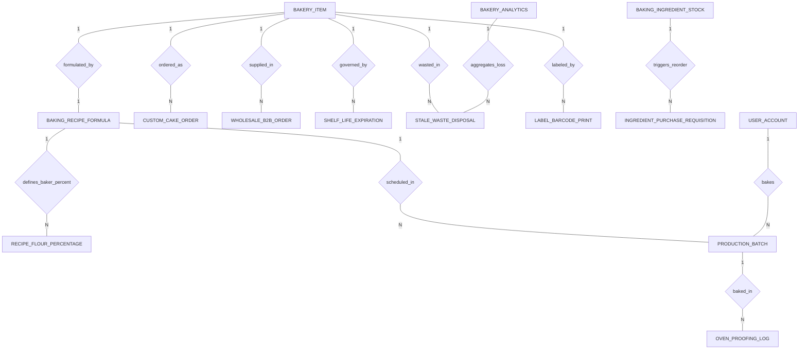

# Conceptual ERD — Bakery Management System

## Mermaid Code

## Entity Description Table | Bang mo ta Entity

| # | Entity Name | Vietnamese Name | Description | Key Attributes | Main Relationships |
|---|-------------|-----------------|-------------|----------------|-------------------|
| 1 | BAKERY_ITEM | Mat hang tiem banh | Master retail bakery product item, SKU, category, retail price, shelf-life days, and weighted item flags. | item_id, item_sku, item_name, category, retail_price, shelf_life_days, is_weighted | One-to-One with BAKING_RECIPE_FORMULA; One-to-Many with SHELF_LIFE_EXPIRATION, STALE_WASTE_DISPOSAL, LABEL_BARCODE_PRINT, CUSTOM_CAKE_ORDER, WHOLESALE_B2B_ORDER |
| 2 | BAKING_RECIPE_FORMULA | Cong thuc lam banh | Master baking recipe formula, base flour weight, total formula percentage, and target loaf yield. | formula_id, item_id, formula_name, base_flour_weight_g, total_formula_percent, target_loaf_yield | One-to-One with BAKERY_ITEM; One-to-Many with RECIPE_FLOUR_PERCENTAGE, PRODUCTION_BATCH |
| 3 | RECIPE_FLOUR_PERCENTAGE | Ty le phan tram tho | Line item ingredient in a baking formula defined using Baker's Percentages (Flour = 100%). | line_id, formula_id, ingredient_name, baker_percentage, calculated_weight_g | Belongs to BAKING_RECIPE_FORMULA |
| 4 | PRODUCTION_BATCH | Lo san xuat banh | Daily baking production batch execution record, target dough weight kg, target unit yield, and status. | batch_id, formula_id, baker_user_id, production_date, target_dough_weight_kg, status | Belongs to BAKING_RECIPE_FORMULA, USER_ACCOUNT; One-to-Many with OVEN_PROOFING_LOG |
| 5 | CUSTOM_CAKE_ORDER | Don hang banh theo yeu cau | Pre-ordered custom celebration cake specs, customer contact, pickup datetime, total price, deposit paid, and status. | cake_order_id, order_number, customer_name, pickup_datetime, total_price, deposit_paid, cake_status | Belongs to BAKERY_ITEM |
| 6 | WHOLESALE_B2B_ORDER | Don hang banh si B2B | Standing wholesale B2B bread delivery order for hotel/cafe clients, delivery date, subtotal, and payment terms. | b2b_order_id, client_name, delivery_date, order_subtotal, payment_terms, delivery_status | Belongs to BAKERY_ITEM |
| 7 | SHELF_LIFE_EXPIRATION | Quy tac han su dung | Shelf-life display hour limits and scheduled end-of-day markdown discount rules (e.g., 50% markdown at 7:00 PM). | policy_id, item_id, max_display_hours, markdown_trigger_time, markdown_discount_percent | Belongs to BAKERY_ITEM |
| 8 | STALE_WASTE_DISPOSAL | Nhat ky banh cu hu | Daily unsold stale bread and expired pastry disposal log, capturing stale quantity, waste cost, and reason. | waste_id, item_id, waste_date, stale_quantity, waste_cost_total, waste_reason | Belongs to BAKERY_ITEM; Aggregated in BAKERY_ANALYTICS |
| 9 | BAKING_INGREDIENT_STOCK | Ton kho nguyen lieu banh | Bulk raw baking ingredient inventory (flour, butter, sugar, yeast), current stock kg, reorder levels, and unit costs. | ingredient_id, ingredient_code, ingredient_name, current_stock_kg, reorder_level_kg, unit_cost_per_kg | One-to-Many with INGREDIENT_PURCHASE_REQUISITION |
| 10 | LABEL_BARCODE_PRINT | Nhat ky in ma vach | Log of barcode price labels printed by integrated weighing scales, storing barcode payload, net weight, and price. | print_id, item_id, barcode_payload, net_weight_g, printed_price, printed_at | Belongs to BAKERY_ITEM |
| 11 | OVEN_PROOFING_LOG | Nhat ky u va nuong banh | Monitoring log for dough proofing times, oven deck numbers, baking temperatures, and start/end time logs. | oven_log_id, batch_id, oven_number, proofing_time_minutes, baking_temp_celsius, bake_start_time | Belongs to PRODUCTION_BATCH |
| 12 | INGREDIENT_PURCHASE_REQUISITION | De xuat mua nguyen lieu banh | Automated bulk purchase requisition triggered when baking flour or butter drops below minimum safety stock levels. | req_id, ingredient_id, reorder_qty_kg, estimated_cost, req_status, generated_at | Belongs to BAKING_INGREDIENT_STOCK |
| 13 | USER_ACCOUNT | Tai khoan he thong | Core security authentication account holding credentials, password hashes, and user role definitions. | user_id, username, password_hash, role_name | One-to-Many with PRODUCTION_BATCH |
| 14 | BAKERY_ANALYTICS | Thong ke hieu qua tiem banh | Daily analytical dashboard tracking total retail sales, stale waste loss amounts, baking yield %, and overall gross margins. | analytics_id, metric_date, total_retail_sales, total_stale_loss_amount, baking_yield_percent | Aggregates STALE_WASTE_DISPOSAL |

## Relationship Description | Mo ta Quan he

| # | From Entity | Cardinality | To Entity | Relationship Label | Business Explanation |
|---|-------------|-------------|-----------|-------------------|----------------------|
| 1 | BAKERY_ITEM | One-to-One | BAKING_RECIPE_FORMULA | formulated_by | Mot mat hang banh duoc dinh nghia bang mot cong thuc lam banh tuong ung. |
| 2 | BAKERY_ITEM | One-to-Many | SHELF_LIFE_EXPIRATION | governed_by | Mot mat hang banh duoc quan ly bang quy tac han su dung va giam gia cuoi ngay. |
| 3 | BAKERY_ITEM | One-to-Many | STALE_WASTE_DISPOSAL | wasted_in | Mot mat hang banh co the bi huy hang neu cu hoac qua han su dung. |
| 4 | BAKERY_ITEM | One-to-Many | LABEL_BARCODE_PRINT | labeled_by | Mot mat hang banh duoc in nhan ma vach gia va trong luong tai can thong minh. |
| 5 | BAKING_RECIPE_FORMULA | One-to-Many | RECIPE_FLOUR_PERCENTAGE | defines_baker_percent | Mot cong thuc lam banh dinh nghia ty le phan tram tho (Baker's %) cua cac nguyen lieu. |
| 6 | BAKING_RECIPE_FORMULA | One-to-Many | PRODUCTION_BATCH | scheduled_in | Mot cong thuc lam banh duoc dua vao san xuat trong nhieu lo nuong hang ngay. |
| 7 | PRODUCTION_BATCH | One-to-Many | OVEN_PROOFING_LOG | baked_in | Mot lo san xuat banh duoc theo doi qua nhat ky u va nuong tai lo. |
| 8 | USER_ACCOUNT | One-to-Many | PRODUCTION_BATCH | bakes | Tho banh chinh thuc hien va chi dao nhieu lo san xuat banh. |
| 9 | BAKING_INGREDIENT_STOCK | One-to-Many | INGREDIENT_PURCHASE_REQUISITION | triggers_reorder | Nguyen lieu banh sap het kho kich hoat cac de xuat mua hang tu dong. |
| 10 | BAKERY_ITEM | One-to-Many | CUSTOM_CAKE_ORDER | ordered_as | Mot mat hang banh co the duoc dat hang theo yeu cau rieng cua khach. |
| 11 | BAKERY_ITEM | One-to-Many | WHOLESALE_B2B_ORDER | supplied_in | Mot mat hang banh duoc cung cap trong cac don hang ban si B2B cho khach san/cafe. |
| 12 | BAKERY_ANALYTICS | One-to-Many | STALE_WASTE_DISPOSAL | aggregates_loss | Thong ke hieu qua loai tru va quy doi gia tri thiet hai banh cu hang ngay. |
