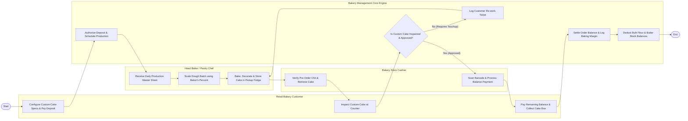

# Swimlane Diagram — Bakery Management System

## Mermaid Code

## Flow Description | Mo ta luong

| Lane | Actor | Role in Flow |
|------|-------|-------------|
| **Lane 1** | Retail Bakery Customer | Configures custom cake specifications, pays non-refundable 50% booking deposit, inspects decorated cake at counter, pays remaining balance, and collects boxed cake. |
| **Lane 2** | Head Baker / Pastry Chef | Receives daily master production sheet, scales dough ingredient formulas using Baker's Percentages, bakes, decorates custom cake, and moves cake to pickup fridge. |
| **Lane 3** | Bakery Store Cashier | Verifies customer order pickup chit, retrieves custom cake box from display fridge, scans barcode label, and processes final balance checkout at POS. |
| **Lane 4** | Bakery Management Core Engine | Authorizes deposit payments, schedules daily production, verifies cake inspection approvals, deducts bulk flour/butter inventory, and settles billing ledgers. |

### Process Execution Steps | Cac buoc thuc hien quy trinh

1. **Order Placement & Deposit**: Customer configures custom cake specs and pays 50% deposit (`C1`). Core Engine authorizes deposit and schedules production (`S1`).
2. **Baking & Decoration**: Head Baker receives daily production sheet (`B1`), scales dough using Baker's Percentages (`B2`), bakes, decorates custom cake, and stores it in pickup fridge (`B3`).
3. **Counter Inspection & Pickup**: Cashier verifies order chit and retrieves cake (`K1`). Customer inspects decorated cake (`C2`). Core Engine checks approval status (`S3`).
   - If **No (Requires Touchup)**: Engine logs touchup ticket (`S5`) and returns cake to Pastry Chef for immediate adjustment (`B3`).
   - If **Yes (Approved)**: Cashier processes remaining balance payment at POS (`K2`). Customer pays and collects cake box (`C3`). Core Engine settles billing ledger (`S4`) and deducts raw baking ingredient stock (`S2`), completing execution (`Finish`).
