# Action Tree — Bakery Management System

## Mermaid Code

```mermaid
graph TD
    Root["Bakery Management System"]

    Root --> M1["Custom Cake & Pre-Order Management"]
    Root --> M2["Dough Formulas & Baker Percentage Scaling"]
    Root --> M3["Daily Production & Oven Batch Scheduling"]
    Root --> M4["Barcode Weight Labeling & Expiration Controls"]
    Root --> M5["Stale Waste & End-of-Day Markdown Audits"]
    Root --> M6["Baking Inventory & Wholesale B2B Orders"]
    Root --> M7["Bakery Analytics & System Administration"]

    M1 --> A11["Configure Custom Cake Options & Price Quotes"]
    M1 --> A12["Collect 50 Percent Pre-Order Deposits"]
    M1 --> A13["Manage Cake Pickup Calendar & Fridge Status"]
    M1 --> A14["Maintain Digital Custom Cake Photo Catalog"]

    M2 --> A21["Create Master Dough Recipe Formulas"]
    M2 --> A22["Scale Batch Ingredients via Baker's Percent"]
    M2 --> A23["Configure Hydration & Levain Ratios"]
    M2 --> A24["Calculate Dough Division Loss Allowances"]

    M3 --> A31["Generate Daily Master Baking Production Sheets"]
    M3 --> A32["Monitor Dough Proofing Room Timers"]
    M3 --> A33["Track Commercial Deck Oven Baking Batches"]
    M3 --> A34["Log Daily Loaf & Pastry Yield Totals"]

    M4 --> A41["Weigh Packaged Bread on Smart Label Scales"]
    M4 --> A42["Print Barcode Weight & Price Labels"]
    M4 --> A43["Automate 7 PM End-of-Day Markdown Discounts"]
    M4 --> A44["Block Expiry-Breached Cream Pastry PLUs"]

    M5 --> A51["Record Daily Unsold Stale Bread Loss"]
    M5 --> A52["Categorize Waste Reasons Spoilage/Damaged"]
    M5 --> A53["Manage Day-Old Clearance Basket Pricing"]
    M5 --> A54["Audit Monetary Stale Loss Values"]

    M6 --> A61["Track Bulk Flour Butter & Yeast Stock"]
    M6 --> A62["Auto-Generate Bulk Baking Purchase Orders"]
    M6 --> A63["Manage Standing Wholesale B2B Accounts"]
    M6 --> A64["Schedule B2B Bread Delivery Shipments"]

    M7 --> A71["Monitor Daily Baking Production Yield"]
    M7 --> A72["Analyze Product Gross Margin Rankings"]
    M7 --> A73["Export Bakery Financial Tax & Sales Reports"]
    M7 --> A74["Manage User Roles & Scale Template Settings"]
```

## Module Description | Mo ta Module

| # | Module | Description | Actions |
|---|--------|-------------|---------|
| 1 | Custom Cake & Pre-Order Management | Manages custom celebration cake design builders, deposit payment collections, pickup calendar tracking, and digital cake photo catalogs. | Configure Custom Cake Options & Price Quotes, Collect 50 Percent Pre-Order Deposits, Manage Cake Pickup Calendar & Fridge Status, Maintain Digital Custom Cake Photo Catalog |
| 2 | Dough Formulas & Baker Percentage Scaling | Controls master dough formula setup, automated ingredient scaling based on Baker's Percentages (Flour = 100%), hydration ratios, and division loss math. | Create Master Dough Recipe Formulas, Scale Batch Ingredients via Baker's Percent, Configure Hydration & Levain Ratios, Calculate Dough Division Loss Allowances |
| 3 | Daily Production & Oven Batch Scheduling | Compiles daily master production sheets from retail, pre-order, and wholesale demand, monitoring proofing room timers and deck oven baking batches. | Generate Daily Master Baking Production Sheets, Monitor Dough Proofing Room Timers, Track Commercial Deck Oven Baking Batches, Log Daily Loaf & Pastry Yield Totals |
| 4 | Barcode Weight Labeling & Expiration Controls | Integrates with smart weighing scales to print barcode price/weight labels, automates 7 PM end-of-day markdown discounts, and enforces expiry locks. | Weigh Packaged Bread on Smart Label Scales, Print Barcode Weight & Price Labels, Automate 7 PM End-of-Day Markdown Discounts, Block Expiry-Breached Cream Pastry PLUs |
| 5 | Stale Waste & End-of-Day Markdown Audits | Logs daily unsold stale bread disposals, categorizes waste causes, manages day-old clearance basket pricing, and calculates monetary waste loss values. | Record Daily Unsold Stale Bread Loss, Categorize Waste Reasons Spoilage/Damaged, Manage Day-Old Clearance Basket Pricing, Audit Monetary Stale Loss Values |
| 6 | Baking Inventory & Wholesale B2B Orders | Tracks bulk raw baking ingredient inventory (flour, butter, yeast), auto-generates supplier purchase orders, and manages standing wholesale B2B deliveries. | Track Bulk Flour Butter & Yeast Stock, Auto-Generate Bulk Baking Purchase Orders, Manage Standing Wholesale B2B Accounts, Schedule B2B Bread Delivery Shipments |
| 7 | Bakery Analytics & System Administration | Provides executive reporting on daily baking yield percentages, product margin rankings, stale waste loss values, scale label templates, and user security permissions. | Monitor Daily Baking Production Yield, Analyze Product Gross Margin Rankings, Export Bakery Financial Tax & Sales Reports, Manage User Roles & Scale Template Settings |
