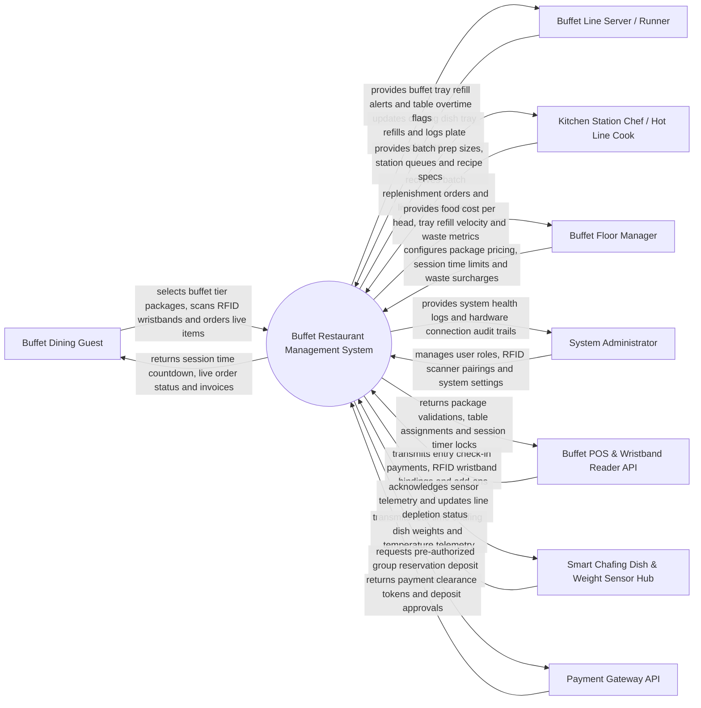

# Context Diagram — Buffet Restaurant Management System

## Mermaid Code

## Actor & Interaction Table | Bang Actor & Tuong tac

| # | Actor | Actor Type | Data Sent TO System | Data Received FROM System | Notes |
|---|-------|------------|---------------------|---------------------------|-------|
| 1 | Buffet Dining Guest | Primary | Package selection (Adult/Child/Seafood Tier), RFID wristband scans, live cooking order tickets, table clearance requests | Session time countdown alerts, live cooking order status, leftover surcharge quotes | Interacts via entrance kiosk, table tablet, or RFID wristband. |
| 2 | Buffet Line Server / Runner | Primary | Manual tray refill confirmations, table clearing logs, leftover waste weight logs, table turnover updates | Line depletion alerts, chafing dish refill priorities, table session overtime alerts | Manages buffet line replenishment and table clearing. |
| 3 | Kitchen Station Chef | Primary | Batch cooking completion, live station prep status, ingredient shortage alerts | Batch replenishment orders, live cooking tickets, station portion guidelines | Prepares bulk replenishment food for buffet lines and cooks live orders. |
| 4 | Buffet Floor Manager | Primary | Buffet package pricing tiers, session time limits (e.g., 90 mins), leftover waste surcharge rules | Food cost per head, tray refill velocity, table turnover ratios, waste loss reports | Oversees dining floor operations, seating capacity, and profitability. |
| 5 | System Administrator | Primary | User credentials, security role policies, RFID scanner pairings, system parameters | Hardware connection health logs, API telemetry alerts, security audit trails | Manages software infrastructure, RFID wristband hardware, and permissions. |
| 6 | Buffet POS & Wristband Reader API | Supporting | Guest check-in payments, RFID wristband UID bindings, ala-carte add-on charges | Package validations, assigned table numbers, session time lock triggers | Front-counter POS and entrance turnstile RFID wristband readers. |
| 7 | Smart Chafing Dish & Weight Sensor Hub | Supporting | Real-time chafing dish tray weight telemetry, food temperature logs (HACCP) | Sensor telemetry acknowledgments, threshold calibration parameters | IoT weight sensors and temperature probes under buffet chafing pans. |
| 8 | Payment Gateway API | Supporting | Group reservation deposit clearance tokens, credit card approvals | Pre-authorization deposit charge requests, refund instructions | Processes credit card deposits for large group buffet reservations. |

## System Boundary Description | Mo ta Pham vi He thong

The **Buffet Restaurant Management System** manages all-you-can-eat buffet operations, tier package pricing, session time limits, smart line replenishment, and leftover food waste control. Inside its boundary, the system handles RFID wristband guest check-ins, real-time chafing dish weight depletion tracking, automated kitchen batch replenishment alerts, live cooking station ticketing, dining session overtime enforcement, leftover food waste surcharge calculations, and food cost per head analytics.

The system boundary excludes physical cooking of food by chefs, physical table wiping by servers, raw credit card clearance (handled by Payment Gateways), and physical entrance turnstile hardware manufacturing.
