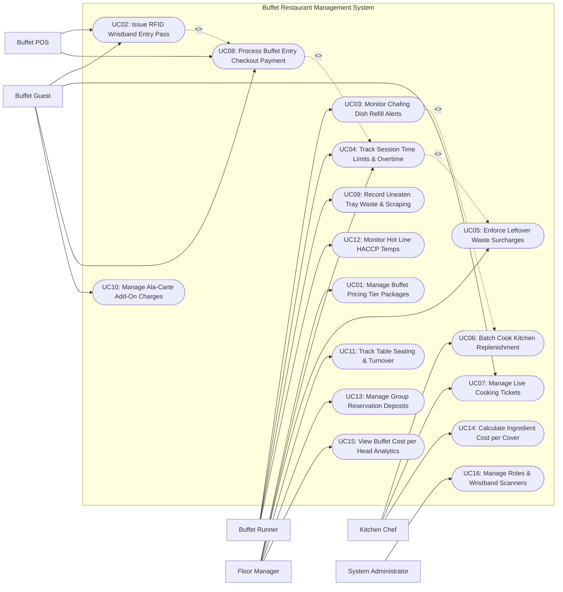

# Use Case Diagram — Buffet Restaurant Management System

## Mermaid Code

## Actor Table | Bang Actor

| # | Actor | Actor Type | Role Description | Related Use Cases |
|---|-------|------------|------------------|-------------------|
| 1 | Buffet Guest | Primary | Dining customer selecting buffet tier packages, receiving RFID wristbands, ordering live cooking items, and checking out. | UC02, UC07, UC08, UC10 |
| 2 | Buffet POS | Secondary System | Entrance POS terminal and turnstile hardware issuing RFID wristbands, validating package tiers, and collecting payments. | UC02, UC08 |
| 3 | Buffet Runner | Primary | Floor server monitoring line chafing dish levels, clearing tables, checking session timers, and logging tray temperature checks. | UC03, UC04, UC09, UC12 |
| 4 | Kitchen Chef | Primary | Station cook receiving automated batch replenishment orders, cooking live grill/sushi tickets, and tracking portion yields. | UC06, UC07, UC14 |
| 5 | Floor Manager | Primary | Restaurant manager configuring tier pricing, session time limits, leftover waste surcharge rules, and analyzing cost per head. | UC01, UC04, UC05, UC11, UC13, UC15 |
| 6 | System Administrator | Primary | Technical manager configuring RFID scanner hardware, user security permissions, system settings, and audit logs. | UC16 |

## Use Case Table | Bang Use Case

| # | UC ID | Use Case Name | Primary Actor | Secondary Actor | Description | Priority |
|---|-------|---------------|---------------|-----------------|-------------|----------|
| 1 | UC01 | Manage Buffet Pricing Tier Packages | Floor Manager | None | Configures buffet pricing package tiers (Standard Lunch, Seafood Dinner, Child, Senior, Weekend VIP) and time limits. | High |
| 2 | UC02 | Issue RFID Wristband Entry Pass | Buffet Guest | Buffet POS | Encodes and issues RFID wristbands or seat ticket QR passes at entrance POS, binding guest tier packages and entry timestamps. | High |
| 3 | UC03 | Monitor Chafing Dish Refill Alerts | Buffet Runner | None | Receives real-time chafing dish weight depletion alerts, prioritizing line replenishment before food pans run empty. | High |
| 4 | UC04 | Track Session Time Limits & Overtime | Floor Manager | Buffet Runner | Tracks table session timers (e.g., 90-minute limit), displaying warning flags on runner tablets when tables exceed time limits. | High |
| 5 | UC05 | Enforce Leftover Waste Surcharges | Floor Manager | None | Calculates and applies leftover food waste surcharges (e.g., $10 per 100g uneaten food) upon table checkout to discourage food waste. | High |
| 6 | UC06 | Batch Cook Kitchen Replenishment | Kitchen Chef | None | Receives automated batch cooking orders in the kitchen based on real-time line pan depletion rates and guest headcount. | High |
| 7 | UC07 | Manage Live Cooking Tickets | Buffet Guest | Kitchen Chef | Processes custom live station orders (Grill, Teppanyaki, Noodle Station) ordered via RFID wristband scan or table tablet. | Medium |
| 8 | UC08 | Process Buffet Entry Checkout Payment | Buffet Guest | Buffet POS | Processes payment at entrance check-in or exit checkout, settling package charges, add-on drinks, and waste surcharges. | High |
| 9 | UC09 | Record Uneaten Tray Waste & Scraping | Buffet Runner | None | Weighs and logs uneaten food scraped from guest plates and expired buffet line trays for waste reduction auditing. | Medium |
| 10 | UC10 | Manage Ala-Carte Add-On Charges | Buffet Guest | None | Charges premium non-buffet items (Alcohol, Specialty Desserts, Lobster Add-on) to guest RFID wristband or table tab. | Medium |
| 11 | UC11 | Track Table Seating & Turnover | Floor Manager | None | Monitors real-time table occupancy layout, seating assignments, table turnover rates, and floor throughput. | High |
| 12 | UC12 | Monitor Hot Line HACCP Temps | Buffet Runner | None | Records periodic chafing dish food holding temperatures (HACCP Hot Hold >= 60°C; Cold Line <= 4°C), flagging safety breaches. | High |
| 13 | UC13 | Manage Group Reservation Deposits | Floor Manager | None | Manages large group buffet reservations (10+ guests), processing pre-authorization deposit holds and seating allocations. | Medium |
| 14 | UC14 | Calculate Ingredient Cost per Cover | Kitchen Chef | None | Perpetually calculates raw ingredient consumption weight per dining cover based on total batch production and guest count. | High |
| 15 | UC15 | View Buffet Cost per Head Analytics | Floor Manager | None | Generates analytical reports on Food Cost per Head (COGS per Cover), net margin percentage, tray refill velocity, and waste loss. | High |
| 16 | UC16 | Manage Roles & Wristband Scanners | System Admin | None | Configures user access roles, RFID wristband scanner hardware IP bindings, turnstile integration keys, and system logs. | High |

## Use Case Specification | Dac ta Use Case

---

### UC01 — Manage Buffet Pricing Tier Packages

| Field | Detail |
|-------|--------|
| **UC ID** | UC01 |
| **Use Case Name** | Manage Buffet Pricing Tier Packages |
| **Actor(s)** | Primary: Buffet Floor Manager   Secondary: None |
| **Description** | Configures buffet package pricing tiers (Standard Lunch, Premium Seafood Dinner, Child Tier, Senior Discount, Weekend VIP), defining price per cover, included station access, and default session time limits. |
| **Precondition** | 1. User is authenticated with Floor Manager privileges.   2. Package pricing matrix and time limit settings module are open. |
| **Main Flow** | 1. Manager opens "Buffet Tier Package Management" module on administration console.   2. Manager creates or edits a buffet package tier:      - Package Name: `Premium Seafood & Grill Dinner`      - Adult Cover Price: $48.00 / person      - Child Cover Price (Height 100-130cm): $24.00 / person      - Senior Cover Price (Age >= 60): $38.00 / person      - Included Stations: All Stations (Hot Line, Sushi Bar, Seafood Ice Bar, Dessert Station, Soft Drinks)      - Session Time Limit: 90 Minutes      - Applicable Schedule: Friday - Sunday (17:00 to 22:00).   3. Manager configures optional package add-on rules (e.g., Free-Flow Beer Add-on = +$12.00/person).   4. Manager saves package tier configuration settings.   5. System broadcasts updated package pricing to entrance POS terminals, self-service check-in kiosks (UC08), and website booking engines. |
| **Alternative Flow** | **AF1** — Height-based child pricing automation:   1. Entrance staff measures child height using digital ultrasonic height gauge.   2. System automatically assigns `Child Under 100cm (Free)` or `Child 100-130cm (50% Off)` tier. |
| **Exception Flow** | **EX1** — Package price conflict alert:   1. Manager inputs a child price higher than adult price.   2. System flags validation error "Child price cannot exceed Adult price" and blocks saving. |
| **Postcondition** | Buffet package pricing tiers, station access rules, and session time limits are published network-wide. |
| **Business Rule** | **BR1**: Buffet package pricing must be defined per cover (per person) and automatically apply designated session time limits upon check-in.   **BR2**: Package pricing changes take effect immediately on entrance POS terminals for new guest check-ins. |

---

### UC02 — Issue RFID Wristband Entry Pass

| Field | Detail |
|-------|--------|
| **UC ID** | UC02 |
| **Use Case Name** | Issue RFID Wristband Entry Pass |
| **Actor(s)** | Primary: Buffet Guest   Secondary: Buffet POS |
| **Description** | Encodes and issues an RFID wristband or seat ticket QR entry pass at entrance POS check-in, binding the selected package tier, assigned table number, and entry timestamp. |
| **Precondition** | 1. Entrance POS terminal and RFID wristband encoder hardware are online.   2. Active buffet package tiers (UC01) are loaded. |
| **Main Flow** | 1. Guest approaches entrance POS counter or self-service check-in kiosk.   2. Guest selects party size (e.g., 4 Adults, 1 Child) and chooses package tier (`Premium Seafood Dinner`).   3. POS processes payment for entry check-in (executing UC08).   4. System assigns available table in dining room (e.g., Table #T-14) based on table layout capacity (UC11).   5. POS encoder writes encrypted RFID payload onto wristband chip (or prints barcode seat ticket): Member UID, Package Tier ID, Table #T-14, Entry Timestamp (18:30:00), Expiry Timestamp (20:00:00 - 90 mins).   6. Entrance turnstile unlocks automatically upon RFID wristband scan; Guest enters dining room.   7. System initializes 90-minute session countdown timer for Table #T-14 (UC04) and updates dining room seating layout display. |
| **Alternative Flow** | **AF1** — Post-meal payment model (Pay at Exit):   1. Guest receives RFID wristband at entrance without pre-paying.   2. Guest uses wristband to track add-ons during meal and pays total bill at exit checkout turnstile. |
| **Exception Flow** | **EX1** — RFID wristband encoding error:   1. At step 5, RFID encoder returns write error (defective chip).   2. POS displays alert "Encoder Failed", dispenses replacement wristband, and re-encodes payload. |
| **Postcondition** | Guest receives encoded RFID wristband, table is assigned, turnstile unlocks, and session countdown timer begins. |
| **Business Rule** | **BR1**: Each guest in a party must wear an encoded RFID wristband or carry a seat ticket specifying their package tier.   **BR2**: Entry timestamps recorded on RFID passes serve as the official start time for session limit monitoring. |

---

### UC03 — Monitor Live Buffet Chafing Dish Refill Alerts

| Field | Detail |
|-------|--------|
| **UC ID** | UC03 |
| **Use Case Name** | Monitor Live Buffet Chafing Dish Refill Alerts |
| **Actor(s)** | Primary: Buffet Runner   Secondary: Smart Chafing Dish & Weight Sensor Hub |
| **Description** | Continuously monitors real-time food weight depletion in buffet line chafing dishes via IoT weight sensors, triggering high-priority refill alerts to kitchen chefs and runners before pans run empty. |
| **Precondition** | 1. IoT weight sensors under chafing dishes are connected to sensor hub.   2. Full tray weights and minimum refill thresholds (e.g., 20% remaining capacity) are configured. |
| **Main Flow** | 1. Smart Chafing Dish Weight Sensor measures real-time food weight in Chafing Dish #H-04 (e.g., Grilled Ribeye Steak Pan).   2. Sensor hub transmits weight telemetry to System (e.g., Full Weight: 5.0 kg; Current Weight: 0.9 kg = 18% remaining).   3. System detects current weight has fallen below the 20% minimum refill threshold.   4. System flags high-priority **Refill Alert: Chafing Dish #H-04 (Ribeye Steak) at 18% Capacity**.   5. System dispatches refill alert to Kitchen KDS screens (UC06) and Buffet Runner handheld tablets, highlighting pan location in flashing yellow.   6. Kitchen Chef receives alert, batch cooks 5.0 kg replacement pan, and places pan in pass-through window.   7. Buffet Runner collects hot pan, replaces empty tray at Chafing Dish #H-04, and taps "Refill Completed" on tablet.   8. Sensor measures new tray weight (5.2 kg = 100%), and System resets alert status to **Normal (Green)**. |
| **Alternative Flow** | **AF1** — Manual refill alert by runner (No IoT Sensor):   1. Line runner conducts visual walkthrough and notices Seafood Ice Tray is low.   2. Runner taps "Request Refill: Oysters (Station 3)" on mobile tablet, sending kitchen alert manually. |
| **Exception Flow** | **EX1** — Kitchen ingredient out-of-stock for refill:   1. Chef receives refill alert for Ribeye Steak, but raw steak inventory is sold out.   2. Chef taps "Item 86ed / Out of Stock"; System updates line display: "Ribeye Steak Out of Stock — Substituting Roast Beef". |
| **Postcondition** | Buffet pan depletion is monitored, kitchen receives automated batch cooking alerts, and pan refills are completed. |
| **Business Rule** | **BR1**: Refill alerts must trigger when pan food weight drops below 20% to allow 8-12 minutes for kitchen batch cooking before total pan depletion.   **BR2**: High-cost items (Seafood, Steaks) must track refill frequency to detect high-consumption dining rushes. |

---

### UC04 — Track Dining Session Time Limits & Overtime

| Field | Detail |
|-------|--------|
| **UC ID** | UC04 |
| **Use Case Name** | Track Dining Session Time Limits & Overtime |
| **Actor(s)** | Primary: Buffet Runner, Floor Manager   Secondary: None |
| **Description** | Monitors dining session time countdowns for occupied tables against package time limits (e.g., 90 minutes), displaying warning notifications to runners and flagging overtime tables for manager intervention. |
| **Precondition** | 1. Guest table session was initialized upon entrance check-in (UC02).   2. Package session time limit (e.g., 90 minutes) is active. |
| **Main Flow** | 1. System continuously tracks active table session countdown timers in dining room layout module (e.g., Table #T-14 started at 18:30; 90-min limit ends at 20:00).   2. When session timer reaches 75 minutes (15 minutes remaining), System displays amber status indicator on Runner tablet: **Table #T-14 (15 Mins Remaining)**.   3. Runner approaches Table #T-14, delivers polite "15-minute courtesy reminder" note, and presents dessert options.   4. When session timer reaches 90 minutes (0 minutes remaining), System updates table status to **Red / Time Expired**.   5. If guests remain seated past 105 minutes (15 minutes overtime), System triggers **Flashing Red Alert: Table #T-14 Overtime (15 Mins Over)** to Floor Manager display.   6. Floor Manager approaches table to assist guests with exit checkout or apply overtime surcharge rules (UC05).   7. Guests depart table; Runner taps "Table Cleared & Sanitized", resetting table status to `Available` (UC11). |
| **Alternative Flow** | **AF1** — Paid session time extension:   1. Guests request to extend dining session by 30 minutes.   2. Manager taps "Extend Session +30 Mins" on tablet, adding $8.00 per person extension fee to table bill. |
| **Exception Flow** | **EX1** — Unrecorded table clearance:   1. Guests leave table early at 60 minutes, but runner forgets to tap "Table Cleared".   2. Manager notices empty table on floor, taps "Force Clear Table #T-14", and stops timer. |
| **Postcondition** | Session countdown timers are monitored, overtime tables are flagged, and table clearance resets availability. |
| **Business Rule** | **BR1**: Tables exceeding session time limits by > 15 minutes without manager extension approval flag high-priority turnover alerts.   **BR2**: Session time countdowns must pause during live cooking order delays exceeding 20 minutes. |

---

### UC05 — Enforce Leftover Food Waste Surcharge Rules

| Field | Detail |
|-------|--------|
| **UC ID** | UC05 |
| **Use Case Name** | Enforce Leftover Food Waste Surcharge Rules |
| **Actor(s)** | Primary: Buffet Floor Manager   Secondary: None |
| **Description** | Calculates and applies a leftover food waste surcharge penalty (e.g., $10 per 100g of uneaten food) at table checkout when guests leave excessive uneaten food on plates to discourage wasteful behavior. |
| **Precondition** | 1. Leftover waste surcharge policy rules (e.g., Allowable allowance: 100g uneaten food per table; Surcharge: $10/100g excess) are published on menus.   2. Digital table scale is available for runner waste weighing. |
| **Main Flow** | 1. Buffet Runner clearing Table #T-14 notices excessive uneaten food left on plates (e.g., multiple full untouched plates of seafood and meat).   2. Runner places uneaten food plates onto digital table scale or opens "Leftover Waste Evaluation" on tablet.   3. Scale weighs uneaten food: Total Uneaten Weight = 450 grams.   4. System subtracts allowable free threshold allowance (100g free allowance = 350g excess waste).   5. System calculates Leftover Food Waste Surcharge: `(350g / 100g) * $10.00 = $35.00 Surcharge Fee`.   6. System displays surcharge prompt on tablet: **Excess Leftover Waste: 350g — Surcharge: $35.00**.   7. Runner requests Floor Manager review; Manager inspects table plates, confirms excessive wastage, and taps "Approve Waste Surcharge".   8. System appends $35.00 Leftover Waste Surcharge Fee to table invoice tab (UC08).   9. Guest pays total bill including surcharge at exit checkout POS; System logs waste penalty transaction. |
| **Alternative Flow** | **AF1** — Manager courtesy waiver:   1. Guest explains child was feeling unwell, causing untouched plate.   2. Manager taps "Waive Waste Surcharge", inputs courtesy reason note, and removes penalty fee. |
| **Exception Flow** | **EX1** — Guest refuses to pay waste surcharge:   1. Guest disputes waste penalty fee at exit checkout.   2. System flags manager alert, keeping turnstiles locked until dispute resolution or manager manual override is logged. |
| **Postcondition** | Excess uneaten food is weighed, waste surcharge fee is billed to table invoice, and waste metrics are logged. |
| **Business Rule** | **BR1**: Leftover waste surcharges require mandatory Floor Manager digital sign-off before being billed to customer invoices.   **BR2**: Waste surcharge policies must be prominently displayed on table tents and entrance menus to ensure legal enforceability. |
