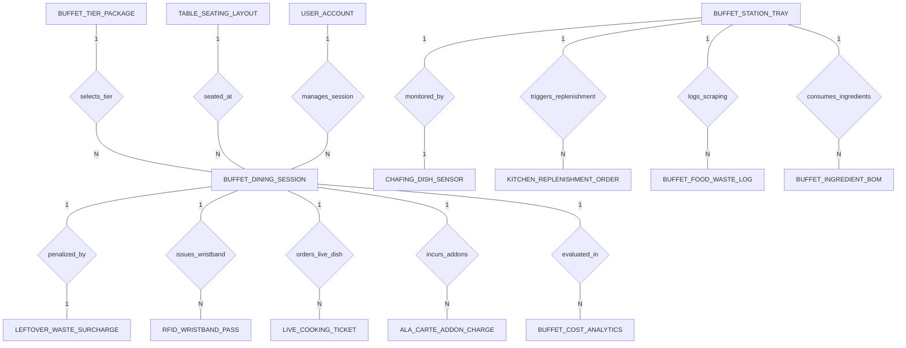

# Conceptual ERD — Buffet Restaurant Management System

## Mermaid Code

## Entity Description Table | Bang mo ta Entity

| # | Entity Name | Vietnamese Name | Description | Key Attributes | Main Relationships |
|---|-------------|-----------------|-------------|----------------|-------------------|
| 1 | BUFFET_TIER_PACKAGE | Goi gia buffet | Buffet package pricing tiers (Standard Lunch, Seafood Dinner, Child, Senior, VIP), per-head prices, and session time limits. | package_id, package_name, adult_price_per_head, child_price_per_head, session_limit_minutes | One-to-Many with BUFFET_DINING_SESSION |
| 2 | BUFFET_DINING_SESSION | Phiên an buffet | Active dining session record, assigned table ID, package tier, entry/expiry timestamps, guest count, and status. | session_id, package_id, table_id, entry_time, expiry_time, guest_adult_count, session_status | Belongs to BUFFET_TIER_PACKAGE, TABLE_SEATING_LAYOUT; One-to-Many with RFID_WRISTBAND_PASS, LIVE_COOKING_TICKET, ALA_CARTE_ADDON_CHARGE; One-to-One with LEFTOVER_WASTE_SURCHARGE |
| 3 | RFID_WRISTBAND_PASS | The Vong tay RFID | Encoded RFID wristband UID pass assigned to individual guests for station access and order tracking. | wristband_id, session_id, wristband_uid, guest_type, is_active | Belongs to BUFFET_DINING_SESSION |
| 4 | BUFFET_STATION_TRAY | Khay do an quay buffet | Individual food pan/tray on buffet line stations, full weight kg, minimum refill percentage threshold, and current status. | tray_id, station_name, food_item_name, full_weight_kg, min_refill_threshold_percent | One-to-One with CHAFING_DISH_SENSOR; One-to-Many with KITCHEN_REPLENISHMENT_ORDER, BUFFET_FOOD_WASTE_LOG, BUFFET_INGREDIENT_BOM |
| 5 | CHAFING_DISH_SENSOR | Cam bien khay nuong IoT | IoT weight and temperature sensor under buffet chafing pans, transmitting real-time weight kg and Celsius temps. | sensor_id, tray_id, sensor_code, current_weight_kg, current_temp_celsius | One-to-One with BUFFET_STATION_TRAY |
| 6 | KITCHEN_REPLENISHMENT_ORDER | Don lenh che bien them | Automated kitchen batch replenishment order generated when a buffet pan weight falls below minimum threshold. | order_id, tray_id, order_time, required_batch_weight_kg, kitchen_status | Belongs to BUFFET_STATION_TRAY |
| 7 | LIVE_COOKING_TICKET | Phieu che bien tai cho | Order ticket for custom live cooking station items (Grill, Teppanyaki, Noodle Station) ordered by guests. | ticket_id, session_id, dish_name, quantity, special_instructions, ticket_status | Belongs to BUFFET_DINING_SESSION |
| 8 | LEFTOVER_WASTE_SURCHARGE | Phai thu phat do an thua | Leftover food waste penalty fee billed to table session when uneaten plate food exceeds free weight allowance. | surcharge_id, session_id, excess_waste_grams, surcharge_amount, manager_approval_status | One-to-One with BUFFET_DINING_SESSION |
| 9 | BUFFET_FOOD_WASTE_LOG | Nhat ky thiet hai thuc an | Daily log of scraped uneaten food plates and expired buffet line trays, capturing scraped weight kg and cost loss. | waste_log_id, tray_id, log_date, scraped_waste_weight_kg, monetary_loss_amount | Belongs to BUFFET_STATION_TRAY |
| 10 | ALA_CARTE_ADDON_CHARGE | Chi phi goi them ngoai buffet | Non-buffet premium add-on charges (Alcohol, Special Desserts, Lobster add-ons) billed to guest table session. | addon_id, session_id, addon_item_name, quantity, unit_price, total_price | Belongs to BUFFET_DINING_SESSION |
| 11 | TABLE_SEATING_LAYOUT | So do ban nha hang | Dining room table layout record, table number, seating capacity, zone location, and real-time occupancy status. | table_id, table_number, max_capacity, zone_name, table_status | One-to-Many with BUFFET_DINING_SESSION |
| 12 | BUFFET_INGREDIENT_BOM | Dinh muc nguyen lieu theo suat | Bill of Materials (BOM) ingredient consumption weight per dining cover calculated for buffet station trays. | bom_id, tray_id, ingredient_name, weight_per_cover_grams, unit_cost | Belongs to BUFFET_STATION_TRAY |
| 13 | USER_ACCOUNT | Tai khoan he thong | Core security authentication account holding credentials, password hashes, and security role definitions. | user_id, username, password_hash, role_name | One-to-Many with BUFFET_DINING_SESSION |
| 14 | BUFFET_COST_ANALYTICS | Thong ke chi phi va loi nhuan | Executive daily analytics tracking total covers served, total buffet revenue, COGS food costs, and Food Cost per Cover. | analytics_id, metric_date, total_covers_served, total_buffet_revenue, total_food_cogs, food_cost_per_cover | Evaluates BUFFET_DINING_SESSION |

## Relationship Description | Mo ta Quan he

| # | From Entity | Cardinality | To Entity | Relationship Label | Business Explanation |
|---|-------------|-------------|-----------|-------------------|----------------------|
| 1 | BUFFET_TIER_PACKAGE | One-to-Many | BUFFET_DINING_SESSION | selects_tier | Mot goi gia buffet (Lunch, Dinner) duoc chon cho nhieu phiên an cua khach. |
| 2 | TABLE_SEATING_LAYOUT | One-to-Many | BUFFET_DINING_SESSION | seated_at | Mot ban trong so do duoc xep cho nhieu phiên an qua cac khung gio. |
| 3 | BUFFET_DINING_SESSION | One-to-Many | RFID_WRISTBAND_PASS | issues_wristband | Mot phiên an buffet phat hanh nhieu the vong tay RFID cho cac thanh vien trong doan. |
| 4 | BUFFET_STATION_TRAY | One-to-One | CHAFING_DISH_SENSOR | monitored_by | Mot khay do an tren quay duoc theo doi bang mot cam bien trong luong IoT. |
| 5 | BUFFET_STATION_TRAY | One-to-Many | KITCHEN_REPLENISHMENT_ORDER | triggers_replenishment | Mot khay do an het kich hoat cac lenh che bien them gui ve bep. |
| 6 | BUFFET_DINING_SESSION | One-to-Many | LIVE_COOKING_TICKET | orders_live_dish | Mot phiên an buffet co the dat nhieu phieu che bien tai cho (Grill, Noodle). |
| 7 | BUFFET_DINING_SESSION | One-to-One | LEFTOVER_WASTE_SURCHARGE | penalized_by | Mot phiên an duoc tinh phi phat neu luong thuc an thua vuot qua muc quy dinh. |
| 8 | BUFFET_STATION_TRAY | One-to-Many | BUFFET_FOOD_WASTE_LOG | logs_scraping | Mot khay do an duoc ghi nhat ky thiet hai thuc an bi do/thua hang ngay. |
| 9 | BUFFET_DINING_SESSION | One-to-Many | ALA_CARTE_ADDON_CHARGE | incurs_addons | Mot phiên an co the goi thêm nhieu mon hoac do uong cao cap ngoai goi buffet. |
| 10 | BUFFET_STATION_TRAY | One-to-Many | BUFFET_INGREDIENT_BOM | consumes_ingredients | Mot khay do an quy doi va tru dinh muc nguyen lieu nguyen tho theo dau khach. |
| 11 | USER_ACCOUNT | One-to-Many | BUFFET_DINING_SESSION | manages_session | Nhan vien quan ly hoac le tan theo doi va dieu hanh cac phiên an buffet. |
| 12 | BUFFET_DINING_SESSION | One-to-Many | BUFFET_COST_ANALYTICS | evaluated_in | Cac phiên an buffet duoc thong ke va danh gia chi phi nguyen lieu tren moi dau khach. |
