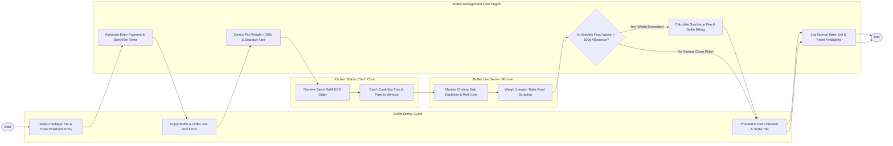

# Swimlane Diagram — Buffet Restaurant Management System

## Mermaid Code

## Flow Description | Mo ta luong

| Lane | Actor | Role in Flow |
|------|-------|-------------|
| **Lane 1** | Buffet Dining Guest | Selects package tier at entrance, scans RFID wristband, enjoys buffet lines, orders live station items, and settles final checkout bill. |
| **Lane 2** | Buffet Line Server / Runner | Monitors chafing dish food depletion levels, replaces empty pans with hot kitchen refills, clears tables, and weighs uneaten food waste. |
| **Lane 3** | Kitchen Station Chef / Cook | Receives automated batch cooking orders on kitchen KDS screens, cooks bulk replenishment batches, and passes hot trays to runners. |
| **Lane 4** | Buffet Management Core Engine | Authorizes check-in payments, tracks 90-minute session timers, detects pan weight depletion via IoT sensors, calculates waste surcharges, and updates analytics. |

### Process Execution Steps | Cac buoc thuc hien quy trinh

1. **Check-In & Session Start**: Guest selects package tier and scans RFID wristband (`C1`). Core Engine authorizes payment and starts 90-minute session countdown timer (`S1`).
2. **Buffet Line & Replenishment Alert**: Guest enjoys buffet and orders live grill items (`C2`). Core Engine detects chafing pan weight < 20% via IoT sensors and sends alert (`S2`). Kitchen Chef batch cooks 5kg tray (`B1`, `B2`). Runner refills line pan (`K1`).
3. **Table Clearing & Waste Audit**: Runner clears table and weighs uneaten food scraping (`K2`). Core Engine checks waste threshold (`S3`).
   - If **Yes (Waste Exceeded > 100g)**: Core Engine calculates waste surcharge fee ($10/100g) and appends to bill (`S4`).
   - If **No (Normal Clean Plate)**: Core Engine skips surcharge.
4. **Checkout & Clearance**: Guest settles final bill at exit checkout turnstile (`C3`). Core Engine logs table exit, resets table status to `Available` (`S5`), and updates food cost per head analytics, completing execution (`Finish`).
