# Action Tree — Buffet Restaurant Management System

## Mermaid Code

```mermaid
graph TD
    Root["Buffet Restaurant Management System"]

    Root --> M1["Buffet Tier Packages & Seating Session Control"]
    Root --> M2["Smart Chafing Dish Telemetry & Line Refill Alerts"]
    Root --> M3["Kitchen Replenishment & Live Cooking Stations"]
    Root --> M4["Overtime & Leftover Waste Surcharge Management"]
    Root --> M5["Ala-Carte Add-Ons & Wristband POS Billing"]
    Root --> M6["Food Scrap Waste Audits & HACCP Temperature Logs"]
    Root --> M7["Cost-per-Head Analytics & System Administration"]

    M1 --> A11["Configure Buffet Tier Pricing Packages"]
    M1 --> A12["Issue RFID Wristband Entry Passes"]
    M1 --> A13["Manage Dining Room Seating Layout"]
    M1 --> A14["Track Group Reservation Deposit Holds"]

    M2 --> A21["Ingest Real-Time Chafing Pan Weights"]
    M2 --> A22["Trigger Automated Kitchen Batch Refill Alerts"]
    M2 --> A23["Prioritize High-Consumption Station Refills"]
    M2 --> A24["Substitute Out-of-Stock Buffet Dishes 86ing"]

    M3 --> A31["Receive Batch Cooking Orders on Kitchen KDS"]
    M3 --> A32["Manage Live Grill & Teppanyaki Tickets"]
    M3 --> A33["Calculate Recipe Ingredient BOM Scaling"]
    M3 --> A34["Track Pass-Through Window Tray Handoffs"]

    M4 --> A41["Monitor 90-Minute Table Session Countdowns"]
    M4 --> A42["Flag Overtime Tables Past Session Limits"]
    M4 --> A43["Weigh Uneaten Table Food Scraping"]
    M4 --> A44["Calculate Leftover Food Waste Surcharges"]

    M5 --> A51["Process Entrance Turnstile Check-In Payment"]
    M5 --> A52["Charge Ala-Carte Drinks to Wristband UID"]
    M5 --> A53["Apply Waste Surcharge Fees to Exit Invoice"]
    M5 --> A54["Process Exit Turnstile Checkout Settlement"]

    M6 --> A61["Record Daily Uneaten Tray Waste Scraping"]
    M6 --> A62["Log Chafing Dish HACCP Temperature Checks"]
    M6 --> A63["Audit Expired Line Food Monetary Loss"]
    M6 --> A64["Track Sanitizer Chemical Verification"]

    M7 --> A71["Monitor Food Cost per Head COGS per Cover"]
    M7 --> A72["Analyze Tray Refill Velocity & Food Demand"]
    M7 --> A73["Compare Table Turnover Ratio Metrics"]
    M7 --> A74["Manage User Roles & RFID Scanner Settings"]
```

## Module Description | Mo ta Module

| # | Module | Description | Actions |
|---|--------|-------------|---------|
| 1 | Buffet Tier Packages & Seating Session Control | Controls buffet package tier pricing (Adult, Child, Senior, Weekend), RFID wristband pass encoding, dining room seating layouts, and group deposit holds. | Configure Buffet Tier Pricing Packages, Issue RFID Wristband Entry Passes, Manage Dining Room Seating Layout, Track Group Reservation Deposit Holds |
| 2 | Smart Chafing Dish Telemetry & Line Refill Alerts | Ingests real-time IoT pan weights, triggers automated kitchen batch refill alerts, prioritizes high-consumption refills, and manages dish substitution 86ing. | Ingest Real-Time Chafing Pan Weights, Trigger Automated Kitchen Batch Refill Alerts, Prioritize High-Consumption Station Refills, Substitute Out-of-Stock Buffet Dishes 86ing |
| 3 | Kitchen Replenishment & Live Cooking Stations | Manages kitchen KDS batch replenishment orders, live cooking tickets (Grill, Teppanyaki), ingredient BOM scaling, and pass-through window handoffs. | Receive Batch Cooking Orders on Kitchen KDS, Manage Live Grill & Teppanyaki Tickets, Calculate Recipe Ingredient BOM Scaling, Track Pass-Through Window Tray Handoffs |
| 4 | Overtime & Leftover Waste Surcharge Management | Tracks 90-minute session countdown timers, flags overtime tables, weighs uneaten plate scraping, and calculates leftover waste penalty surcharges. | Monitor 90-Minute Table Session Countdowns, Flag Overtime Tables Past Session Limits, Weigh Uneaten Table Food Scraping, Calculate Leftover Food Waste Surcharges |
| 5 | Ala-Carte Add-Ons & Wristband POS Billing | Handles entrance turnstile check-in payments, charges premium non-buffet drinks to RFID wristbands, applies waste surcharges, and settles exit checkout. | Process Entrance Turnstile Check-In Payment, Charge Ala-Carte Drinks to Wristband UID, Apply Waste Surcharge Fees to Exit Invoice, Process Exit Turnstile Checkout Settlement |
| 6 | Food Scrap Waste Audits & HACCP Temperature Logs | Logs scraped uneaten food waste, audits monetary waste losses, records chafing dish HACCP temperature holding checks, and tracks sanitizer verification. | Record Daily Uneaten Tray Waste Scraping, Log Chafing Dish HACCP Temperature Checks, Audit Expired Line Food Monetary Loss, Track Sanitizer Chemical Verification |
| 7 | Cost-per-Head Analytics & System Administration | Provides executive reporting on Food Cost per Head (COGS per Cover), tray refill velocity, table turnover ratios, RFID scanner settings, and user permissions. | Monitor Food Cost per Head COGS per Cover, Analyze Tray Refill Velocity & Food Demand, Compare Table Turnover Ratio Metrics, Manage User Roles & RFID Scanner Settings |
