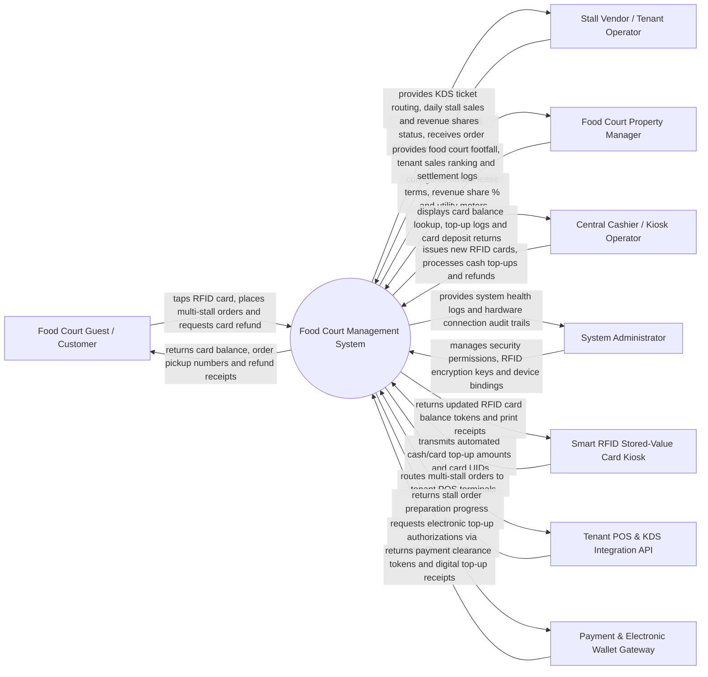

# Context Diagram — Food Court Management System

## Mermaid Code

## Actor & Interaction Table | Bang Actor & Tuong tac

| # | Actor | Actor Type | Data Sent TO System | Data Received FROM System | Notes |
|---|-------|------------|---------------------|---------------------------|-------|
| 1 | Food Court Guest / Customer | Primary | RFID card tap payments, multi-stall order choices, QR table scans, card refund requests | Card balance status, order pickup pager numbers, remaining balance cash refunds | Interacts via RFID smart cards, self-service kiosks, or table QR codes. |
| 2 | Stall Vendor / Tenant Operator | Primary | Item sold-out (86) updates, order prep completion triggers, stall menu updates | Routed KDS order tickets, daily stall sales totals, net revenue settlement statements | Operates individual food stalls within the food court mall. |
| 3 | Property Manager | Primary | Tenant lease agreement contracts, revenue share percentages (e.g., 15% GMV), utility rates | Multi-tenant sales rankings, footfall analytics, monthly tenant settlement invoices | Oversees commercial food court property operations and tenant leases. |
| 4 | Central Cashier | Primary | Issued RFID card UIDs, cash/card top-up amounts, card deposit refunds | RFID card balance confirmation, top-up receipts, card refund authorization | Operates central food court cash counter for card issuing/refunding. |
| 5 | System Administrator | Primary | User credentials, security role policies, RFID card encryption keys, POS API tokens | System health metrics, hardware connection logs, security audit logs | Manages cloud platform infrastructure, RFID card encryption, and permissions. |
| 6 | Smart RFID Stored-Value Card Kiosk | Supporting | Automated cash/card top-up amounts, new card issuance requests, card UIDs | Encrypted card balance updates, card deposit tokens, printed receipts | Automated self-service kiosks for purchasing and recharging RFID cards. |
| 7 | Tenant POS & KDS Integration API | Supporting | Tenant-specific order prep statuses, stall sales transactions | Consolidated order tickets, item master updates, tenant revenue share logs | Integrates with individual stall POS/KDS systems across vendors. |
| 8 | Payment & Electronic Wallet Gateway | Supporting | Digital top-up authorizations (MoMo, ZaloPay, Credit Cards) | Payment clearance tokens, transaction receipts, refund approvals | Clears digital wallet and card payments for RFID card top-ups. |

## System Boundary Description | Mo ta Pham vi He thong

The **Food Court Management System** manages multi-tenant food court mall operations, centralized stored-value RFID card payments, multi-stall order routing, and tenant revenue share settlements. Inside its boundary, the system handles RFID card issuance, top-up transactions, card deposit refunds, central kiosk and table QR multi-stall ordering, tenant KDS order dispatching, overhead order pickup pager screens, stall utility consumption metering, and monthly tenant revenue share calculation (e.g., 15% property commission + net payout).

The system boundary excludes physical cooking inside vendor stalls, physical dishwashing by central utility staff, raw credit card clearance (handled by Payment Gateways), and physical mall building construction.
