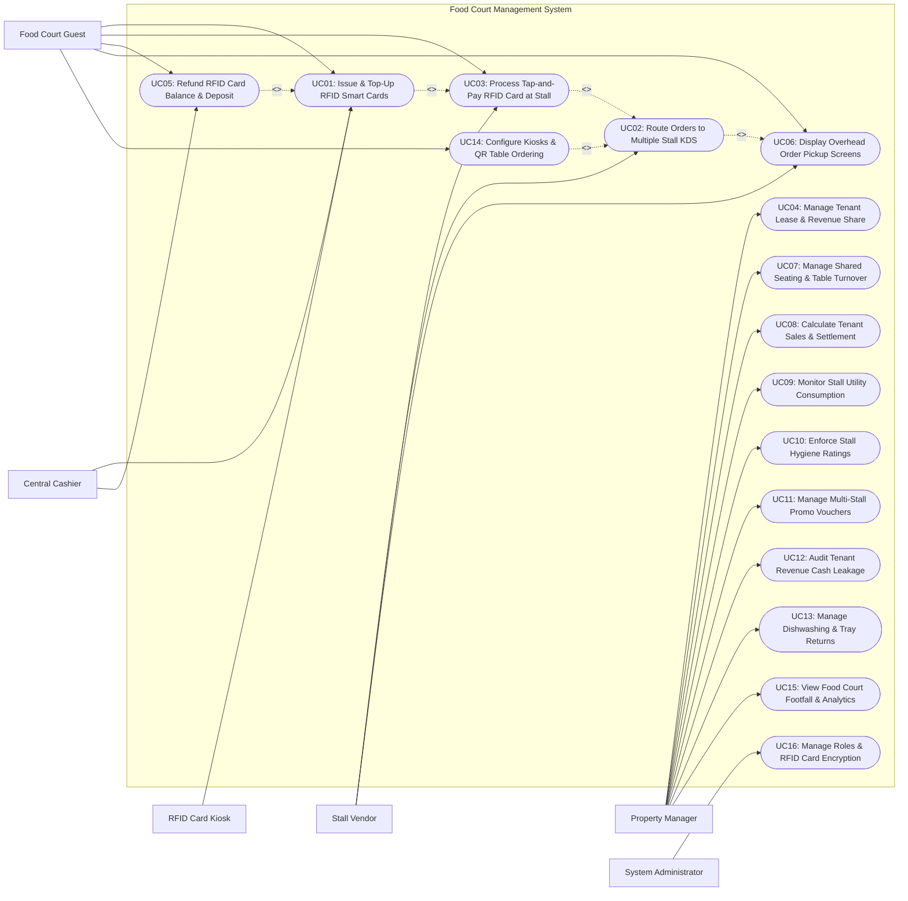

# Use Case Diagram — Food Court Management System

## Mermaid Code

## Actor Table | Bang Actor

| # | Actor | Actor Type | Role Description | Related Use Cases |
|---|-------|------------|------------------|-------------------|
| 1 | RFID Card Kiosk | Secondary System | Automated self-service kiosk hardware issuing new RFID cards, accepting cash/e-wallet top-ups, and printing receipts. | UC01 |
| 2 | Food Court Guest | Primary | Customer purchasing/topping up RFID cards, scanning table QR codes, tapping cards at food stalls, and getting cash refunds. | UC01, UC03, UC05, UC06, UC14 |
| 3 | Central Cashier | Primary | Food court property employee issuing RFID smart cards, processing cash top-ups, and refunding remaining balances at exit counter. | UC01, UC05 |
| 4 | Stall Vendor | Primary | Tenant cook operating an individual food stall, tapping guest RFID cards on stall terminals, receiving KDS tickets, and preparing meals. | UC02, UC03, UC06 |
| 5 | Property Manager | Primary | Food court manager configuring tenant lease contracts, revenue share percentages, settling monthly payouts, and auditing cash leakage. | UC04, UC07, UC08, UC09, UC10, UC11, UC12, UC13, UC15 |
| 6 | System Administrator | Primary | Technical admin managing RFID card encryption keys, terminal IP bindings, user security roles, and system audit logs. | UC16 |

## Use Case Table | Bang Use Case

| # | UC ID | Use Case Name | Primary Actor | Secondary Actor | Description | Priority |
|---|-------|---------------|---------------|-----------------|-------------|----------|
| 1 | UC01 | Issue & Top-Up RFID Smart Cards | Guest / Cashier | RFID Card Kiosk | Issues new reusable RFID stored-value cards (with refundable card deposit), topping up cash or digital e-wallet balances. | High |
| 2 | UC02 | Route Orders to Multiple Stall KDS | System | Stall Vendor | Algorithmically splits multi-stall orders from kiosks/QR table ordering and routes sub-tickets to respective vendor KDS displays. | High |
| 3 | UC03 | Process Tap-and-Pay RFID Card at Stall | Guest / Vendor | None | Deducts order amounts from guest RFID stored-value cards at stall reader terminals, validating balance and authorizing prep. | High |
| 4 | UC04 | Manage Tenant Lease & Revenue Share | Property Manager | None | Configures tenant lease contracts, fixed monthly rent, variable revenue share percentages (e.g., 15% GMV), and utility rates. | High |
| 5 | UC05 | Refund RFID Card Balance & Deposit | Guest / Cashier | None | Refunds unspent stored-value balances and refundable card deposit amounts in cash/e-wallet when guests return cards at exit. | High |
| 6 | UC06 | Display Overhead Order Pickup Screens | Guest / Vendor | None | Renders ready order pickup numbers on central overhead TV screens and triggers SMS/app notifications to waiting guests. | High |
| 7 | UC07 | Manage Shared Seating & Table Turnover | Property Manager | None | Monitors real-time food court dining hall table occupancy, cleaning status, peak footfall hours, and table turnover rates. | Medium |
| 8 | UC08 | Calculate Tenant Sales & Settlement | Property Manager | None | Calculates monthly net revenue payouts for each tenant stall (Gross Sales - Revenue Share % - Utility Costs = Net Payout). | High |
| 9 | UC09 | Monitor Stall Utility Consumption | Property Manager | None | Tracks sub-metered electricity, gas, and water consumption for each food stall, billing utility costs back to tenants. | Medium |
| 10 | UC10 | Enforce Stall Hygiene Ratings | Property Manager | None | Conducts weekly food safety inspections across stalls, issuing hygiene ratings (A/B/C) and enforcing penalty fines for violations. | Medium |
| 11 | UC11 | Manage Multi-Stall Promo Vouchers | Property Manager | None | Configures mall-wide promotional discount vouchers valid across all food stalls (e.g., $5 Off $25 Multi-Stall Purchase). | Medium |
| 12 | UC12 | Audit Tenant Revenue Cash Leakage | Property Manager | None | Audits stall cash transactions to detect unrecorded cash sales or unauthorized cash bypass outside the central RFID card system. | High |
| 13 | UC13 | Manage Dishwashing & Tray Returns | Property Manager | None | Tracks central tray return station volumes, dishwashing machine throughput, and reusable tableware inventory. | Medium |
| 14 | UC14 | Configure Kiosks & QR Table Ordering | Guest | None | Enables guests to scan table QR codes or use central kiosks to order food from multiple stalls in a single transaction. | High |
| 15 | UC15 | View Food Court Footfall & Analytics | Property Manager | None | Displays analytical dashboards on mall footfall, top-performing stalls, peak dining hours, revenue contribution, and card utilization. | High |
| 16 | UC16 | Manage Roles & RFID Card Encryption | System Admin | None | Configures security role permissions, RFID card AES-128 encryption keys, terminal IP bindings, and system logs. | High |

## Use Case Specification | Dac ta Use Case

---

### UC01 — Issue & Top-Up RFID Smart Cards

| Field | Detail |
|-------|--------|
| **UC ID** | UC01 |
| **Use Case Name** | Issue & Top-Up RFID Smart Cards |
| **Actor(s)** | Primary: Food Court Guest, Central Cashier   Secondary: Smart RFID Stored-Value Card Kiosk |
| **Description** | Issues reusable RFID stored-value cards to guests (collecting a refundable card deposit e.g., $2.00) and processes cash or digital wallet top-ups (e.g., MoMo, ZaloPay, Credit Card) to fund stored-value balances. |
| **Precondition** | 1. Central cashier terminal or automated self-service card kiosk is online.   2. Unencoded RFID card inventory is available. |
| **Main Flow** | 1. Guest approaches Central Cashier Counter or Automated Card Kiosk.   2. Guest selects "Get New Food Court Card" or "Top-Up Existing Card".   3. For new card issuance, System prompts for mandatory refundable card deposit (e.g., $2.00).   4. Guest selects top-up amount (e.g., $30.00) and tender method (Cash, MoMo QR, ZaloPay, Credit Card).   5. Guest inserts cash into kiosk cash acceptor or scans digital wallet QR code.   6. System verifies payment clearance ($32.00 total = $30.00 stored balance + $2.00 card deposit).   7. System places unencoded RFID card on writer pad, writes encrypted balance token ($30.00), and records unique 16-digit Card UID.   8. System dispenses RFID card (or updates existing card balance) and prints top-up transaction receipt displaying: `Card UID: ****-8821; Top-up Amount: $30.00; Card Balance: $30.00; Refundable Deposit: $2.00`.   9. Guest receives card and proceeds to food stalls. |
| **Alternative Flow** | **AF1** — Quick contactless top-up via mobile app:   1. Guest scans RFID card QR code using mobile banking app.   2. Guest tops up $20.00 online; System updates card balance server-side instantly. |
| **Exception Flow** | **EX1** — Card writing error:   1. At step 7, RFID writer pad returns communication error (defective card chip).   2. System flags error, ejects card into internal discard bin, dispenses new card, and re-writes balance token. |
| **Postcondition** | RFID card is issued or topped up, encrypted balance is stored in database, and receipt is printed. |
| **Business Rule** | **BR1**: RFID stored-value card balances must be encrypted using AES-128 keys to prevent unauthorized balance tampering.   **BR2**: Card deposit amounts ($2.00) must be tracked separately from spendable food balances to ensure 100% refundability. |

---

### UC02 — Route Orders to Multiple Stall KDS

| Field | Detail |
|-------|--------|
| **UC ID** | UC02 |
| **Use Case Name** | Route Orders to Multiple Stall KDS |
| **Actor(s)** | Primary: System   Secondary: Stall Vendor |
| **Description** | Algorithmically splits multi-stall orders placed at central kiosks or table QR codes into individual stall sub-tickets and dispatches them simultaneously to respective vendor KDS displays. |
| **Precondition** | 1. Customer completes a multi-stall order transaction (UC14 or UC03).   2. Vendor Kitchen Display Systems (KDS) across stalls are online. |
| **Main Flow** | 1. System receives a master multi-stall order payload (Master Order #FC-9022) containing:      - Stall 01 (Noodle Bar): 1x Beef Pho ($8.00)      - Stall 04 (Beverage Bar): 1x Iced Milk Coffee ($3.00)      - Stall 07 (Dessert Stall): 1x Mango Sticky Rice ($5.00).   2. System splits master order into 3 independent stall sub-tickets while retaining Master Order ID link (FC-9022).   3. System assigns a unified customer pickup number (e.g., Pickup #142).   4. System dispatches sub-tickets simultaneously to target stall KDS displays over local network WebSocket.   5. Stall KDS screens chime and render new ticket cards with order items, pickup number #142, and prep timer (00:00).   6. As each vendor completes their items, vendor taps "Ready" on stall KDS screen.   7. System updates overhead pickup screen (UC06) showing: `Pickup #142: Stall 01 READY; Stall 04 READY; Stall 07 PREPARING`. |
| **Alternative Flow** | **AF1** — Single-stall counter order:   1. Customer orders directly at Stall 01 counter via RFID tap.   2. System routes sub-ticket directly to Stall 01 KDS without multi-stall splitting. |
| **Exception Flow** | **EX1** — Target stall KDS display offline:   1. System detects Stall 07 KDS is offline.   2. System automatically reroutes sub-ticket to Stall 07 backup receipt printer and alerts Central Cashier. |
| **Postcondition** | Multi-stall orders are split, sub-tickets are routed to vendor displays, and overhead pickup screens update. |
| **Business Rule** | **BR1**: Unified multi-stall orders must assign a single pickup number to prevent customer confusion.   **BR2**: Order routing latency from checkout to vendor KDS displays must execute within 500 milliseconds. |

---

### UC03 — Process Tap-and-Pay RFID Card at Stall

| Field | Detail |
|-------|--------|
| **UC ID** | UC03 |
| **Use Case Name** | Process Tap-and-Pay RFID Card at Stall |
| **Actor(s)** | Primary: Food Court Guest, Stall Vendor   Secondary: None |
| **Description** | Deducts order amounts from a guest's RFID stored-value card at stall reader terminals in under 1 second, validating active card balances, and authorizing food preparation. |
| **Precondition** | 1. Guest presents active RFID smart card with stored balance.   2. Stall reader terminal is online and loaded with vendor menu PLUs. |
| **Main Flow** | 1. Stall Vendor inputs order items on stall terminal (e.g., 1x Chicken Rice @ $7.50).   2. Vendor taps "Pay via Food Court Card"; Stall RFID reader activates green LED.   3. Guest taps RFID card on stall reader pad.   4. Reader reads encrypted card UID and balance payload, transmitting tap request to System.   5. System decrypts card payload, validates card status (`Active`), and checks balance (Current Balance: $25.00 >= $7.50).   6. System deducts $7.50 from card balance (New Balance: $17.50).   7. System records transaction log: `Order #ST01-402, Stall #01, Amount: $7.50, New Balance: $17.50, Timestamp`.   8. Stall reader beeps green approval tone and displays: **Payment Approved! Balance: $17.50**.   9. System dispatches order ticket to Stall 01 KDS (UC02) and prints customer paper receipt. |
| **Alternative Flow** | **AF1** — Split payment (Card Balance + Cash top-up at stall):   1. Card balance is $5.00, but order is $7.50 (Shortage: $2.50).   2. System prompts "Card Balance Insufficient ($5.00 available). Pay remaining $2.50 via Cash?".   3. Vendor collects $2.50 cash, deducts $5.00 from card, and approves transaction. |
| **Exception Flow** | **EX1** — Card balance insufficient:   1. At step 5, card balance is $3.00 (less than $7.50 order total).   2. Stall reader plays red error tone **Insufficient Balance ($3.00)** and prompts guest to top up card at kiosk or cashier. |
| **Postcondition** | Card balance is decremented, transaction log is recorded, and stall KDS receives prep ticket. |
| **Business Rule** | **BR1**: Tap-and-pay transactions at stalls must execute and return approval within 800 milliseconds.   **BR2**: Stall terminals are strictly locked from accepting direct cash unless configured for split-payment emergency modes. |

---

### UC04 — Manage Tenant Lease & Revenue Share

| Field | Detail |
|-------|--------|
| **UC ID** | UC04 |
| **Use Case Name** | Manage Tenant Lease & Revenue Share |
| **Actor(s)** | Primary: Food Court Property Manager   Secondary: None |
| **Description** | Configures stall tenant lease agreements, fixed monthly rent amounts, variable revenue share percentage rates (e.g., 15% GMV commission), and utility sub-meter billing rates. |
| **Precondition** | 1. User is authenticated with Property Manager privileges.   2. Stall tenant management module is open. |
| **Main Flow** | 1. Property Manager opens "Tenant Lease & Revenue Share Configuration" module.   2. Manager selects a food stall location (e.g., Stall #04 - Noodle House).   3. Manager inputs Tenant Profile: Company Name, Brand Name, Contact Person, Phone, Email, and Tax ID.   4. Manager configures Lease Financial Terms:      - Lease Contract Dates: 2-Year Term (Jan 1, 2026 to Dec 31, 2027)      - Fixed Monthly Base Rent: $1,500.00 / month      - Variable Revenue Share Commission: 15.0% of Gross Sales (GMV)      - Sub-Metered Utility Billing Rates: Electricity ($0.20/kWh), Gas ($1.50/m3), Water ($2.00/m3)      - Central Service Charge: $300.00 / month (Dishwashing & Cleaning fee).   5. Manager configures settlement calculation model: `Highest of (Fixed Rent vs Revenue Share)` OR `Fixed Rent + Revenue Share`.   6. Manager saves lease configuration settings.   7. System updates tenant profile and binds financial calculation rules for monthly settlement execution (UC08). |
| **Alternative Flow** | **AF1** — Tiered revenue share commission:   1. Contract specifies 15% commission on sales up to $20,000, and 12% commission on sales above $20,000.   2. Manager configures tiered commission scale. |
| **Exception Flow** | **EX1** — Lease contract expiration alert:   1. System detects a tenant lease contract is expiring within 60 days.   2. System flags warning alert on Manager dashboard "Lease Expiry Warning: Stall #04" and prompts contract renewal workflow. |
| **Postcondition** | Tenant lease contract terms, revenue share commission percentages, and utility billing rates are saved in system. |
| **Business Rule** | **BR1**: Variable revenue share commissions must be calculated automatically from POS gross sales data (GMV).   **BR2**: Utility sub-meter rates must update automatically based on official municipal utility rate changes. |

---

### UC08 — Calculate Tenant Sales & Settlement

| Field | Detail |
|-------|--------|
| **UC ID** | UC08 |
| **Use Case Name** | Calculate Tenant Sales & Settlement |
| **Actor(s)** | Primary: Food Court Property Manager   Secondary: None |
| **Description** | Calculates monthly net revenue payout settlements for each food stall tenant, deducting corporate revenue share commissions, fixed rent, utility costs, and central service fees. |
| **Precondition** | 1. Monthly sales ingestion (UC03) and utility meter readings (UC09) for billing period are completed.   2. Tenant lease contract terms (UC04) are active. |
| **Main Flow** | 1. Property Manager initiates "Monthly Tenant Settlement Batch" execution at end of billing cycle.   2. System queries all gross sales transactions processed for Stall #04 (Noodle House) during billing period.   3. System calculates Total Gross Merchandise Value (GMV) Sales (e.g., $25,000.00 collected via RFID cards/kiosks).   4. System retrieves lease terms for Stall #04:      - Gross Sales Collected by Property: $25,000.00      - Revenue Share Commission (15% of GMV): -$3,750.00      - Electricity Utility Bill (1,200 kWh @ $0.20): -$240.00      - Gas Utility Bill (150 m3 @ $1.50): -$225.00      - Water Utility Bill (30 m3 @ $2.00): -$60.00      - Central Service & Cleaning Fee: -$300.00.   5. System calculates Net Tenant Payout Amount: `$25,000.00 - $3,750.00 - $240.00 - $225.00 - $60.00 - $300.00 = $20,425.00`.   6. System generates itemized Monthly Tenant Settlement Statement PDF and dispatches to tenant email.   7. Manager reviews settlement statement, approves payout batch, and initiates bank wire transfer of $20,425.00 to tenant bank account.   8. System marks settlement period `Paid / Settled` and posts financial journal entries. |
| **Alternative Flow** | **AF1** — Tenant deficit balance (Expenses exceed sales):   1. Tenant gross sales are low ($1,000.00), but fixed rent/utilities total $1,800.00.   2. System calculates net tenant deficit (-$800.00) and issues invoice to tenant requesting payment. |
| **Exception Flow** | **EX1** — Disputed sales variance:   1. Tenant disputes gross sales calculation ($25,000 vs tenant internal record $25,500).   2. Manager opens audit log, cross-references raw RFID transaction logs, resolves variance, and re-issues statement. |
| **Postcondition** | Monthly tenant settlement statements are generated, net payouts are calculated, and financial records are archived. |
| **Business Rule** | **BR1**: Property managers must execute tenant settlements within 5 business days following monthly period close.   **BR2**: All sales collected via central RFID cards/kiosks belong to property custody until net tenant payout settlement occurs. |
