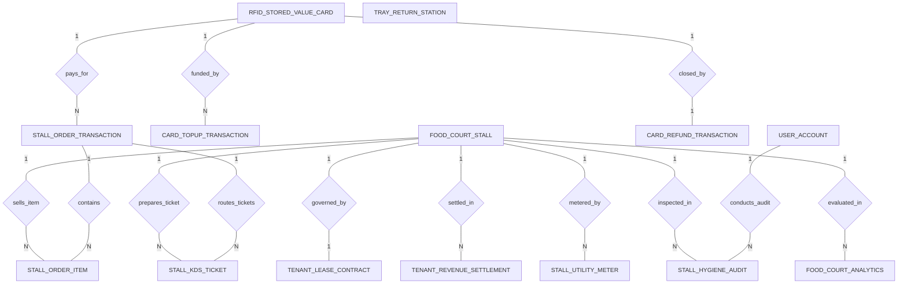

# Conceptual ERD — Food Court Management System

## Mermaid Code

## Entity Description Table | Bang mo ta Entity

| # | Entity Name | Vietnamese Name | Description | Key Attributes | Main Relationships |
|---|-------------|-----------------|-------------|----------------|-------------------|
| 1 | FOOD_COURT_STALL | Gian hang khu am thuc | Registered food stall vendor booth, stall code, stall name, cuisine category, and status. | stall_id, stall_code, stall_name, cuisine_category, stall_status | One-to-One with TENANT_LEASE_CONTRACT; One-to-Many with STALL_ORDER_ITEM, STALL_KDS_TICKET, TENANT_REVENUE_SETTLEMENT, STALL_UTILITY_METER, STALL_HYGIENE_AUDIT, FOOD_COURT_ANALYTICS |
| 2 | TENANT_LEASE_CONTRACT | Hop dong thue gian hang | Lease agreement for stall tenant detailing fixed base rent, variable revenue share commission %, and contract dates. | contract_id, stall_id, tenant_company_name, fixed_base_rent, revenue_share_percent, start_date | One-to-One with FOOD_COURT_STALL |
| 3 | RFID_STORED_VALUE_CARD | The RFID tich gia tri | Reusable RFID smart card record storing card UID, encrypted active balance, card deposit amount, and status. | card_id, card_uid, current_balance, card_deposit_amount, card_status, issued_at | One-to-Many with CARD_TOPUP_TRANSACTION, STALL_ORDER_TRANSACTION; One-to-One with CARD_REFUND_TRANSACTION |
| 4 | CARD_TOPUP_TRANSACTION | Giao dich nap tien the | Record of card top-up transactions, top-up amount, payment method (Cash, MoMo, ZaloPay, Card), and timestamp. | topup_id, card_id, topup_amount, payment_method, transaction_time | Belongs to RFID_STORED_VALUE_CARD |
| 5 | STALL_ORDER_TRANSACTION | Don hang khu am thuc | Master customer order transaction, RFID card ID, master order ref, customer pickup number, grand total, and order time. | order_id, card_id, master_order_ref, customer_pickup_number, grand_total, order_time | Belongs to RFID_STORED_VALUE_CARD; One-to-Many with STALL_ORDER_ITEM, STALL_KDS_TICKET |
| 6 | STALL_ORDER_ITEM | Chi tiet mon theo gian | Line items in an order bound to specific stall IDs, item names, quantities, unit prices, and revenue share amounts. | item_id, order_id, stall_id, item_name, quantity, unit_price, revenue_share_amount | Belongs to STALL_ORDER_TRANSACTION, FOOD_COURT_STALL |
| 7 | STALL_KDS_TICKET | Phieu KDS gian hang | Stall-specific preparation sub-ticket dispatched to target stall KDS displays, prep status, and timestamps. | ticket_id, order_id, stall_id, prep_status, dispatched_at, ready_at | Belongs to STALL_ORDER_TRANSACTION, FOOD_COURT_STALL |
| 8 | TENANT_REVENUE_SETTLEMENT | Quyet toan doanh thu gian | Monthly revenue settlement for a stall tenant calculating gross sales (GMV), commission deduction, utilities, and net payout. | settlement_id, stall_id, period_start, gross_sales_gmv, commission_deduction, net_payout_amount | Belongs to FOOD_COURT_STALL |
| 9 | STALL_UTILITY_METER | Dong ho dien nuoc gian | Utility sub-meter consumption log for a stall tracking electricity kWh, gas m3, water m3, and reading date. | meter_id, stall_id, meter_type, electricity_kwh, gas_m3, water_m3, reading_date | Belongs to FOOD_COURT_STALL |
| 10 | STALL_HYGIENE_AUDIT | Kiem tra ve sinh gian | Weekly food safety inspection audit score for a stall, percentage score, rating grade (A/B/C), and violation notes. | audit_id, stall_id, audit_date, hygiene_score_percent, rating_grade, violation_notes | Belongs to FOOD_COURT_STALL, USER_ACCOUNT |
| 11 | TRAY_RETURN_STATION | Tram thu gom khay | Log of tray return volumes and tableware washing counts recorded at central dishwashing stations. | station_id, station_location, trays_returned_count, recorded_at | Standalone logistics log |
| 12 | CARD_REFUND_TRANSACTION | Giao dich hoan tien the | Record of card closing transactions refunding remaining stored-value balance and card deposit in cash/e-wallet. | refund_id, card_id, refunded_balance, refunded_deposit, refunded_at | One-to-One with RFID_STORED_VALUE_CARD |
| 13 | USER_ACCOUNT | Tai khoan he thong | Core security authentication account holding credentials, password hashes, and user role definitions. | user_id, username, password_hash, role_name | One-to-Many with STALL_HYGIENE_AUDIT |
| 14 | FOOD_COURT_ANALYTICS | Thong ke khu am thuc | Executive daily analytics tracking mall footfall count, total GMV sales, property commission earned, and table turnover. | analytics_id, metric_date, total_footfall_count, total_mall_gmv, total_commission_earned | Evaluates FOOD_COURT_STALL |

## Relationship Description | Mo ta Quan he

| # | From Entity | Cardinality | To Entity | Relationship Label | Business Explanation |
|---|-------------|-------------|-----------|-------------------|----------------------|
| 1 | FOOD_COURT_STALL | One-to-One | TENANT_LEASE_CONTRACT | governed_by | Mot gian hang duoc quan ly bang mot hop dong thue gian hang va phan pham hoa hong. |
| 2 | RFID_STORED_VALUE_CARD | One-to-Many | CARD_TOPUP_TRANSACTION | funded_by | Mot the RFID tich gia tri duoc nap tien nhieu lan qua tien mat hoac vi dien tu. |
| 3 | RFID_STORED_VALUE_CARD | One-to-Many | STALL_ORDER_TRANSACTION | pays_for | Mot the RFID duoc su dung de thanh toan nhieu don hang tai cac gian hang. |
| 4 | RFID_STORED_VALUE_CARD | One-to-One | CARD_REFUND_TRANSACTION | closed_by | Mot the RFID duoc tat the va hoan lai so du va tien coc khi khach tra the. |
| 5 | STALL_ORDER_TRANSACTION | One-to-Many | STALL_ORDER_ITEM | contains | Mot don hang tong hop chua nhieu mon an thuoc mot hoac nhieu gian hang. |
| 6 | FOOD_COURT_STALL | One-to-Many | STALL_ORDER_ITEM | sells_item | Mot gian hang ban cac mon an duoc ghi nhan trong don hang. |
| 7 | STALL_ORDER_TRANSACTION | One-to-Many | STALL_KDS_TICKET | routes_tickets | Mot don hang duoc tach thanh cac phieu KDS gui den cac gian hang tuong ung. |
| 8 | FOOD_COURT_STALL | One-to-Many | STALL_KDS_TICKET | prepares_ticket | Mot gian hang nhan va che bien cac phieu KDS duoc phan luong den. |
| 9 | FOOD_COURT_STALL | One-to-Many | TENANT_REVENUE_SETTLEMENT | settled_in | Mot gian hang duoc quyet toan doanh thu, phi hoa hong va chi phi dien nuoc hang thang. |
| 10 | FOOD_COURT_STALL | One-to-Many | STALL_UTILITY_METER | metered_by | Mot gian hang duoc do luong va ghi nhat ky chi phi dien, ga, nuoc dinh ky. |
| 11 | FOOD_COURT_STALL | One-to-Many | STALL_HYGIENE_AUDIT | inspected_in | Mot gian hang duoc kiem tra ve sinh va an toan thuc pham dinh ky. |
| 12 | USER_ACCOUNT | One-to-Many | STALL_HYGIENE_AUDIT | conducts_audit | Chuyen vien kiem sot chat luong thuc hien cac ca kiem tra ve sinh tai gian hang. |
